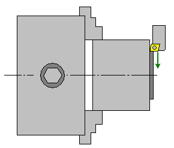
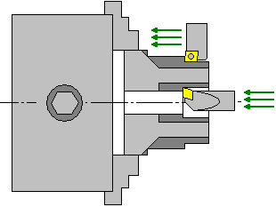
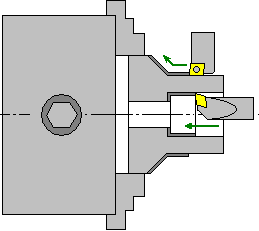
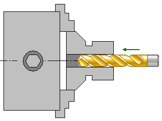
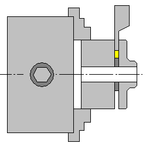
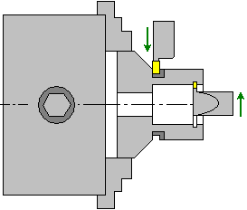
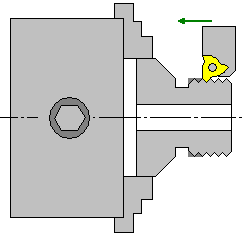

# Operações de torneamento

No sistema CAM, a usinagem no torno é agrupada por operações:

- [Faceamento no torno](307.md) (`Lathe facing`)

- [Desbaste externo e interno](316.md) (`OD Roughing`, `ID Roughing`)

- [Acabamento externo e interno](310.md) (`OD Finishing`, `ID Finishing`)

- [Usinagem de furos no torno](10176.md) (`Lathe hole machining`)

- [Corte da peça no torno](313.md) (`Lathe part-off`)

- [Canais externos, internos e de face](312.md) (`OD Grooving`, `ID Grooving`, `Face grooving`)

- [Rosqueamento externo e interno](319.md) (`OD Threading`, `ID Threading`)

Todas as operações herdadas da versão anterior foram movidas para o grupo Legacy. Consulte a documentação da versão anterior do sistema CAM para obter mais informações sobre essas operações.
