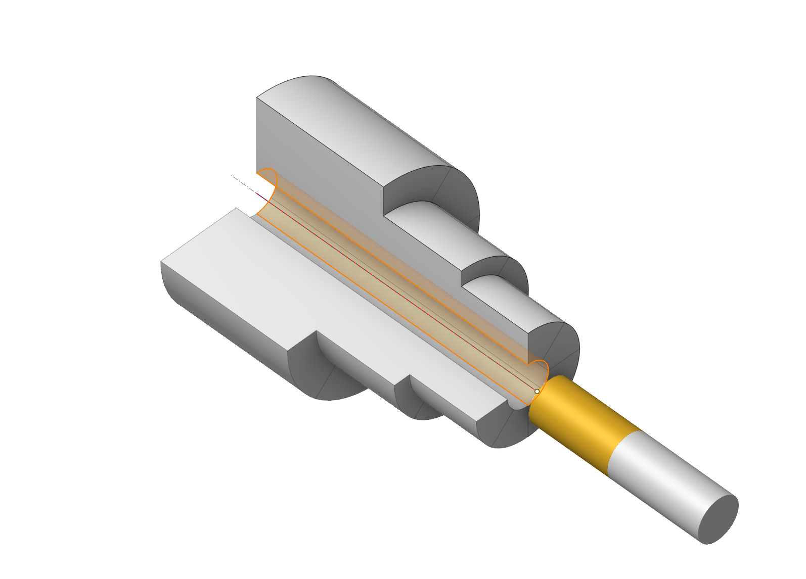

# Lavorazione di fori al tornio

## Ambito di applicazione:

Le operazioni di lavorazione dei fori sono destinate a foratura, centratura, barenatura, svasatura, maschiatura, fresatura di filetti e svuotamento di fori. Consentono di lavorare fori che non giacciono sullo stesso piano e che non giacciono su piani ortogonali. L'operazione può essere utilizzata sia per la lavorazione dei fori di un modello, sia per la preforatura dei punti di affondamento dell'utensile per le operazioni di svuotamento tasche e altre operazioni.

### Configurazione:

La scheda <strong>Setup</strong> serve a configurare i parametri principali del progetto. Ciò può comprendere il posizionamento del pezzo sulla macchina, il sistema di coordinate del pezzo e altro ancora. [Dettagli](1022.md)

### Assegnazione del lavoro:

<strong>Center.</strong> Crea un foro tramite il punto centrale.

<strong>Create.</strong> Crea un foro tramite l'inserimento delle coordinate. [Dettagli](706.md)

<strong>Recognize.</strong> Riconosce automaticamente i fori del pezzo. [Dettagli](406.md)

<strong>Pattern.</strong> Crea una serie di fori secondo uno schema. [Dettagli](407.md)

<strong>Properties.</strong> Visualizza le proprietà di un elemento. Questo menu può essere richiamato anche facendo doppio clic su una voce dell'elenco. [Dettagli](706.md)

<strong>Sorting.</strong> Ordina l'elenco dei fori in base a determinati parametri. [Dettagli](10158.md)

<strong>Delete.</strong> Rimuove una voce dall'elenco.

<strong>Restrictions.</strong> Consente di delimitare le zone che non devono essere lavorate. [Dettagli](101231.md)

### Strategia:

Questo gruppo di parametri funziona in modo analogo all'<strong>Hole machining operation</strong> (operazione di lavorazione dei fori). [Dettagli](10100.md)

### Collegamenti/Attacchi:

Nella scheda Links/Leads si definiscono i parametri dei movimenti rapidi. Questi movimenti comprendono l'avvicinamento dell'utensile dalla posizione di cambio utensile, l'attacco all'inizio della corsa di lavoro, la retrazione dopo l'ultimo movimento di taglio, i collegamenti tra le passate di lavoro e il ritorno al punto di cambio utensile. È possibile configurare la sequenza dei movimenti lungo le coordinate, la traiettoria di questi movimenti e l'entità degli spostamenti.

Fare clic qui per espandere..

<strong>Comprende:</strong>

<strong>Approach/Return.</strong> Questo gruppo di parametri gestisce i movimenti dell'utensile dalla posizione di cambio utensile all'inizio dei percorsi di attacco, e viceversa. [Dettagli](100116.md).

<strong>Safe motions.</strong> Definisce il tipo di superficie di sicurezza e la sua distanza dal grezzo. Questa superficie agevola i collegamenti tra le superfici lavorate o tra i percorsi utensile, e verso di essa avviene la prima fase dell'avvicinamento o del ritorno. [Dettagli](100117.md).

<strong>Advanced links settings.</strong> Questo gruppo di parametri specifica le caratteristiche di formazione del percorso utensile, principalmente per le operazioni a cinque assi, tenendo conto dei movimenti ottimali degli assi rotativi. [Dettagli](100118.md).

<strong>Links.</strong> Definisce le regole che governano i collegamenti di ingresso/uscita e i collegamenti tra i movimenti di lavoro. [Dettagli](100133.md).

<strong>Distances.</strong> Distanze utilizzate nelle regole dei collegamenti (Links) [Dettagli](100141.md).

### Avanzamenti/Velocità:

In questa finestra di dialogo l'utente può definire la velocità di rotazione del mandrino, il valore dei movimenti rapidi e i valori di avanzamento per le diverse zone del percorso utensile. La velocità di rotazione del mandrino può essere definita come giri al minuto oppure come velocità di taglio. Il valore determinante è sottolineato. Il secondo valore viene ricalcolato in base al valore determinante, tenendo conto del diametro dell'utensile. [Dettagli](100142.md)

### Trasformazioni:

Insieme di parametri dell'operazione che consentono di eseguire trasformazioni di coordinate sul percorso utensile calcolato all'interno dell'operazione. [Dettagli](10168.md)

### Pezzo:

Il pezzo (Part) è un gruppo di elementi geometrici che definisce lo spazio da controllare per le intaccature. [Dettagli](330.md)

### Grezzo:

Il modello del grezzo di un'operazione definisce il materiale da lavorare. [Dettagli](738.md)

### Attrezzature:

Come attrezzature (Fixtures) si specificano di solito i dispositivi di bloccaggio, come mandrini autocentranti, griffe, staffe, ecc., nonché le zone di limitazione di qualsiasi altra natura. [Dettagli](10283.md)
