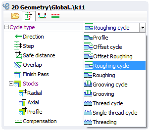

# Ciclos de torneamento

O tipo de ciclo define o modo de geração do caminho da ferramenta com base no perfil definido. Os próximos tipos do elemento de atribuição de trabalho para as operações de torno estão disponíveis.

- No modo "[Profile](10189.md)", o perfil definido é enviado para o caminho da ferramenta sem nenhum acréscimo.
- O [ciclo de deslocamento](10191.md) gera o ciclo ISO G73 com base no perfil definido.
- O [desbaste por deslocamento](10190.md) gera o mesmo percurso da ferramenta que o [ISO G73](10191.md), mas a saída é feita no modo expandido. Esse modo pode verificar o estado atual da peça de trabalho.
- O [ciclo de desbaste](10193.md) gera um dos ciclos ISO G71/G72 com base no perfil definido.
- O [desbaste](10192.md) gera o mesmo percurso da ferramenta que o [ISO G71/G72](10193.md), mas a saída é feita no modo expandido. Esse modo pode verificar o estado atual da peça de trabalho.
- O modo [GroovingLathe_](10195.md) gera o mesmo percurso da ferramenta que o [ISO G74/G75](10204.md), mas a saída é feita no modo expandido. Esse modo pode verificar o estado atual da peça de trabalho. Nas versões futuras, esse modo será aprimorado e verificará a configuração real do perfil.
- [Ciclo de rosca](10197.md) - é o ciclo de rosca de várias passagens que gera o caminho da ferramenta no ISO G76.
- [Ciclo de rosca de passe único](10197.md) - rosqueamento que pode ser realizado em várias passagens. Cada passagem é gerada como um ciclo separado no formato ISO G92.
- [Rosqueamento](10197.md) - rosqueamento com o formato de saída expandido. Assim, cada movimento é executado como um bloco separado. Os movimentos de trabalho são sincronizados com a rotação do fuso. Esse modo é ativado pelo ISO G32/G33. O formato expandido permite fazer roscas específicas, como as roscas com conicidade diferente, espirais na face etc.
- [Torneamento de 4 eixos](10202.md) permite usinar áreas de difícil acesso de uma peça com apenas uma operação, alterando continuamente o ângulo de inclinação da ferramenta no processo de movimentação ao longo de um contorno (usando o eixo 4 da máquina, se disponível).
