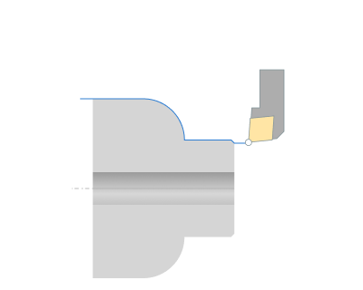

# Profilzyklus

Der Profilzyklus ist der einfachste Zyklus: Der Werkzeugweg folgt grundsätzlich der in der Auftragszuweisung festgelegten geometrischen Kontur. Folgende Anpassungen sind möglich:

- Ergänzen von An- und Abfahrbewegungen;
- Versetzen um Aufmaßwerte;
- Ausschließen grauer Bereiche, die das Werkzeug nicht erreichen kann;
- Berücksichtigen der Werkzeugradiuskorrektur.

Eine ausführliche Beschreibung der Parameter finden Sie unter [Eigenschaften der Auftragszuweisung](10208.md).
