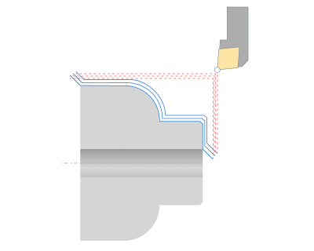
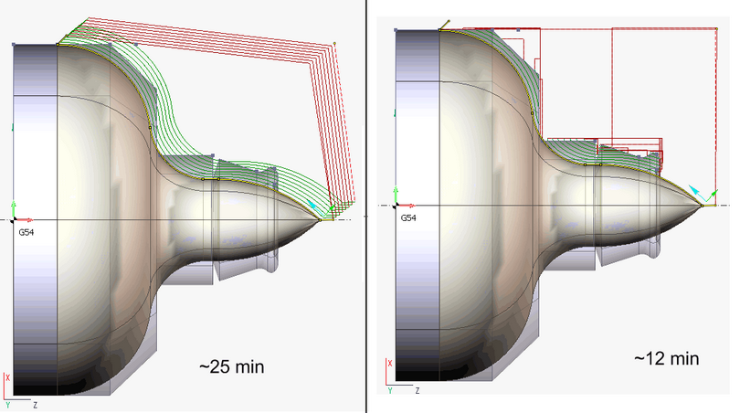
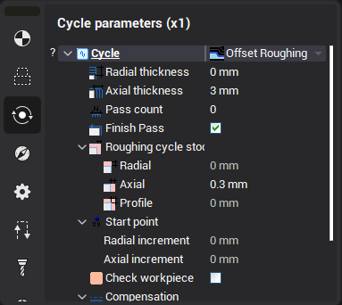
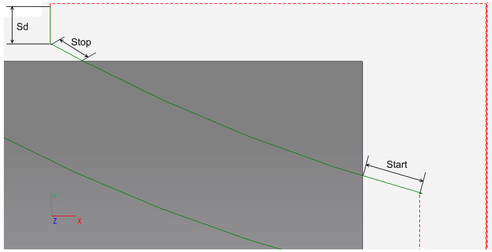
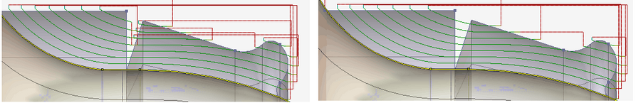
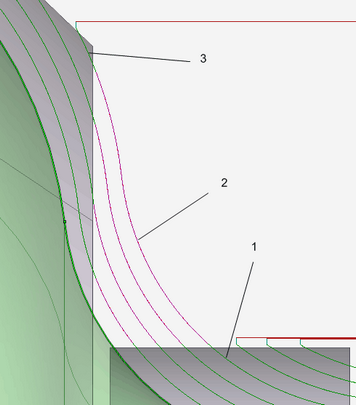
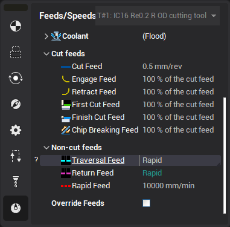

# Sgrossatura a offset

La sgrossatura a offset (Offset Roughing) genera lo stesso percorso utensile del ciclo [ISO G73](10191.md), ma lo emette in forma espansa.

Questa modalità può tenere conto dello stato attuale del grezzo.

Il controllo dello stato attuale del grezzo consente di ridurre il tempo di lavorazione. Nell'immagine è rappresentato il pezzo. La lavorazione richiede circa 25 minuti.

L'impiego di algoritmi basati sullo stato attuale del grezzo riduce del 50% il tempo di lavorazione di questo pezzo, eliminando le passate dell'utensile in aria alla velocità di avanzamento di lavoro.

I parametri di controllo del grezzo possono essere definiti nella finestra delle proprietà.

Sd — distanza di sicurezza

Start — entità di ingresso iniziale

Stop — entità di ingresso finale

In alcuni casi è opportuno ignorare il passaggio dell'utensile in aria, se la lunghezza di tale tratto è piuttosto piccola. Il parametro Ignore thickness (spessore da ignorare) consente di specificare la distanza massima del tratto in aria percorso alla velocità di avanzamento di lavoro.

Se la distanza tra due zone è inferiore al parametro Ignore thickness, il sistema le tratta come un'unica zona.

Nella parte sinistra dell'immagine il parametro Ignore thickness è inferiore alla distanza tra le zone di lavorazione: il sistema le tratta separatamente.

Nella parte destra dell'immagine il parametro Ignore thickness è superiore alla distanza tra le zone di lavorazione: il sistema le tratta come un'unica zona.

In alcuni casi è opportuno trattare più zone come una sola, ma passare alla seconda zona con un avanzamento elevato e con interpolazione attiva (avanzamento di traslazione).

L'utensile lavora la prima zona (1) alla velocità di avanzamento di lavoro, quindi si sposta alla seconda zona (3) con l'avanzamento di traslazione lungo il profilo (2).

Il parametro Maximum traversal distance (distanza massima di traslazione) specifica la distanza massima che l'utensile può percorrere con l'avanzamento di traslazione. Se la distanza tra le zone è superiore a questo parametro, il sistema le tratta separatamente.

Il sistema consente di impostare i valori di avanzamento per un determinato profilo.

