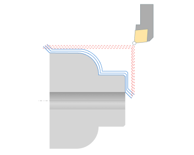
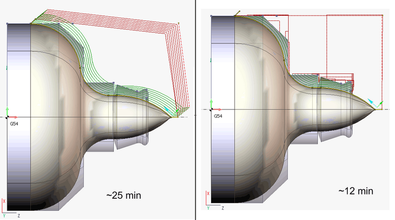
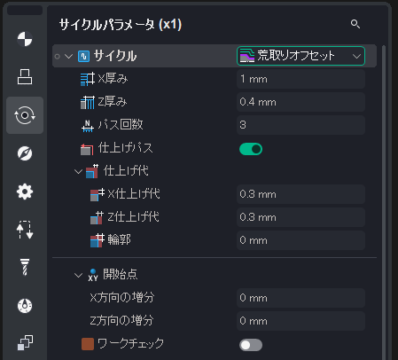
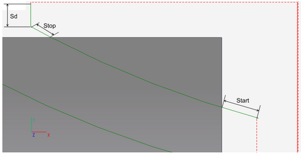
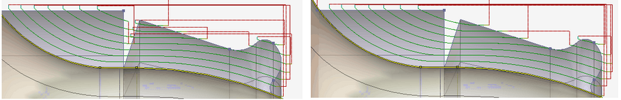
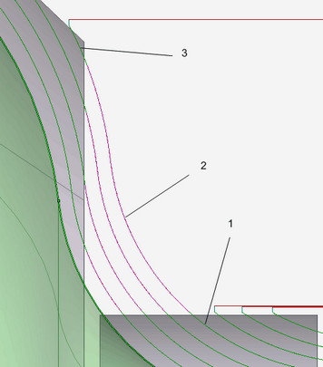
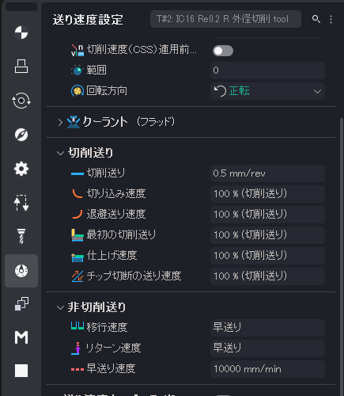

# 荒取りオフセット

<strong>荒取りオフセット</strong>は、[ISO G73](10191.md)と同じツールパスを生成しますが、展開形式で出力されます。

このモードでは、現在のワークの状態を確認できます。

ワークの現状態を確認することで、加工時間を短縮できます。図に示すパーツの場合は、加工時間は約25分です。

ワークの現在の状態に基づくアルゴリズムを使用すると、加工送りでの空走を除外することで、このパーツの加工時間を50％短縮できます。

ワーク確認のパラメータは、プロパティウィンドウで設定できます。

<strong>Sd</strong> - 安全距離

<strong>開始</strong> - 開始時の進入量

<strong>停止</strong> - 終了時の進入量

空走する距離がごく短い場合、空走を無視する方が適切な場合があります。

<strong>厚さを無視</strong> パラメータでは、加工送りにおける空走の最大距離を指定できます。

2つの領域間の距離が<strong>厚さを無視</strong>パラメータより小さい場合、システムはそれらを1つの領域として扱います。

図の左側では、<strong>厚さを無視</strong>パラメータが加工領域間の距離より小さいため、システムはそれぞれの領域を別々に扱います。

図の右側では、<strong>厚さを無視</strong>パラメータが加工領域間の距離より大きいため、システムはそれらを1つの領域として扱います。

場合によっては、複数の領域を1つの領域として扱いながら、補間を有効にした高速送り（移動送り）で2つ目の領域への移動することが適切な場合があります。

工具は最初の領域（1）を加工送りで加工し、その後、プロファイル（2）に沿って移動送りで2つ目の領域（3）へ移動します。

<strong>最大移動距離</strong>は、工具が移動送りで移動できる最大距離を指定します。領域間の距離がこのパラメータの値より大きい場合、システムはそれらの領域を別々の領域として扱います。

このシステムは、特定のプロファイルに対して送り速度の値を設定できます。

