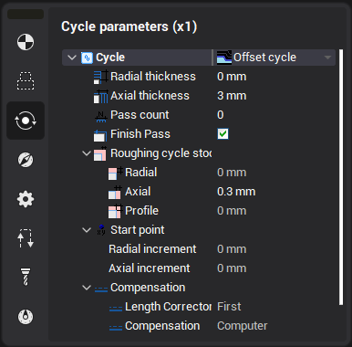
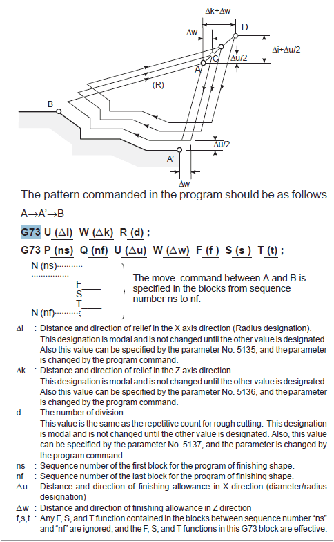

# オフセットサイクル（ISO G73）

オフセットサイクルは、指定したプロファイルに基づいてG73の固定サイクルを生成します。サイクルのパラメータは、プロパティウィンドウで設定できます。

仕上げパスチェックボックスをオンにすると、荒取りサイクルの直後に仕上げサイクル（ISO G70）が生成されます。

以下に、G73 サイクルに関するFanucオペレーターズマニュアルからの抜粋を示します。

この機能により、輪郭を徐々にずらしながら、その輪郭に沿った加工を繰り返し行うことができます。この切削サイクルを使用することで、荒加工、鍛造、鋳造などによって、すでにおおよその形状が形成されているワークを効率的に切削することができます。

