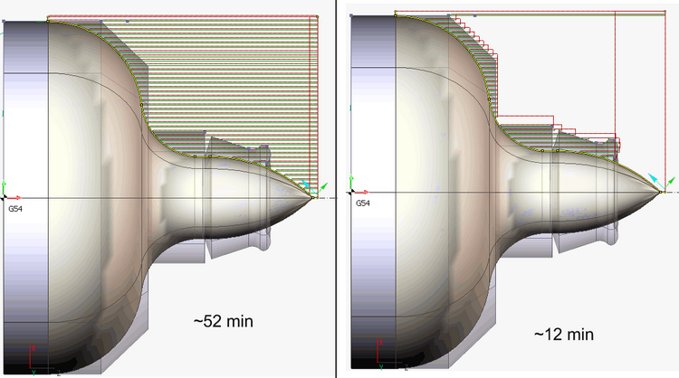
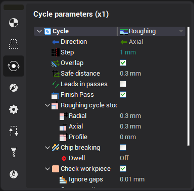
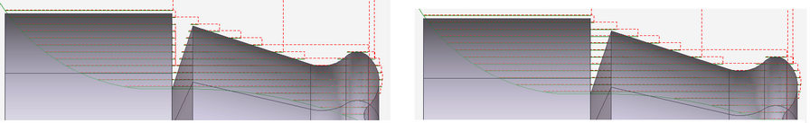
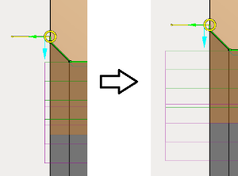
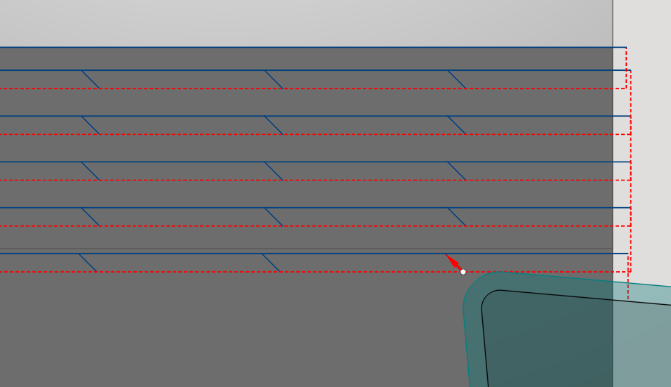

# Desbaste

Desbaste baseado em [ISO G71/G72](10193.md), mas com saída no modo expandido.

Este modo pode verificar o estado atual do bruto.

A verificação do estado atual do bruto pode reduzir o tempo de usinagem. A imagem mostra a peça. A usinagem leva aproximadamente 52 minutos. O uso de algoritmos baseados no estado atual do bruto reduzirá em 80% o tempo de usinagem dessa peça, eliminando as passagens da ferramenta pelo ar com avanço de trabalho.

Os parâmetros de verificação do bruto podem ser definidos na janela de propriedades.

Em alguns casos, é aconselhável ignorar o fato de que a ferramenta passa pelo ar, se a distância dessa passagem for bem pequena. O parâmetro Ignore thickness permite especificar a distância máxima da passagem pelo ar com avanço de trabalho. Se a distância entre duas áreas for menor que o valor de Ignore thickness, o sistema as tratará como uma única área.

No lado esquerdo da imagem, o parâmetro Ignore thickness é menor que a distância entre as áreas de usinagem, e o sistema as trata separadamente. No lado direito da imagem, o parâmetro Ignore thickness é maior que a distância entre as áreas de usinagem, e o sistema as trata como uma única área.

Além disso, este modo tem o parâmetro <strong>Leads in passes</strong>, que permite usar nas passadas as entradas/saídas da guia Links/Leads. Isso é bastante útil com o parâmetro <strong>check workpiece</strong> ativado.

O parâmetro <strong>Chip breaking</strong> ajuda a ajustar o comprimento de corte antes da quebra de cavacos. O comprimento da retração é definido pelo parâmetro <strong>safe distance</strong>. O parâmetro <strong>Dwell</strong> define uma pausa em segundos ou rotações em vez da retração na quebra de cavacos. A quebra de cavacos também funciona no modo de sobreposição. O avanço de quebra de cavacos é definido na guia Speeds.

