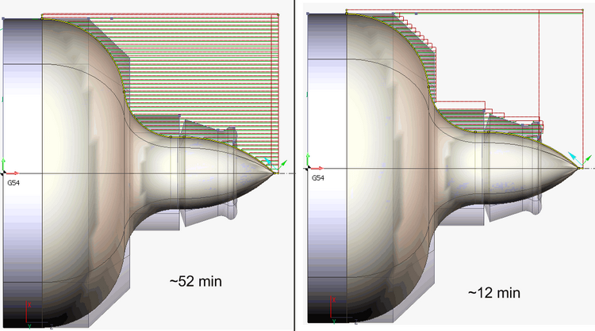
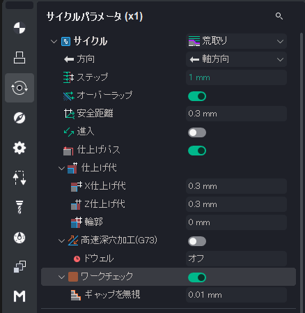
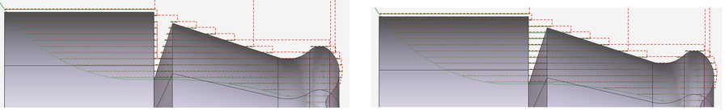
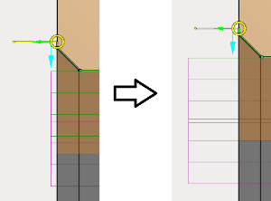
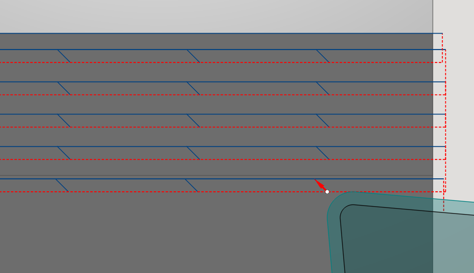

# 荒取り

荒取りは、[ISO G71/G72](10193.md)に基づいていますが、展開形式で出力します。

このモードでは、現在のワークの状態を確認できます。

ワークの現在の状態を確認することで、加工時間を短縮できます。図に示すパーツの場合、加工時間は約52分です。

ワークの現在形状に基づくアルゴリズムを使用すると、加工送りでの空走を除外することで、このパーツの加工時間を 80% 短縮できます。

ワーク確認のパラメータは、プロパティウィンドウで設定できます。

工具の空走する距離がごく短い場合、空走を無視する方が適切な場合があります。

厚さを無視 パラメータでは、加工送りにおける空走の最大距離を指定できます。

2つの領域間の距離が厚さを無視 パラメータより小さい場合、システムはそれらを1つの領域として扱います。

図の左側では、厚さを無視パラメータが加工領域間の距離より小さいため、それぞれの領域を別々に扱います。

図の右側では、厚さを無視パラメータが加工領域間の距離より大きいため、それらを1つの領域として扱います。

また、このモードには<strong>進入</strong>パラメータがあり、リンク/リードタブで設定した 切込み/退避 を各パスで使用できます。これは、<strong>チェックワーク</strong>パラメータを有効に

している場合に非常に便利です。

<strong>チップ切断</strong>パラメータは、チップ切断を行う前の切削長さを調整するのに役立ちます。退避の長さは <strong>安全距離</strong>パラメータによって設定します。<strong>ドウェルパラメータ</strong> は、チップ切断における退避の代わりに、秒数または回転数で停止時間を設定します。チップ切断はオーバーラップモードでも動作します。チップ切断は 速度タブで設定します。

