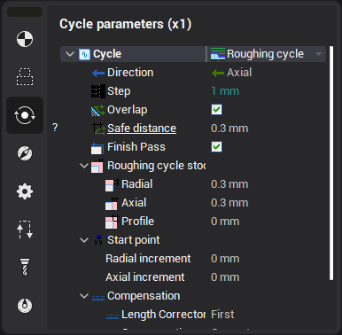
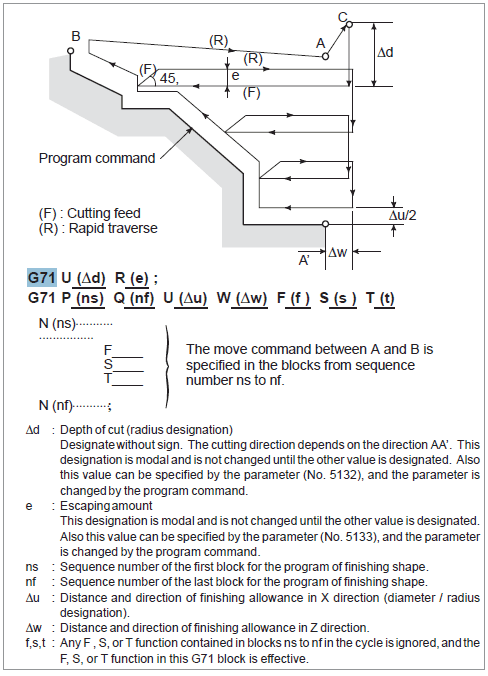
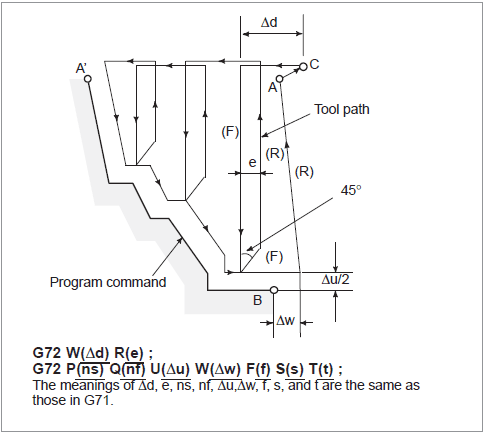

# 荒取りサイクル

荒取りサイクルは、指定したプロファイルに基づき、固定サイクルISO G71またはISO G72のいずれかを生成します。サイクルのパラメータは、プロパティウィンドウで設定します。方向プロパティで、G71とG72を切り替えます。「仕上げパス」をオンにすると、荒取りサイクルの直後にISO G70仕上げサイクルを生成します。

以下に、G71/G72 サイクルに関するFanuc オペレーターズマニュアルからの抜粋を示します。

