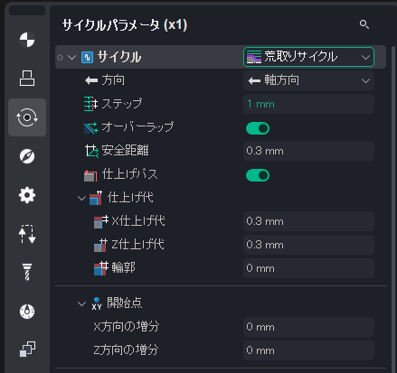
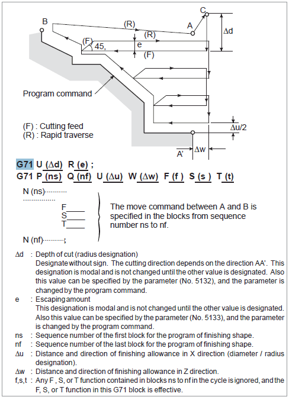
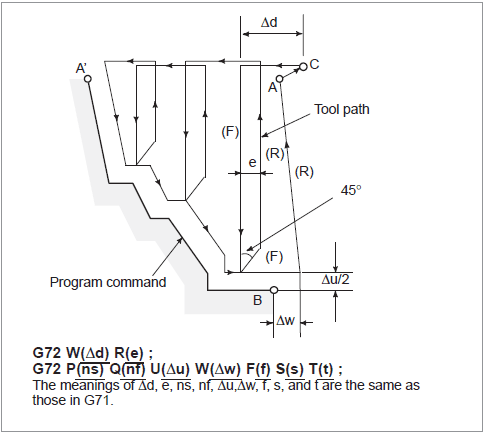

# 荒取りサイクル

荒取りサイクルは、指定したプロファイルに基づいて、ISO G71 または ISO G72 のいずれかの固定サイクルを生成します。サイクルのパラメータは、プロパティウィンドウで設定できます。

方向プロパティは、G71とG72を切り替えます。

仕上げパスチェックボックスがオンの場合、荒取りサイクルの直後に仕上げサイクル（ISO G70）が生成されます。

以下に、G71/G72 サイクルに関するFanuc オペレーターズマニュアルからの抜粋を示します。

