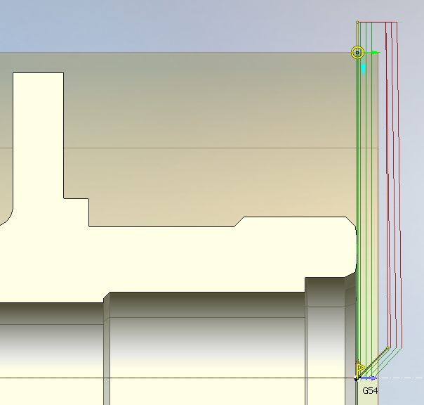
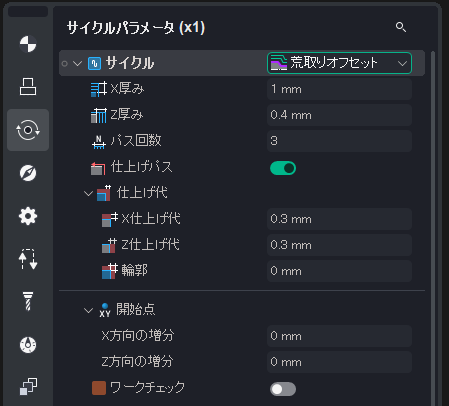

# 端面

端面サイクルは、オフセット荒取りまたは単純な輪郭加工サイクルに基づいています。これは、パーツの右端面または左端面を加工の基となる幾何輪郭として定義し、その輪郭をワークの境界まで延長する機能です。

このサイクルは、パーツの前後の軸方向端面を簡単に加工するために設計されており、後続の加工に備えてワークの表面を整える最初の工程として頻繁に使用されます。

この項目のパラメータは、選択されているサイクルタイプによって異なります。デフォルトでは[荒取りオフセット](10190.md)が設定されており、軸厚、パス数、ストックなどを再定義できます。各サイクルのパラメータについての詳細については、該当するサイクルタイプのドキュメントを参照してください。

