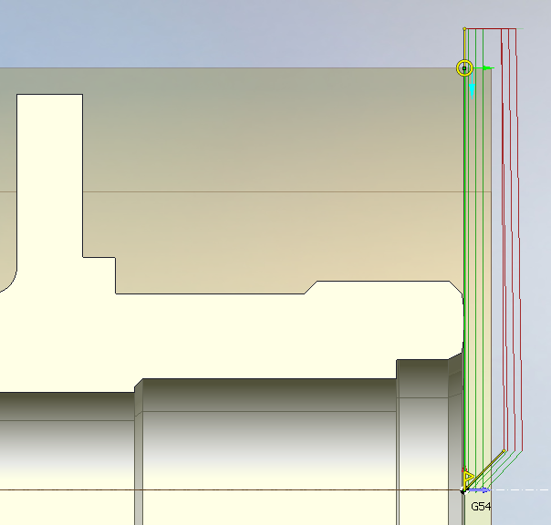
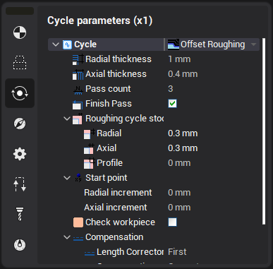

# Faceamento

O ciclo de faceamento baseia-se nos ciclos de desbaste por offset (Offset roughing) ou de usinagem simples de perfil (Profile). Ele apenas define outro contorno geométrico de origem, correspondente à face direita ou esquerda da peça, e o estende até os limites do bruto.

Destina-se à usinagem simples das faces axiais frontal e traseira da peça e, frequentemente, é a primeira operação, que prepara a superfície do bruto para a usinagem seguinte.

Os parâmetros desse item dependem do tipo de ciclo ativo. Por padrão, é o [desbaste por offset](10190.md); assim, é possível redefinir a espessura axial, o número de passadas, os sobremetais etc. Consulte a documentação do tipo exato de ciclo para obter informações mais detalhadas sobre os parâmetros de cada ciclo.

