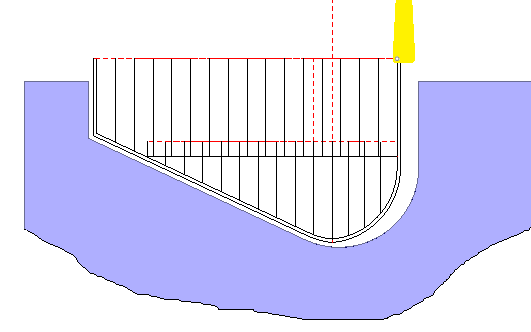
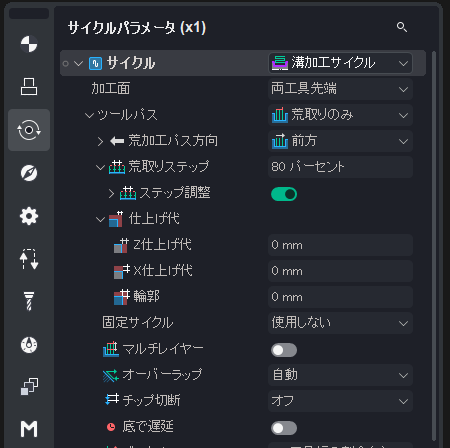
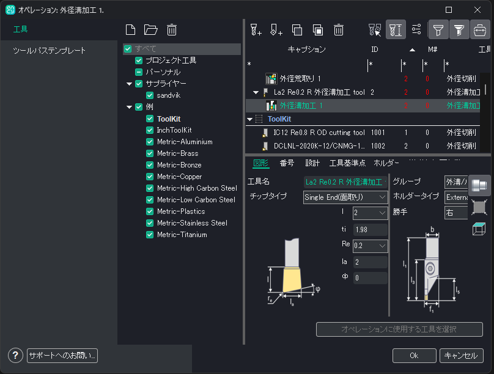
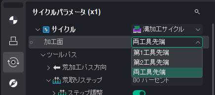
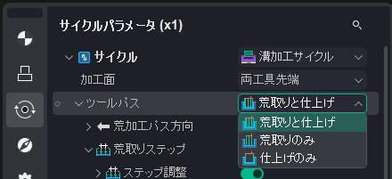
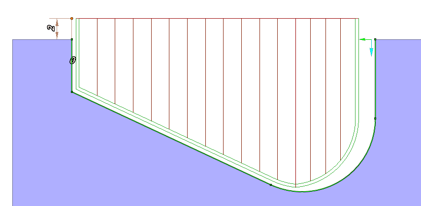
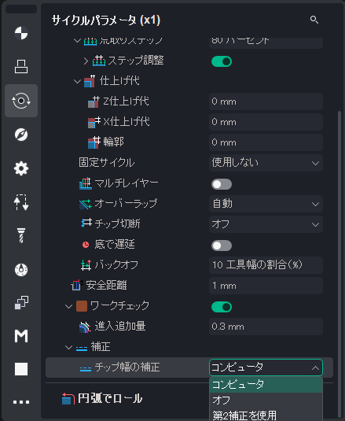
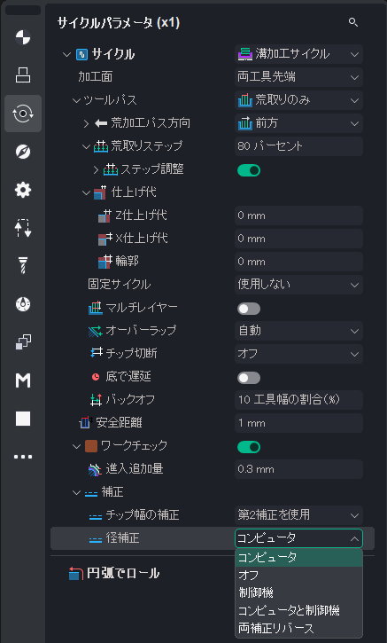
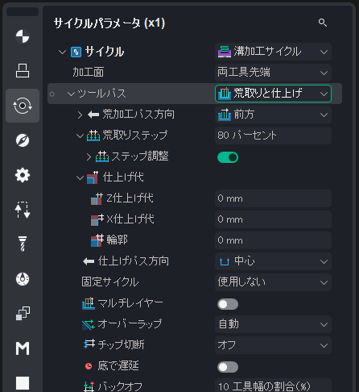

# 溝加工サイクル

高度な溝加工要素は、さまざまな種類の旋削溝加工に対応する複雑なツールパスを生成します。外径溝、内径溝、端面溝、または傾斜した溝を加工できます。

サイクルのパラメータは、プロパティウィンドウで設定できます。

溝加工サイクルでは、溝輪郭の底点を基準に、異なる工具先端を使用して溝の両側面を加工します。各側面は、輪郭の終了点から底点に向かって加工されます。工具の先端は、以下に示す工具ダイアログで定義します。

加工面パラメータでは、溝の片側のみを加工するように設定できます。<strong>第1</strong>工具先端を選択した場合、その刃先が接触する側面のみが加工されます。

高度な溝加工サイクルでは、荒取りパスと仕上げパスを生成します。ツールパスパラメータでは、どのパスを生成するか指定します。

仕上げのみを選択すると、仕上げパスのみが生成され、ダイアログには仕上げパス用のパラメータのみが表示されます。

荒取りのみを選択すると、荒取りパスのみが生成され、ダイアログには荒取りパス用のパラメータのみが表示されます。

荒取りと仕上げを選択すると、すべてのパラメータが表示されます。

安全距離パラメータでは、溝の上端から早送り移動を行う高さまでの距離を設定します。安全距離の編集は、グラフィックウィンドウ上で点をドラッグするか、ダイアログに直接値を入力することで編集できます。

仕上げパスのパラメータ

<strong>刃物インサート幅補正</strong>は使用する補正値を設定します。

コンピュータを選択した場合、1番目の補正番号のみを使用するツールパスを生成します。

<strong>オフ</strong>は補正なしでツールパスを生成します。

第2補正を使用を選択すると、1番目および2番目の補正番号を使用するツールパスを生成します。

<strong>径補正</strong>パラメータについては、[こちら](10208.md)を参照してください。

荒取りパスのパラメータ

荒取りステップ - 荒取りパス間の距離を設定します。この値は、工具幅に対する割合（%）または長さの単位で設定することもできます。

<strong>ステップ</strong>調整 オプションを有効にすると、各プランジで切削負荷が均等になるように、CAMシステムがステップ量を自動調整します。

最大ステップ公差 では、調整されたステップが設定したステップからどれだけ変動できるか、その最大偏差を設定します。 この値は、長さ単位または工具幅に対する割合（%）で設定できます。

固定サイクル オプションでは、ツールパス内で固定サイクルを使用するかどうかを選択します。

仕上げ代 では、荒取りパスに追加する加工代（ストック量）を設定します。

マルチレイヤー オプションは、粗加工を複数レイヤーに分けて生成する際に使用します。レイヤー数、または各レイヤーの切込み深さを設定できます。

オーバーラップ オプションを有効にすると、荒取りパスの終了位置から前の荒取りパスの終了位置まで、追加のツールパスが生成されます。

<strong>自動</strong> モードでは、<strong>マルチレイヤー</strong>オプションが有効な場合に自動的に<strong>オーバーラップ</strong>オプションも有効になります。 ツールパスが固定サイクルを使用している場合、オーバーラップオプションは無効になります。

チップ切断 オプションは、最初の荒取りのみ、またはすべての荒取りで有効にすることができます。 切断回数または切断を入れる間隔（ピッチ）を設定できます。チップ切断時の戻り距離は、長さ単位またはプランジステップに対する割合（%）で設定できます。

<strong>底で遅延</strong> オプションを有効にすると、荒取りパスの終了位置で遅延コマンドが生成されます。遅延時間は、秒数またはワークの回転数で設定できます。

退避 距離は、長さ単位または荒取りステップに対する割合（%）で設定できます。

<strong>ワークチェック</strong> 機能を使用すると、加工時間を大幅に短縮できます。加工送りで移動する動作のうち、ワークの外側を通る部分が早送り移動に置き換えられます。

<strong>進入追加量</strong> パラメータは、送り速度を切り替えるワークからの距離を設定します。
