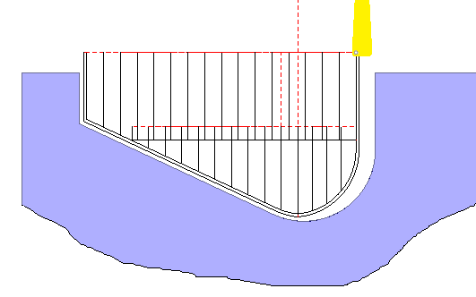
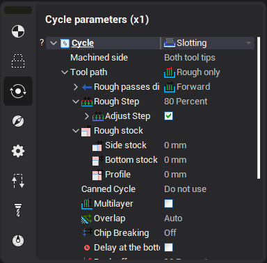
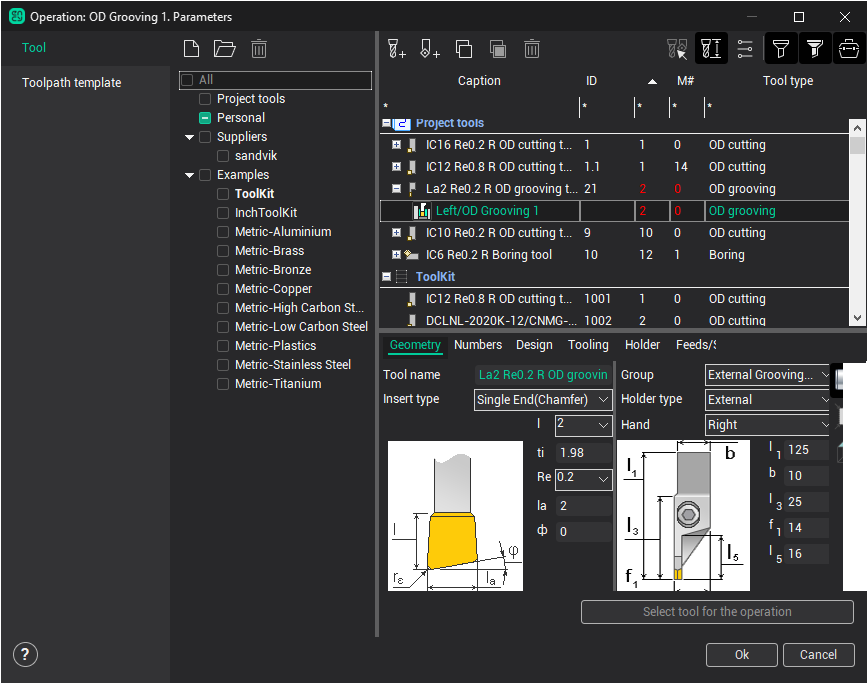
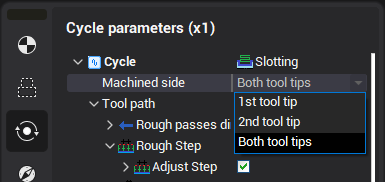
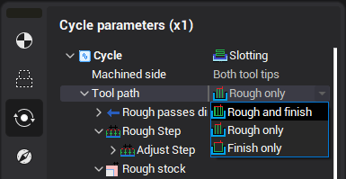
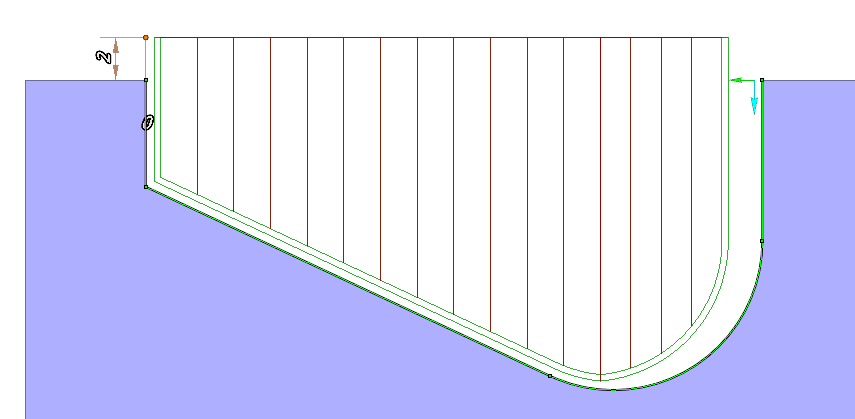
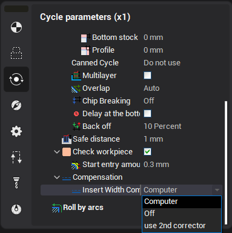
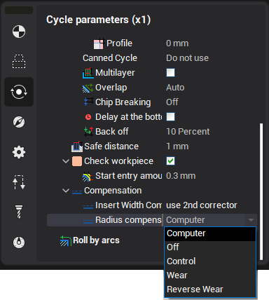
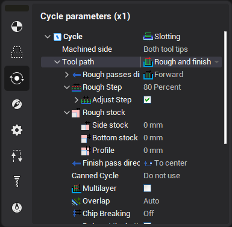

# Ciclo di scanalatura

L'elemento di scanalatura avanzata genera il percorso utensile complesso per qualsiasi tipo di gola da tornio. Consente di lavorare gole radiali esterne, radiali interne, frontali o inclinate.

I parametri del ciclo possono essere definiti nella finestra delle proprietà.

Il ciclo di scanalatura definisce il punto di fondo del contorno della gola e lavora entrambi i lati della gola con taglienti diversi dell'utensile. Ciascun lato viene lavorato dal punto finale del profilo fino al punto di fondo. I taglienti dell'utensile sono definiti nella finestra di dialogo Tool, mostrata di seguito.

Il parametro Machined side (lato lavorato) consente di lavorare un solo lato della gola. Se si seleziona 1st tool tip (primo tagliente), viene lavorato solo il lato toccato dal primo tagliente.

Il ciclo di scanalatura avanzata genera passate di sgrossatura e di finitura. Il parametro Tool path (percorso utensile) definisce quali passate devono essere generate.

Se si seleziona Finish only (solo finitura), viene generata solo la passata di finitura e la finestra di dialogo mostra soltanto i parametri per il percorso di finitura. Se si seleziona Rough only (solo sgrossatura), viene generato il percorso di sgrossatura e nella finestra di dialogo vengono mostrati soltanto i parametri per la passata di sgrossatura. Se si seleziona Rough and finish (sgrossatura e finitura), vengono mostrati tutti i parametri.

Il parametro Safe distance (distanza di sicurezza) definisce la distanza tra la sommità della gola e il livello dei movimenti rapidi. Per modificare la distanza di sicurezza è possibile trascinare il punto nella finestra grafica oppure inserire il valore nella finestra di dialogo.

Parametri del percorso di finitura

Il parametro Insert width compensation (compensazione della larghezza dell'inserto) definisce l'uso dei correttori.

La modalità Computer genera il percorso utensile solo per il primo correttore.

La modalità Off non è implementata.

La modalità Use 2nd corrector (usa il secondo correttore) genera il percorso utensile per il primo e il secondo correttore.

Il parametro <strong>Radius compensation</strong> (compensazione del raggio) è descritto [qui](10208.md).

Parametri del percorso di sgrossatura

Il parametro Rough step (passo di sgrossatura) definisce la distanza tra le passate di sgrossatura. Può essere definito in percentuale della larghezza dell'utensile o in unità di lunghezza. Se è attiva l'opzione Adjust step (adegua il passo), il sistema CAM modifica automaticamente il passo in modo da ottenere uno sforzo uniforme a ogni affondamento. Il parametro Max Step deviation (deviazione massima del passo) definisce lo scostamento massimo del passo adeguato rispetto al passo definito. Questo valore può essere definito in unità di lunghezza o in percentuale della larghezza dell'utensile.

L'opzione Canned cycle consente di utilizzare o meno i cicli fissi nel percorso utensile.

Il parametro Rough stock (sovrametallo di sgrossatura) definisce il sovrametallo aggiuntivo per le passate di sgrossatura.

L'opzione Multilayer (multistrato) è necessaria per generare le passate di sgrossatura su più strati. È possibile definire il numero di strati o la profondità dello strato.

Se l'opzione Overlap (sovrapposizione) è attiva, viene generato un percorso utensile aggiuntivo dalla fine del taglio di sgrossatura fino alla fine del taglio di sgrossatura precedente. In modalità <strong>Auto</strong>, l'opzione <strong>Overlap</strong> è attiva quando è attiva l'opzione <strong>Multilayer</strong>. L'opzione Overlap risulta inattiva se il percorso utensile utilizza i cicli fissi.

L'opzione Chip breaking (rottura del truciolo) può essere attivata sul primo taglio di sgrossatura o su ogni taglio di sgrossatura. È possibile definire il numero di interruzioni o il passo per la rottura del truciolo. La distanza di ritorno per la rottura del truciolo può essere definita in unità di lunghezza o in % del passo di affondamento.

Se l'opzione Delay at the bottom (sosta sul fondo) è attiva, il comando Delay viene generato alla fine del taglio di sgrossatura. Il tempo di sosta può essere definito in secondi o in giri del pezzo.

La distanza di Back off (arretramento) può essere definita in unità di lunghezza o in percentuale del passo del taglio di sgrossatura.

La funzione <strong>Check workpiece</strong> (controllo del grezzo) può ridurre in modo significativo il tempo di lavorazione. La parte dei movimenti in avanzamento di lavoro che si trova all'esterno del grezzo viene sostituita da movimenti rapidi. Il parametro <strong>Start entry amount</strong> (entità di ingresso iniziale) determina la distanza dal grezzo alla quale si commuta l'avanzamento.
