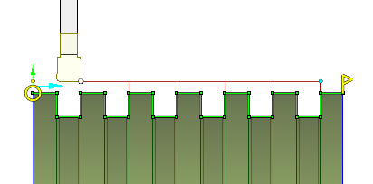

# Ciclo di scanalatura

Il ciclo di scanalatura (Slotting) per tornitura è identico al ciclo di [gola (Grooving)](10195.md), ma è regolato con maggiore finezza per la lavorazione di gole rettangolari. In questo modo le gole rettangolari possono ora essere svuotate con un solo clic e con movimenti minimi dell'utensile.

