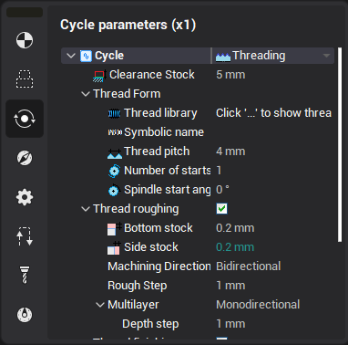
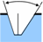
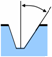
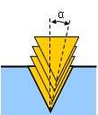

# 標準形状ねじ

標準形状ねじ切りオペレーションのジョブ割り当て項目について、プロパティウィンドウには以下のパラメータがあります。

ねじ輪郭は、工具形状および<strong>ねじ形式</strong>グループ内のパラメータによって指定します。

<strong>深さ</strong>フィールドの値は、ねじ輪郭の高さ（外径と内径の差）を定義します。この値には正の値を指定する必要があります。この値の方向は自動計算され、輪郭の<strong>加工面</strong>パラメータによって決まります。

プランジモードが<strong>側面</strong>または<strong>交互切込み</strong>の場合、<strong>ねじ角度</strong>および<strong>傾斜角度</strong>パラメータによって、各パスにおける工具のプランジ角度を設定します。

| ねじ角度 | 傾斜角度 |
|---|---|
|  |  |

<strong>シーケンス</strong>グループのパラメータは、各パスのスタート数とプランジモードを定義します。

<strong>シーケンス</strong>コンボボックスの値によってプランジモードを設定します。以下の方法が使用可能です。

- <strong>X方向</strong> プランジの方向は、回転軸に対して垂直です。

- <strong>側面</strong> プランジは、ねじ山の片側に沿って行われます。

- <strong>交互切込み</strong> プランジは、 ねじ山の両側面に沿って交互に行われます。

- <strong>カスタム切込み</strong> プランジは、角度 パラメータで指定した角度で行われます。

実際のねじ切り加工は、複数のパスに分けて行われます。これにより、仕上げ面の品質向上や工具負荷の低減が可能になります。

加工パスの本数は、直接パス数を指定するか、最初のパスの深さを設定することで設定できます。最後の場合、開始数はねじ溝の深さに基づいて自動的に計算されます。

切込み深さが一定の場合、次の層へ切り込むにつれて加工面積と工具負荷が増大します。加工面積と工具負荷が一定になるように切り込み深さを計算することも可能です。 <strong>切込み深さタイプ</strong>パラメータでは、<strong>均</strong>等面積と均等深さの2つの値を選択できます。

| 均等面積 | 均等深さ |
|---|---|
|  |  |

<strong>均等面積</strong>モードでは、各レイヤーごとに切削深さが減少します。<strong>最小切込み深さ</strong>を設定することが可能です。計算された切り込み深さがこの値より小さくなった場合は、最小切込み深さが使用されます。

表面を良好に仕上げるため、最後のパスでは非常に少ない加工代で加工を行い、その後、加工代なしで仕上げプロファイルに沿った平滑化（仕上げパス）を数回繰り返します。

<strong>仕上げパス深さ</strong> パラメータでは、 仕上げパスの加工代を設定します。

<strong>仕上げパス回数</strong> パラメータでは、仕上げパスを含めた、完成プロファイルに沿ったパスの回数を設定します。
