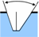
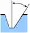
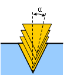

# Gewinde mit Standardprofil

Das Eigenschaftenfenster eines Auftragselements für Standardgewinde enthält folgende Parameter:

Das Profil ergibt sich aus der Werkzeugform und den Parametern der Gruppe **Thread form**.

**Depth** legt die Gewindeprofiltiefe zwischen Außen- und Innendurchmesser fest. Der Wert muss positiv sein. Die Zustellrichtung wird anhand von **Machining side** automatisch bestimmt.

Bei **Flank** und **Alternate Flank** bestimmen **Thread angle** und **Inclination angle** die Zustellrichtung jedes Durchgangs.

| Profilwinkel | Neigungswinkel |
|---|---|
|  |  |

Die Gruppe **Sequence** bestimmt Gangzahl und Zustellverfahren.

In der Liste **Sequence** stehen folgende Zustellstrategien zur Verfügung:

- **Radial.** Zustellung senkrecht zur Drehachse.

- **Flank (Flanke).** Zustellung entlang einer Gewindeflanke.

- **Alternate flank (Wechselnde Flanken).** Abwechselnde Zustellung entlang beider Gewindeflanken.

- **Modified flank (Modifizierte Flankenzustellung).** Zustellung unter dem mit **Angle** festgelegten Winkel.

Die Bearbeitung erfolgt in mehreren Durchgängen, um die Werkzeugbelastung zu reduzieren und die Oberflächenqualität zu verbessern.

Die Anzahl kann direkt eingegeben oder über die Tiefe des ersten Schnitts bestimmt werden. Im zweiten Fall wird sie aus der Gewindeprofiltiefe berechnet.

Bei gleicher Zustelltiefe wächst mit zunehmender Tiefe meist der abgetragene Querschnitt und damit die Werkzeugbelastung. Für einen gleichbleibenden Querschnitt kann die Zustelltiefe entsprechend berechnet werden. **Determine cut depth from** bietet **Equal area** und **Equal depth**.

| Gleicher Spanungsquerschnitt | Gleiche Zustelltiefe |
|---|---|
|  |  |

Bei **Equal area** nimmt die Zustelltiefe von Ebene zu Ebene ab. **Minimal cut depth** begrenzt sie nach unten. Ein kleinerer berechneter Wert wird durch diesen Mindestwert ersetzt.

Für eine gute Oberfläche wird der letzte Schnitt mit geringem Aufmaß ausgeführt. Danach können mehrere Leer- bzw. Glättdurchgänge ohne zusätzliche Zustellung folgen. **Finish pass depth** legt das Schlichtaufmaß fest; **Finish pass count** zählt die Durchgänge entlang des fertigen Profils einschließlich des Schlichtdurchgangs.
