# 輪郭ねじ切り加工

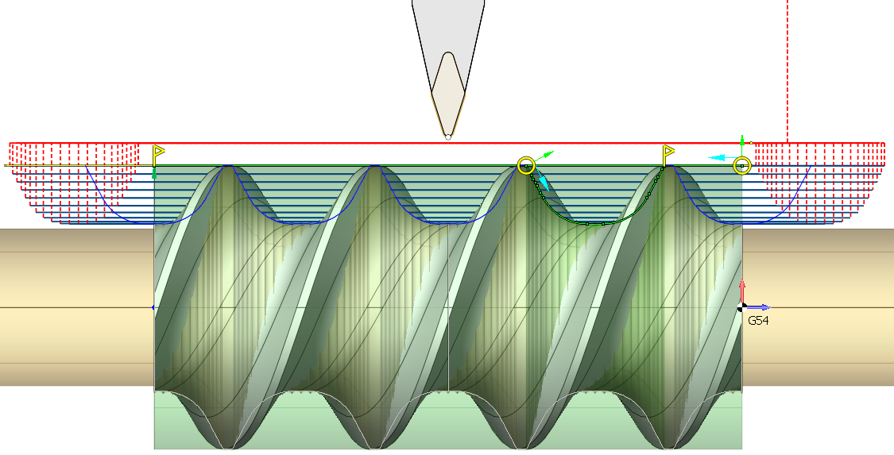

#### 適用分野：

このオペレーションでは、工具形状に依存せず、任意の輪郭のねじを加工できます。これは、ねじ溝全体の材料を連続する複数のパスで除去することで実現されます。各パスの相互位置は、工具形状とねじ溝形自体の形状の両方を考慮して計算されます。ジョブ割り当てでは、次の2つの項目を定義する必要があります。

・パーツ上でねじの開始位置と終了位置を指定する項目

・ねじ溝の形状を指定する項目

指定したプロファイルの向きに応じて、円筒ねじ、テーパーねじ、または端面ねじ（アルキメデスらせん）を加工できます。

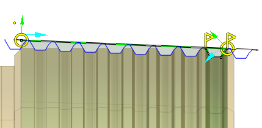

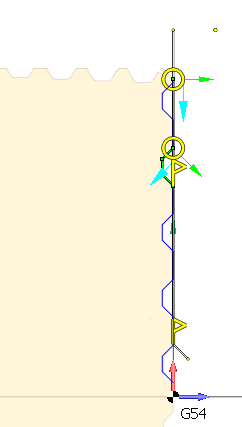

#### ジョブ割り当て：

<strong>ねじ切り</strong> 部品上でのねじ部（ねじ切り区間）の位置を指定します。 この項目を選択すると、システムはパーツプロファイル上にねじラインを 自動的に 生成します。

グラフィカルウィンドウでは、次の操作によってこの線をインタラクティブに編集できます。

・開始点、終了点の移動

・ねじ方向を示す矢印の変更

・ねじ溝の側面を示す矢印の調整

・線全体を移動して、外径／内径を変更

ねじの種類（内ねじ／外ねじ）は、輪郭の加工側 （輪郭の開始点付近に表示される垂直方向の矢印） によって指定します。ねじの方向（左ねじ／右ねじ）は、輪郭の加工方向（輪郭開始点付近に表示される平行方向の矢印）と主軸の回転方向によって指定します。

輪郭のアプローチ／リトラクト領域では、工具退出時の延長または面取り量を設定できます。

各オペレーションでは、ジョブ割り当てから1つの項目のみが使用されます。複数のねじを加工する場合、たとえパラメータが同じであっても、必要な数だけオペレーションを作成します。

この機能により、一定のピッチで連続円筒ねじ切り、テーパーねじ切り、または端面ねじ切りモード（G23/G33）が有効になります。このモードでは、工具移動と主軸回転の同期が有効になります。補間切り替えまたは高速ツールパスコマンドが検出されるまで、すべての工具移動はねじ切りモードで実行されます。

工具が主軸の回転軸と平行に移動する場合は、円筒ねじが形成されます。工具が主軸回転軸に対して平行方向および垂直方向に同時に移動する場合は、テーパーねじが形成されます。工具が主軸回転軸に対して垂直方向に移動する場合は、特殊な端面ねじを形成できます。この場合、端面にはアルキメデスらせん状の溝が形成されます。

G32／G33 コマンド自体は工具移動を生成しないため、 加工中のすべての工具移動（アプローチ、リトラクト、次パスへの移行など）は、<strong>加工設定</strong> タブおよ <strong>リンク</strong>タブで個別のパラメータとして指定する必要があります。

<strong>単一ねじ切りサイクル</strong> このオプションは、パーツ上のねじ切り部分の位置を定義するためにも使用されます。 システムは、NCプログラムにG92サイクルを出力します。

このサイクルでは、1 回のねじ切りパスに対する一連の閉じた（完結した）工具移動を生成します。下図は、その加工スキームを示しています。このサイクルを呼び出す前に、工具は開始位置に待機しています。サイクルはNCプログラムの1行で呼び出され、ねじの開始点、ピッチ、テーパサイズ、面取りサイズなどを指定します。

この行を実行した結果、工具は開始点からねじ開始点へ移動し、ねじ終了点までねじ切りを行い、その後 開始点へ戻ります。

通常、ねじ切り加工は複数のパスで行われるため、NCプログラムは異なるねじ径を持つ複数のサイクル呼び出しで構成されます。そのため、標準的な形状のねじと自由形状のねじの両方に使用できます。

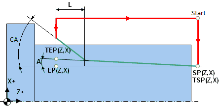

<strong>ねじ</strong><strong>溝</strong> この機能は、ねじ溝の輪郭を決定する輪郭を指定します。

この輪郭を<strong>ねじ切り</strong>または<strong>単一ねじ切りサイクル</strong>に沿って、<strong>サイクルパラメータ</strong>タブで指定した<strong>ねじピッチ</strong>の間隔で繰り返します。 <strong>ねじピッチ</strong> は、 グラフィカルウィンドウ上でインタラクティブに入力できます。

溝の方向と側面が、<strong>ねじ切り</strong> または <strong>単一ねじ切りサイクル</strong> の対応するパラメータと一致していることを確認することが重要です。

下図では、緑色の曲線が、ねじの開始点（S点）と終了点を示し、青色の曲線が、ねじ溝の形状を示しています。この輪郭上で赤色で示された点（H点）は、ねじの開始点（S点）と垂直方向に一致します。輪郭を定義する曲線は、ねじ開始点に対して任意の位置に配置できるため、H点を正しく配置することが重要です。

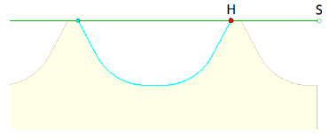

#### サイクルパラメータ：

##### サイクル

<strong>ジョブ割り当て</strong>に記載されている使用可能な旋削サイクルのうちいずれか1つを選択することができます。このセクションでサイクルを切り替えると、 <strong>ジョブ割り当て</strong> 内の対応する項目も自動的に変更されます。設定できるパラメータは、旋削サイクルごとに異なります。

拡大

<strong>クリアランスストック</strong> ねじから移行高さまでの距離を指定します。このサイクルは、前のパスの終了位置から次のパスの開始位置へと移動する際、この高さを通過します。

<strong>ねじ形式</strong> このグループは、ねじ形状のパラメータを設定します。

拡大

<strong>ねじライブラリ</strong> ねじのパラメータが標準規格に準拠している場合、データベースからねじパラメータを選択します。すべてのパラメーターを手動で入力する必要はありません。ねじの種類を指定し、ドロップダウンリストからその呼び名を選択するだけで、 残りのパラメータについてはデータベースが規格値で自動的に補完します。

<strong>記号名</strong> ねじの種類とサイズを表す任意の記号的名称です。（例： M10）この名称を使用して、ねじテーブルから目的のねじをすばやく検索できます。規格外のねじの場合は、独自の名称を入力することもできます。

<strong>ねじピッチ</strong> ねじピッチを、長さの単位、または単位長さあたりのねじ山数のいずれかで指定します。

<strong>開始数</strong> 2条以上のスタート数を指定すると、多条ねじが加工されます。 サイクルタイプによって 開始数 の扱いは異なり ます。

ISO G76では、条数がパラメータとしサイクルに渡されます。ただし、一部の機械ではサイクル内にこのパラメータを持たない場合があります。

その場合は、<strong>主軸開始角</strong>の値を変更して同じサイクルを実行することで、多条ねじを作成できます。

別の方法として、ISO G92 または ISO G32／G33 を使用することもできます。この場合、オペレーションは異なる主軸開始角度を持つパスを自動的に生成します。

<strong>主軸開始角度</strong> ねじのらせん線の切削を開始する、X 軸からの角度を指定します。

<strong>ねじ荒取り</strong> このオプションを有効にすると、工具は複数のパスに分けてねじ溝から材料を除去します。これは、加工面の品質向上および工具負荷を軽減するために不可欠です。 システムは、回転軸に沿って一定のステップで工具を順次移動させ、加工を複数のレイヤーに分割して 荒取りパスを実行します。

<strong>X 仕上げ代</strong> 後続の仕上げパスで除去するために、 ねじ溝の底に残す取り代（ストック）です。

<strong>Z 仕上げ代</strong> 後続の仕上げパスで除去するために、 ねじ溝の側面に残す取り代（ストック）です。

<strong>加工方向</strong> 荒加工の順序を定義します。

<strong>両方向</strong> 溝の中心から溝の側面に向かって加工が行われます。最初に右端へ移動し、次に左端へ工具が移動します。

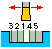

<strong>交互</strong> 溝の中心から加工を開始し、工具の前進と後退の 動作を 交互に繰り返しながら側面へ進みます。

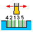

<strong>前方</strong> 溝を 前方から後方に向かって 加工します。 デフォルトは、 右から左への方向です。

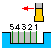

<strong>後方</strong> 溝を後方から前方に向かって加工します。 デフォルトは、 左から右への方向 です。

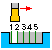

<strong>荒取りステップ</strong> ねじに沿った隣接する2つの荒加工パス間の距離です。工具の移動距離または移動回数のいずれかを指定します。工具移動のステップが小さいほど工具への負荷は軽減されますが、加工時間は長くなります。

<strong>マルチレイヤー</strong> 荒加工の材料を複数のレイヤーに分けて除去できます。

<strong>オフ</strong> 単一レイヤー加工に対応します。

<strong>一方向</strong> 複数レイヤー加工を有効にします。 各レイヤーでパスの進行方向が同一になります。

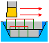

<strong>ジグザグ</strong> 複数レイヤー加工を有効にします。最初のレイヤーのパス 方向は <strong>加工方向</strong>の設定に従い、それ以降の各レイヤーでは、パスの方向が前のレイヤーとは逆になります。

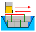

<strong>深さステップ</strong> 各レイヤーで工具を切り込ませる最大距離を指定します。切込み深さを直接指定するか、または レイヤー数で指定できます。

<strong>ねじ仕上げ</strong> このオプションを有効にすると、 <strong>ジョブ割り当て</strong>で定義した輪郭に沿って仕上げパスを生成します。

<strong>仕上げステップ</strong> 隣接する2つのパス間の距離で、プロファイル長さに基づいて計算されます。ステップは、パス数または距離のいずれかで直接設定できます。

<strong>加工方向</strong> 仕上げ加工の順序を指定します。

<strong>前方</strong> 主軸に向かって仕上げ加工を行います。

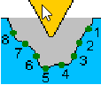

<strong>後方</strong> 主軸から離れる方向に仕上げ加工を行います。

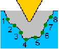

<strong>両方向</strong> ねじ溝の外周側から中央に向かって 仕上げパスを 配置します。

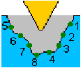

<strong>補正</strong> カッター幅補正の出力方法を制御します。

<strong>長補正</strong> <strong>工具-工具プロパティ-番号</strong>で指定した工具補正番号のプログラムへの出力を制御します。

<strong>第1</strong> <strong>第1</strong>パラメータを選択した場合、<strong>1番目の補正</strong>番号をNCプログラムに出力します。

<strong>第2</strong> <strong>第2</strong>パラメータを選択した場合、 <strong>2番目の補正</strong>番号をNCプログラムに出力します。

##### 円弧でロール

システムは、工具ノーズ半径と同じ半径の円弧を使用して、ツールパスの外側コーナーを丸めます。このパラメータグループは、外径、内径荒取り オペレーションと同様に機能します<strong>。</strong>[詳細を見る](316.md)

#### 送り速度設定

このダイアログを使用して、ユーザーは主軸回転速度、早送り値、ツールパスの各領域の送り値を設定できます。主軸回転速度は、毎分回転数または切削速度 のいずれかで指定できます 。 設定値には下線が表示されます。もう一方の値は、工具径を考慮し、設定値に基づいて再計算されます 。 [詳細を見る](100142.md)

#### 変換：

オペレーション内で計算された工具の軌跡に対して座標変換 を 行うための パラメータグループです 。[詳細を見る](10168.md)

#### パーツ：

パーツは、干渉をチェックする空間を定義する幾何要素のグループです。[詳細を見る](330.md)

#### ワーク：

加工のワークモデルは、加工する素材を定義します。[詳細を見る](738.md)

#### 治具：

治具 には通常、 チャック、グリップ、クランプなどの固定補助具と、その他の種類の制限領域を指定します 。[詳細を見る](10283.md)
