# Profilgewindedrehen

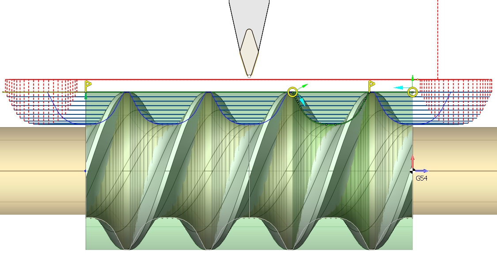

## Anwendungsbereich:

Diese Operation erzeugt Gewinde, deren Nutprofil von der Werkzeugform abweicht. Das Material wird über mehrere Durchgänge innerhalb der gesamten Gewindenut abgetragen. Deren Anordnung berücksichtigt sowohl die Werkzeugform als auch das Nutprofil. Die Auftragszuweisung benötigt zwei Elemente: die Lage von Gewindeanfang und -ende am Bauteil sowie die Form der Gewindenut. Je nach Orientierung entstehen zylindrische, konische oder Stirngewinde in Form einer archimedischen Spirale.

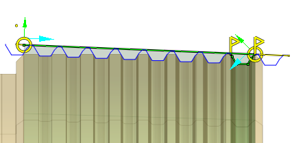

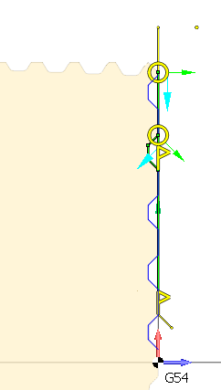

### Auftragszuweisung:

**Threading (Gewindedrehen).** Definiert die Lage des Gewindebereichs. Die erzeugte Gewindelinie kann im Grafikfenster über Anfang, Ende, Richtungs- und Seitenpfeil sowie durch Verschieben des Durchmessers geändert werden. Die Bearbeitungsseite bestimmt Innen- oder Außengewinde; Bearbeitungsrichtung und Spindeldrehrichtung bestimmen Links- oder Rechtsgewinde. An- und Abfahrabschnitte legen Verlängerung oder Auslauffase fest. Pro Operation wird ein Gewindebereich verwendet; für mehrere Gewinde sind mehrere Operationen nötig. G32/G33 aktiviert die Synchronisation von Bewegung und Spindel bis zum Wechsel der Interpolation oder zum Eilgang. Axiale Bewegung erzeugt ein zylindrisches, gleichzeitige axiale und radiale Bewegung ein konisches Gewinde; rein radiale Bewegung erzeugt eine Stirnspirale. Da der Befehl keine vollständige Zyklusbahn erzeugt, werden alle Bewegungen auf **Strategy** und **Links** eingestellt.

**Single thread cycle (Einzelpasszyklus).** Definiert ebenfalls den Gewindebereich und gibt G92 aus. Der Zyklus führt vom Startpunkt zum Gewindeanfang TSP, schneidet bis TEP und kehrt zum Startpunkt zurück. Ein Satz legt Anfang, Steigung, Konizität, Fase und weitere Werte fest. Mehrere Aufrufe mit unterschiedlichen Durchmessern erzeugen die erforderlichen Zustellungen. Der Zyklus eignet sich für Standard- und Freiformgewinde.

**Threaded groove (Gewindenutprofil).** Definiert die Profilkontur. Sie wird entlang des Gewindebereichs in Abständen der unter **Thread Pitch** angegebenen Steigung wiederholt. Die Steigung kann auch interaktiv eingestellt werden. Richtung und Bearbeitungsseite müssen mit dem Gewindebereich übereinstimmen. In der Abbildung markiert die grüne Kurve Anfang S und Ende des Gewindes; die blaue Kurve beschreibt das Nutprofil. Der rote Punkt H liegt senkrecht über bzw. unter S. Da die Profilkurve beliebig relativ zum Gewindeanfang liegen kann, muss H korrekt positioniert werden.

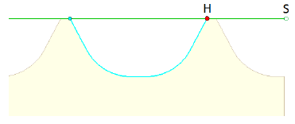

### Zyklusparameter:

#### Zyklus

Wählen Sie einen der unter Auftragszuweisung beschriebenen Drehzyklen. Beim Wechsel wird das zugehörige Auftragselement automatisch angepasst. Die verfügbaren Parameter hängen vom Zyklustyp ab.

Weitere Informationen anzeigen

**Clearance Stock (Freifahrabstand).** Abstand vom Gewinde zur Ebene der Übergänge zwischen den Durchgängen.

**Thread Form (Gewindeform).** Geometrische Gewindeparameter.

Weitere Informationen anzeigen

**Thread Library (Gewindetabelle).** Übernimmt Standardgewindeparameter aus der Datenbank. Wählen Sie Gewindetyp und Bezeichnung; die übrigen Werte werden ergänzt.

**Symbolic Name (Bezeichnung).** Optionale Kennung wie M10 für die schnelle Suche. Für Sondergewinde sind eigene Bezeichnungen möglich.

**Thread Pitch (Gewindesteigung).** Steigung als Länge oder Windungszahl pro Längeneinheit.

**Number of starts (Gangzahl).** Werte ab zwei erzeugen mehrgängige Gewinde. G76 kann die Gangzahl als Parameter erhalten, sofern die Steuerung dies unterstützt. Andernfalls werden Zyklusaufrufe mit unterschiedlichen **Spindle start angle**-Werten verwendet. Bei G92 oder G32/G33 werden entsprechende Durchgänge automatisch erzeugt.

**Spindle Start Angle (Spindelstartwinkel).** Winkel gegenüber der X-Achse, bei dem das Schneiden des Gewindegangs beginnt.

**Thread Roughing (Gewinde schruppen).** Aktiviert mehrere Schruppdurchgänge in der Nut. Das Werkzeug wird mit vorgegebener Schrittweite entlang der Drehachse versetzt; die Bearbeitung kann auf mehrere Schichten verteilt werden.

**Bottom Stock (Grundaufmaß).** Material am Nutgrund für die nachfolgende Schlichtbearbeitung.

**Side Stock (Flankenaufmaß).** Material an den Nutseiten für die nachfolgende Schlichtbearbeitung.

**Machining Direction (Bearbeitungsrichtung).** Reihenfolge der Schruppbahnen.

**Bidirectional (Beidseitig).** Beginnt in der Nutmitte, arbeitet zuerst zur rechten und dann zur linken Flanke.

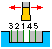

**Alternate (Wechselnd).** Beginnt in der Nutmitte und arbeitet abwechselnd zu beiden Flanken.

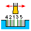

**Forward (Vorwärts).** Bearbeitung von vorne nach hinten, standardmäßig von rechts nach links.

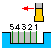

**Backward (Rückwärts).** Bearbeitung von hinten nach vorne, standardmäßig von links nach rechts.

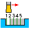

**Rough Step (Schruppschritt).** Abstand benachbarter Schruppbahnen entlang des Gewindes. Er kann direkt oder über die Anzahl der Bahnen bestimmt werden. Kleinere Abstände verringern die Werkzeugbelastung, verlängern jedoch die Bearbeitungszeit.

**Multilayer (Mehrschichtig).** Verteilt den Abtrag auf mehrere Schichten.

**Off (Aus).** Einschichtige Bearbeitung.

**Monodirectional (Gleichgerichtet).** Mehrschichtige Bearbeitung mit gleicher Bahnrichtung auf allen Schichten.

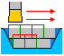

**Zigzag (Zickzack).** Die erste Schicht folgt **Machining Direction**; jede weitere Schicht wird in Gegenrichtung bearbeitet.

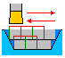

**Depth Step (Tiefenzustellung).** Maximale Zustelltiefe pro Schicht, direkt oder über die Schichtanzahl festgelegt.

**Thread Finishing (Gewinde schlichten).** Erzeugt Schlichtbahnen entlang der Profilkontur der Auftragszuweisung.

**Finish step (Schlichtschritt).** Abstand benachbarter Bahnen entlang der Profillänge, direkt oder über die Bahnanzahl festgelegt.

**Machining Direction (Bearbeitungsrichtung).** Reihenfolge der Schlichtbahnen.

**Forward (Vorwärts).** Schlichten in Richtung der Spindel.

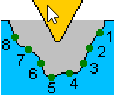

**Backward (Rückwärts).** Schlichten von der Spindel weg.

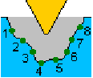

**Bidirectional (Beidseitig).** Schlichtbahnen von den Nuträndern zur Mitte.

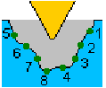

**Compensation (Korrektur).** Steuert die Ausgabe der Schneidenbreitenkorrektur.

**Length corrector (Längenkorrekturregister).** Steuert die Ausgabe der unter **Tools → Tool Properties → Numbers** festgelegten Registernummern.

**First.** Gibt die Nummer des ersten Korrekturregisters aus.

**Second.** Gibt die Nummer des zweiten Korrekturregisters aus.

#### Mit Bögen umfahren

Äußere Werkzeugwegecken werden mit Bögen im Schneideneckenradius verrundet. Die Parameter entsprechen denen der Außen- und Innenschruppoperationen. [Details](316.md)

### Vorschübe und Drehzahlen:

Hier werden Spindeldrehzahl, Eilgang und Vorschübe für die Bahnabschnitte festgelegt. Die Spindel kann über Drehzahl oder Schnittgeschwindigkeit definiert werden. Der maßgebliche Wert ist unterstrichen; der andere wird anhand des Werkzeugdurchmessers berechnet. [Details](100142.md)

### Transformationen:

Koordinatentransformationen des berechneten Werkzeugwegs. [Details](10168.md)

### Bauteil:

Geometrische Elemente zur Prüfung auf unerwünschte Einschnitte. [Details](330.md)

### Rohteil:

Modell des zu bearbeitenden Materials. [Details](738.md)

### Spannmittel:

Spannfutter, Greifer, Spannpratzen und andere Befestigungsmittel oder Sperrbereiche. [Details](10283.md)
