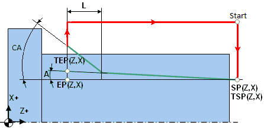

# Ausgabearten der Gewindeschneidzyklen

Werkzeugwege zum Gewindedrehen können in unterschiedlichen Formaten ausgegeben werden.

**Mehrdurchgangszyklus ISO G76.** Enthält die Parameter für ein Standardgewinde. Die Steuerung erzeugt automatisch mehrere Zustellungen bis zur gewünschten Tiefe. Dazu gehören Start- und Endkoordinaten, Konizitätswinkel, Auslauffase, Profilwinkel, Gewindetiefe, Durchgangsanzahl und Zustellstrategie. Die genaue Syntax richtet sich nach der Dokumentation der CNC-Steuerung.


```
                    Example of NC program
G01 X70 Z5.0 F1.0 M08            (Approach to start point)
G01 X70 Z5.0 F1.0 M08            (Approach to start point)
G76 P010060 
G76 X57.4 Z-24.0 P1.3 Q0.35 F2.0 (Calling G76 multipass thread cycle) 
G00 X200.0 Z150.0 M09            (Retract)
```

**Einzelpasszyklus ISO G92.** Je nach Steuerung kann der entsprechende Befehl auch G78, G21 oder anders heißen. Er erzeugt die geschlossene Bewegungsfolge eines Gewindeschneiddurchgangs: vom Startpunkt zum Gewindeanfang TSP, Schneiden bis TEP und Rückfahrt zum Startpunkt. Ein Satz legt unter anderem Anfang, Steigung, Konizität und Fase fest. Für mehrere Zustellungen folgen mehrere Zyklusaufrufe mit unterschiedlichen Durchmessern. Das Verfahren eignet sich für Standard- und Freiformgewinde.



```
                    Example of NC-program
X60.0 Z20.0 M08 
G01 Z10.0 F1.0        (Approach to Start point)
G92 X29.4 Z-52.0 F2.0 (Calling cycle for one threading pass)
X28.9                 (Modal calling G92 cycle with another diameter value)
X28.5                 (Modal calling G92 cycle with another diameter value) 
X28.1                 (Modal calling G92 cycle with another diameter value)
X27.8                 (Modal calling G92 cycle with another diameter value)
X27.56                (Modal calling G92 cycle with another diameter value)
X27.36                (Modal calling G92 cycle with another diameter value)
X27.26                (Modal calling G92 cycle with another diameter value)
G00 X200.0Z150.0M09   (Retract)
```

**Aufgelöste Gewindebearbeitung mit ISO G32/G33.** Der Befehl aktiviert das Schneiden zylindrischer, konischer oder Stirngewinde mit konstanter Steigung. Werkzeugbewegung und Spindelrotation werden synchronisiert, bis ein anderer Interpolationsmodus oder Eilgang aktiviert wird. Eine Bewegung parallel zur Drehachse erzeugt ein zylindrisches Gewinde, eine gleichzeitige axiale und radiale Bewegung ein konisches Gewinde. Eine rein radiale Bewegung erzeugt eine archimedische Spirale auf der Stirnfläche.

G32/G33 erzeugt nicht selbst die komplette Bewegungsfolge. Schnitt-, Anfahr-, Rückfahr- und Zustellbewegungen müssen im NC-Programm ausdrücklich angegeben werden. Diese Ausgabe ist für Standard- und Freiformgewinde geeignet.

```
                    Example of NC program
G00 X60.0 Z10.0 M08 (Approach to Start point) 
G00 X29.4           (Approach to start of pass 1)
G32 Z-52.0 F2.0     (Threading synchronized with spindle)
G00 X60.0           (Return to Start)
Z10.0 
X28.9               (Approach to start of pass 2)
G32 Z-52.0          (Threading synchronized with spindle)
G00 X60.0           (Return to Start)
Z10.0 
X28.5               (Approach to start of pass 3)
G32 Z-52.0          (Threading synchronized with spindle)
G00 X60.0           (Return to Start)
Z10.0 
X28.1               (Approach to start of pass 4)
G32 Z-52.0          (Threading synchronized with spindle)
G00 X60.0           (Return to Start)
Z10.0 
X27.8               (Approach to start of pass 5)
G32 Z-52.0          (Threading synchronized with spindle)
G00 X60.0           (Return to Start)
Z10.0 
X27.56              (Approach to start of pass 6) 
G32 Z-52.0          (Threading synchronized with spindle)
G00 X60.0           (Return to Start)
Z10.0 
X27.36              (Approach to start of pass 7)
G32 Z-52.0          (Threading synchronized with spindle)
G00 X60.0           (Return to Start)
Z10.0 
X27.26              (Approach to start of pass 8)
G32 Z-52.0          (Threading synchronized with spindle)
G00 X60.0           (Return to Start)
Z10.0
X200.0 Z150.0 M09   (Retract)
```
