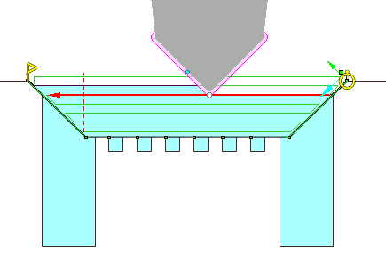
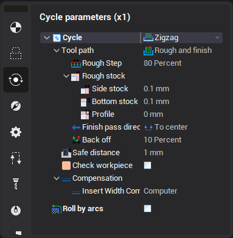
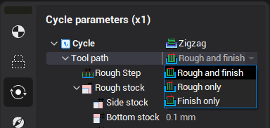
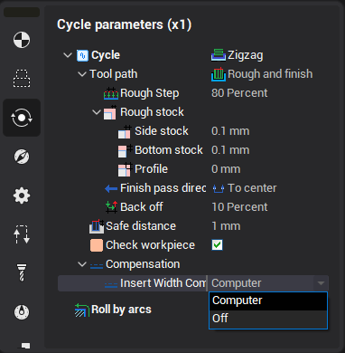

# Ciclo em zigue-zague

O ciclo de torneamento em zigue-zague gera um percurso da ferramenta adequado para usinar, com uma ferramenta neutra, áreas fechadas dos dois lados. A ferramenta desce camada por camada e executa movimentos horizontais, mudando de direção a cada camada.

Parâmetros comuns do ciclo

O ciclo em zigue-zague gera passadas de desbaste e de acabamento. O parâmetro Tool path define quais passadas devem ser geradas.

Se **Finish only** estiver selecionado, será gerada somente a passada de acabamento e a janela exibirá apenas seus parâmetros. Se **Rough only** estiver selecionado, será gerada somente a passada de desbaste e serão exibidos seus parâmetros. Se **Rough and finish** estiver selecionado, todos os parâmetros serão exibidos.

O parâmetro Safe distance define a distância do topo do canal até o nível dos movimentos em avanço rápido. Para editar a distância segura, arraste o ponto na janela gráfica ou digite o valor na janela.

<strong>Parâmetros da passada de acabamento</strong>

O parâmetro Insert width compensation define o uso dos corretores.

- O modo Computer gera o percurso da ferramenta somente para o primeiro corretor.

<strong>Parâmetros da passada de desbaste</strong>

O parâmetro Rough step define a distância entre as passadas de desbaste. Ele pode ser definido em porcentagem da largura da ferramenta ou em unidades de comprimento.

O parâmetro Rough stock define o sobremetal adicional das passadas de desbaste.

A opção Check workpiece remove todos os trechos em vazio dos movimentos de trabalho que não cortam efetivamente o bruto.
