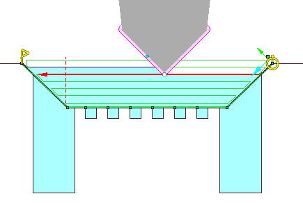
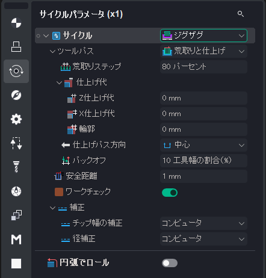
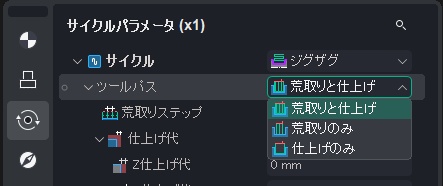
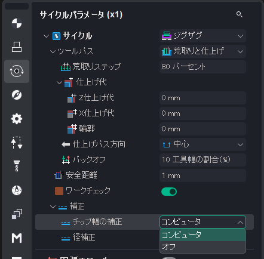

# ジグザグサイクル

ジグザグサイクルは、ニュートラル工具を使用して、両側が閉じた領域を加工するのに適したツールパスを生成します。工具はレイヤーごとに切り込みながら降下し、各レイヤーで方向を切り替えながら水平方向に移動します。

サイクルの共通パラメータ

ジグザグサイクルでは、荒取りパスと仕上げパスを生成します。ツールパスパラメータでは、生成するパスの種類を指定します。

仕上げのみを選択すると、仕上げパスのみが生成され、ダイアログには仕上げパス用のパラメータのみが表示されます。

荒取りのみを選択すると、荒取りパスのみが生成され、ダイアログには荒取りパス用のパラメータのみが表示されます。

荒取りと仕上げを選択すると、すべてのパラメータが表示されます。

安全距離パラメータでは、溝の上端から早送り移動を行う高さまでの距離を設定します。安全距離の編集は、グラフィックウィンドウ内で点をドラッグするか、ダイアログに直接数値を入力することで行えます。

<strong>仕上げパスのパラメータ</strong>

刃物幅補正は使用する補正方法を設定します。

- コンピュータモードを選択した場合、1番目の補正番号のみを使用するツールパスを生成します。

<strong>荒取りパスのパラメータ</strong>

荒取りステップ - 荒取りパス間の距離を設定します。工具幅に対する割合（%）または長さの単位で設定できます。

仕上げ代 - 荒取りパス用の追加の加工代（ストック）を定義します。

ワークチェック - 実際にはワークを切削しない空走部分をすべて除去します。
