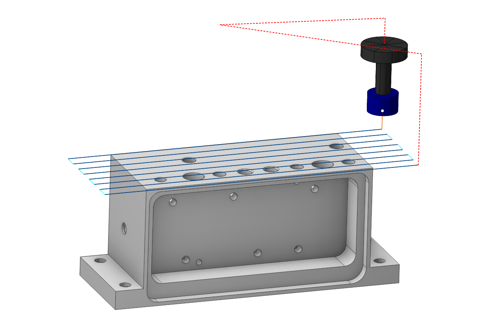
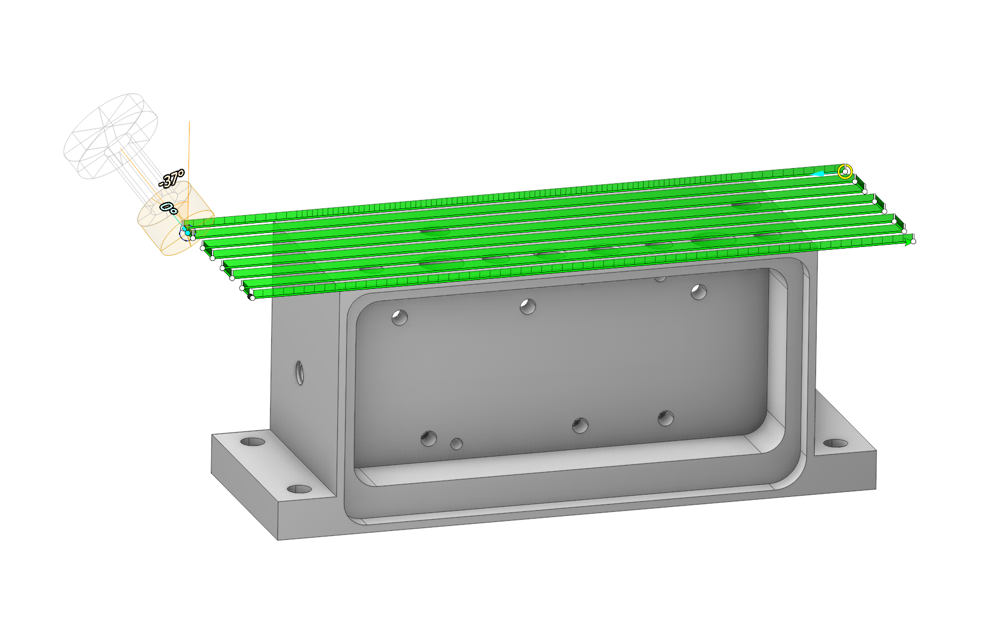
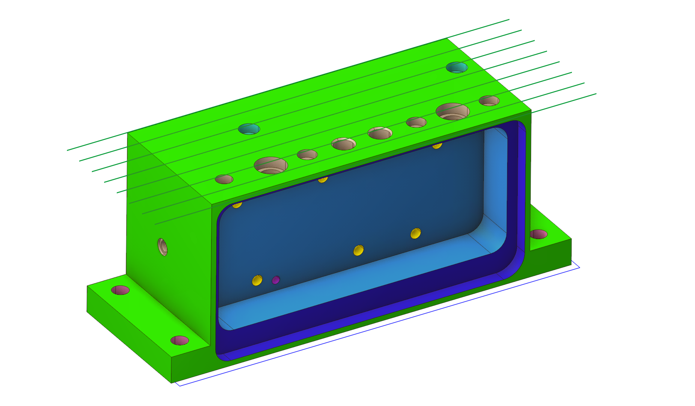

# Conversão de uma trajetória arbitrária para a operação Contorno 6D

 

## Área de aplicação:

É possível pegar (quase) qualquer operação e converter seu percurso da ferramenta em uma operação "6D Contour", que usa esse percurso como definição da tarefa. Isso permite fazer pequenas alterações no percurso original, como modificar as normais da ferramenta, antes do pós-processamento.

Para ativar a função, clique com o botão direito do mouse na operação desejada e, na caixa de diálogo exibida, selecione **Convert toolpath to 6D Contour operation**.

Nesse caso, um grupo de **splines** é criado na aba **Model**.

