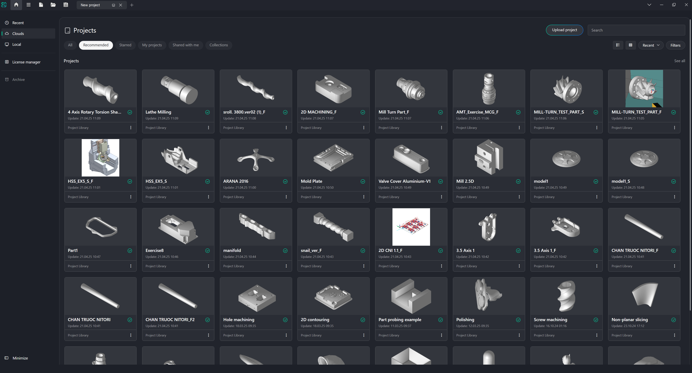
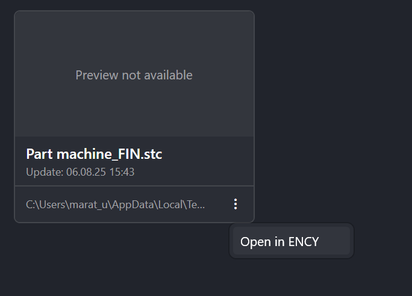
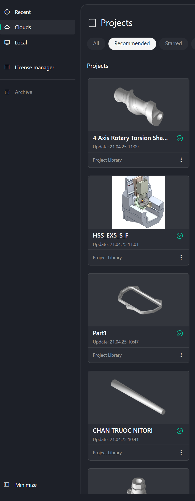
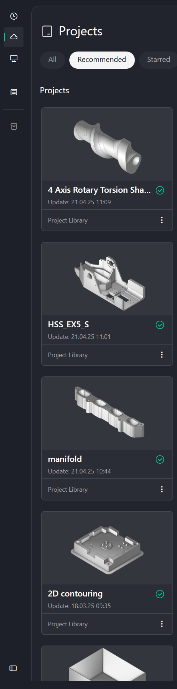
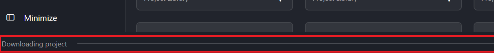

# ホームページ

## 適用分野：

<strong>ホームページ</strong> では、以前に開いたプロジェクトをすばやく簡単に参照したり、プロジェクトライブラリを利用したりできるため、起動プロセスを高速化し、開発者の生産性を向上させます。

### 最近

<strong>最近</strong>タブでは、最近開いたプロジェクトを表示し、素早くアクセスすることができます。 3つの点をクリックすると、システムの最後にアクティブだったウィンドウでプロジェクトを開くことができます。

### クラウド

プロジェクトライブラリでは、オンラインライブラリからサンプルプロジェクトを検索して開くことができます。[詳細を見る](1020141.md)

### ローカル

ファイルエクスプローラーとして機能します。Windowsエクスプローラからプロジェクトを検索する必要はありません。この操作はシステムのホームページ上で行うことができ、プロジェクトのナビゲーションを大幅に簡素化し、スピードアップすることができます。

3つの点から、CAMシステムでプロジェクトを開いたり、ファイルエクスプローラーでプロジェクトの場所を開くこともできます。

### ライセンスマネージャー

ライセンスマネージャーには、CAMシステムのライセンスとモジュールのライセンスを扱う機能があります。[詳細を見る](10025.md)

### 最小化

タブラベルを非表示にすることで、作業スペースを広げることができます。

 

### 進行状況バー

画面下部には、プロジェクトのダウンロードと起動状況を表示する進行状況バーがあります。

