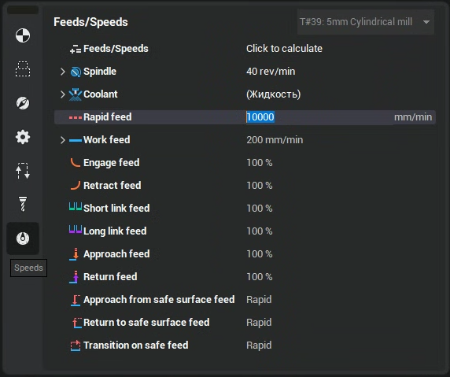

# Eilgangvorschub

Bei der Berechnung G-Code-basierter Roboteroperationen muss der Eilgangvorschub unter **Feeds/Speed → Rapid Feed** eingestellt werden. Der Standardwert beträgt 10.000 mm/min.

Hinweis: Roboterprogramme besitzen üblicherweise keinen besonderen Eilgangbefehl wie G00 bei Dreh- oder Fräsmaschinen. Jede Bewegung enthält einen Vorschubwert. Stellen Sie deshalb den Eilgangvorschub ein, damit die Roboterbahn korrekt berechnet und dargestellt wird.
