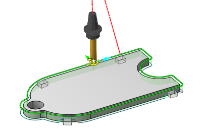
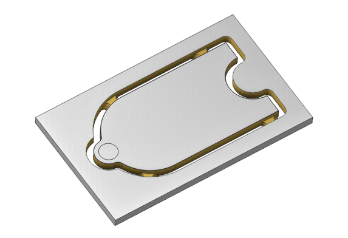
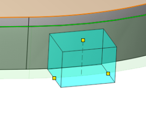
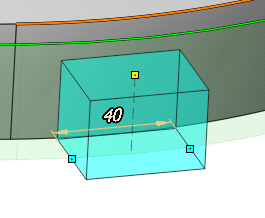
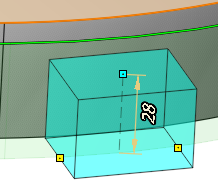

# Haltestege

 

## Anwendungsbereich:

Haltestege verhindern, dass Bauteile oder Rohteilreste am Ende der Bearbeitung herausfallen und Werkzeugbruch oder fehlerhafte Teile verursachen. Das Fenster **Tabs** in der Auftragszuweisung definiert Geometrie und Verteilung der Stege entlang der Konturen. Zunächst können sie automatisch nach einer gewählten Regel platziert werden. Anschließend lassen sich Lage und Größe einzelner Stege im Grafikfenster ändern.

  

### Haltestege hinzufügen.

Definiert die Steggeometrie und ihre Anordnung.

Weitere Informationen anzeigen

**Scope (Anwendungsbereich)**

Legt fest, für welche Konturtypen Haltestege erzeugt werden.

**Closed and unclosed.** Haltestege für offene und geschlossene Konturen.

**Closed only.** Haltestege nur für geschlossene Konturen.

**Unclosed only.** Haltestege nur für offene Konturen.

**Selected countours only.** Beschränkt die Erstellung auf ausgewählte Konturen. Ohne Auswahl werden standardmäßig alle Konturen berücksichtigt; sobald mindestens eine Kontur ausgewählt ist, nur die Auswahl.

**Replace existing tabs.** Erstellt Haltestege auch an Konturen neu, für die bereits Stege vorhanden sind. Standardmäßig aktiviert.

**Dimensions (Abmessungen)**

Legt die Stegabmessungen fest.

**Tab size (Steglänge).** Länge als Vorgabewert, in Millimetern oder als Prozentsatz des Werkzeugdurchmessers.

**Tab height (Steghöhe).** Höhe als Vorgabewert, in Millimetern, als Prozentsatz des Werkzeugdurchmessers oder mit **FullHeight** über die gesamte Element- bzw. Operationshöhe.

**Default dimensions (Vorgabeabmessungen)**

Diese Werte werden bei Auswahl der Vorgabeeinstellung verwendet.

**Default tab size.** Vorgabewert für die Steglänge.

**Default tab height.** Vorgabewert für die Steghöhe.

**Placement strategy (Platzierungsstrategie)**

Legt die Verteilung der Haltestege fest.

**Quantity per countour (Anzahl je Kontur).** Erzeugt die vorgegebene Anzahl und verteilt die Stege gleichmäßig entlang jeder Kontur.

**Desired tab count.** Gewünschte Steganzahl.

**Linear density (Verteilung nach Länge).** Erzeugt je Kurve einen Steg pro Abschnitt der vorgegebenen Länge.

**Linear density.** Abschnittslänge in Millimetern oder als Prozentsatz des Werkzeugdurchmessers. Vorgabe: 500 %.

**Minimal tab count.** Mindestanzahl je Kontur. Vorgabe: 0.

**Area density (Verteilung nach Fläche).** Erzeugt bei geschlossenen Konturen einen Steg je vorgegebener Teilfläche.

**Area density.** Flächenbezogener Wert in mm² oder als werkzeugdurchmesserbezogener Prozentwert. Vorgabe: 1000 %.

**Minimal tab count.** Mindestanzahl je Kontur. Vorgabe: 0.

**Avoid corners (Ecken vermeiden).** Prüft, ob ein Steg in einer Ecke liegt, und versucht ihn schrittweise zu einer Seite oder zur anderen zu verschieben. Wird keine geeignete Lage außerhalb der Ecke gefunden, bleibt er an seiner ursprünglichen Position.

**Merge tabs of neighbor curves (Stege benachbarter Kurven zusammenführen).** Entfernt Stege benachbarter Konturen, die auf die aktuelle Kontur wirken.

