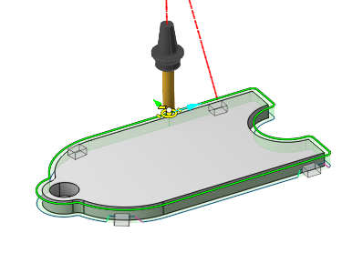
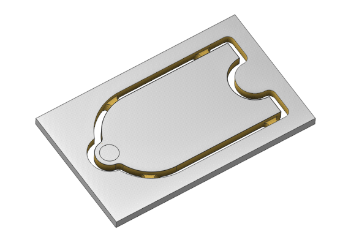
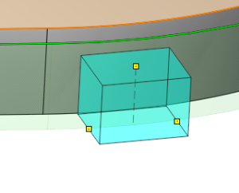
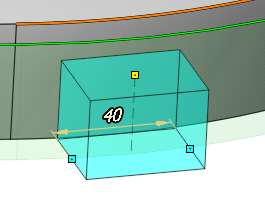
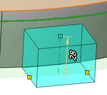

# タブ

 

## 適用分野：

タブは、加工の最終段階で部品やワークの断片が脱落しないよう保持するために必要であり、工具の破損や不良品の原因となります。 <strong>ジョブ割り当て</strong>内の<strong>タブ</strong>ウィンドウでは、<strong>タブの形状および輪郭に沿った配置方法のみが定義されます。</strong>このウィンドウでは、一定のルールに基づいてタブを自動配置し、初期追加を行うことができます。その後、各タブの位置やサイズはグラフィックウィンドウ上で直接編集することが可能です。

  

### タブを追加

タブの形状形成および相対的な配置のために必要です。

拡大

<strong>輪郭範囲</strong> タブが適用される輪郭の種類を決定するために必要です。

<strong>両方</strong> タブは開いた輪郭と閉じた輪郭の両方に作成されます。

<strong>閉じた輪郭のみ</strong> タブは閉じた輪郭に作成されます。

<strong>閉じていない輪郭のみ</strong> タブは開いた輪郭に作成されます。

<strong>選択した輪郭のみ</strong> タブを追加する輪郭のルールを定義します——すべての輪郭に追加するか、選択した輪郭のみに追加するかを指定します。デフォルトでは、操作指示で輪郭が選択されていない場合、すべての輪郭、少なくとも1つが選択されている場合、選択された輪郭のみ。

<strong>既存のタブを置き換える</strong> 以前にタブが作成された輪郭のタブを再作成するかどうか指定します。デフォルトでは有効になっています。

<strong>寸法</strong> タブの寸法を決定します。

<strong>タブサイズ</strong> タブの長さを指定します。デフォルトは、単位は mm または工具径の %で指定します。

<strong>タブ高さ</strong> タブの高さを指定します。デフォルトでは、単位は mm または工具径の％で指定され、 FullHeight（要素またはオペレーションの全高）として扱われます 。

<strong>デフォルト寸法</strong> デフォルトはデフォルトの寸法で定義されています。

<strong>デフォルトタブサイズ</strong> デフォルトタブのサイズの値を指定します。

<strong>デフォルトのタブ高さ</strong> デフォルトタブの高さの値を指定します。

<strong>配置方法</strong> タブの配置戦略を定義します。

<strong>輪郭ごとの個数</strong> 各輪郭に指定した数のタブが自動的に作成されます。タブは輪郭の長さに沿って均等に配置されています。

<strong>必要タブ数</strong> タブの数

<strong>線密度</strong> 各カーブ上で指定された長さ（<strong>線密度</strong>）ごとに、各区間に1つのタブが自動的に作成されます。

<strong>線密度</strong> 長さの単位は mm、または工具径に対する％で指定できます。デフォルトは500％

<strong>最小タブ数</strong> 各回路に配置されるタブの最小数を指定します。デフォルトは0

<strong>面密度</strong> 各閉曲線上の<strong>平面密度</strong> の基本領域ごとに、1つのタブが自動的に作成されます。

<strong>面密度</strong> 面密度は mm² 単位、または工具径に対する％で指定します。デフォルトは1000％

<strong>最小タブ数</strong> 各回路に配置されるタブの最小数を指定します。デフォルトは0

<strong>コーナー回避</strong> コーナーを避けるオプションを有効にすると、アルゴリズムは指定されたタブがコーナーに入るかどうかのチェックを開始します。もし該当する場合、タブは角の外側に配置できる位置が見つかるまで、まず片側に少し移動させ、次に反対側に移動させる動作を繰り返します。失敗した場合は、タブを元の場所に残してください。

<strong>隣接カーブのタブを結合</strong> このパラメータは、この輪郭に影響する隣接する輪郭のタブを削除します。

