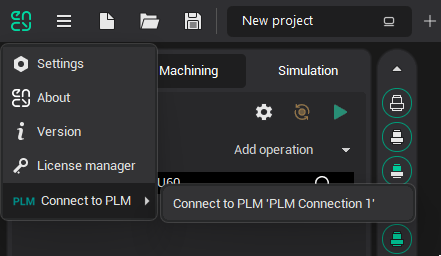
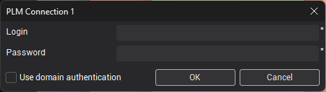
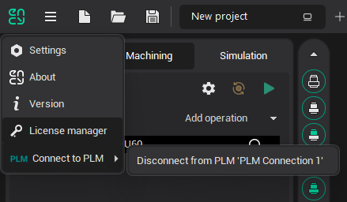

# Im CAM-Hauptfenster an einem externen System anmelden

Öffnen Sie im Hauptmenü **Connect to PLM**. Der Eintrag ist nur vorhanden, wenn mindestens eine PLM-Verbindung konfiguriert ist.

Das Untermenü zeigt die verfügbaren Verbindungen. Wählen Sie die gewünschte Verbindung, um das Anmeldefenster zu öffnen.

Geben Sie Ihre Zugangsdaten ein oder aktivieren Sie **Use domain authentication** (Domänenanmeldung).

Zum Trennen öffnen Sie erneut **Connect to PLM** und wählen **Disconnect from [connection name]** für die betreffende Verbindung.

