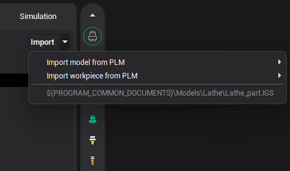
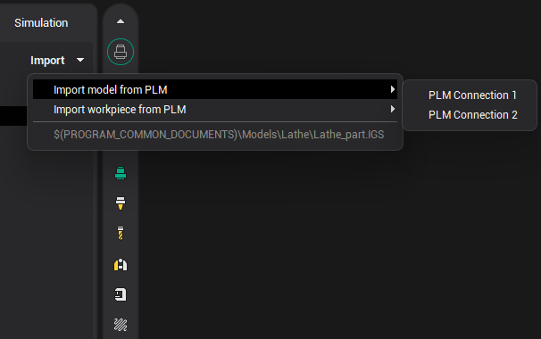
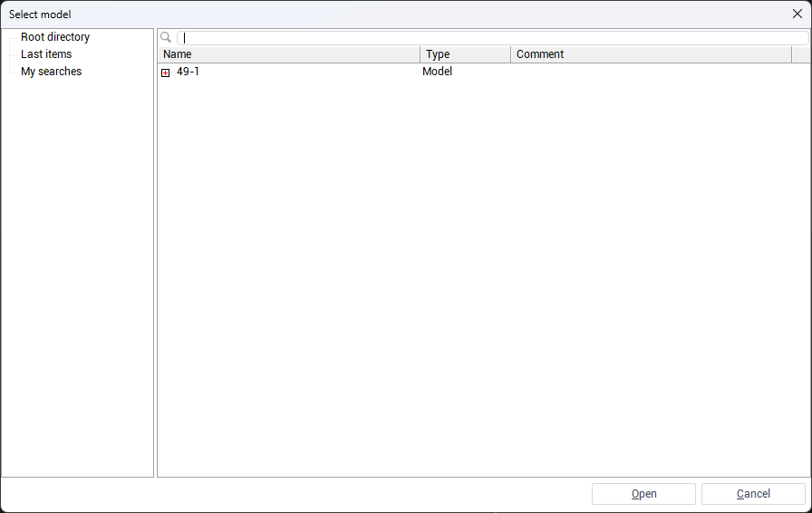
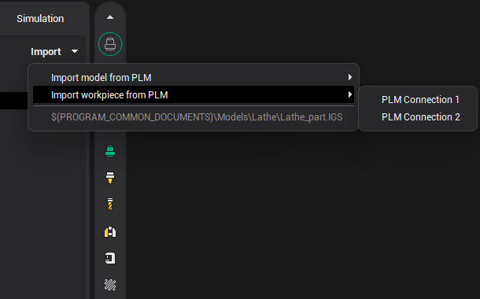
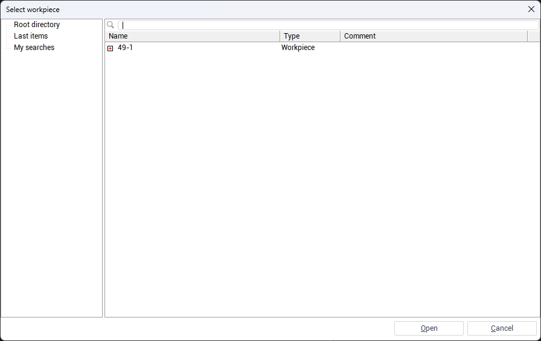

# 外部システムからの図形のインポート

部品やワークピースのジオメトリモデルは、<strong>メインウィンドウ</strong>のツールバーにある<strong>インポート</strong>ボタンを使用して、PLMシステムから直接インポートできます。

このボタンには小さな矢印が付いており、クリックすると追加のインポートオプションを含むドロップダウンメニューが表示されます。

- <strong>PLMからモデルをインポート</strong>
- <strong>PLMからワークをインポート</strong>

各オプションにはサブメニューがあり、設定済みのPLM接続を選択できます。

<strong>注意：PLM関連のオプション</strong>は、少なくとも1つのPLM接続が設定されている場合にのみ表示されます。

<strong>外部システムからのジオメトリモデルのインポート</strong>

<strong>インポート</strong>ボタンの横にある矢印をクリックし、<strong>PLMからモデルをインポート</strong>→［接続名］」を選択します。

外部システムで利用可能なジオメトリモデルのツリービューが表示されたウィンドウが開きます。インポートするモデルを選択して<strong>開く</strong>をクリックすると、選択したモデルが現在のプロジェクトにインポートされます。

## 外部システムからのワークピースのインポート

<strong>インポート</strong>ボタンの横にある矢印をクリックし、<strong>PLMからワークをインポート</strong>→［接続名］」を選択します。

外部システムのオブジェクト構造を参照して必要なワークピースを見つけ、<strong>開く</strong>をクリックします。選択したワークピースが現在のプロジェクトにインポートされます。

