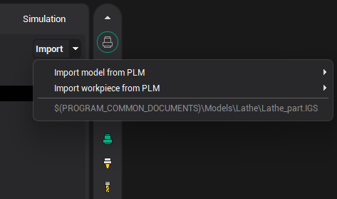
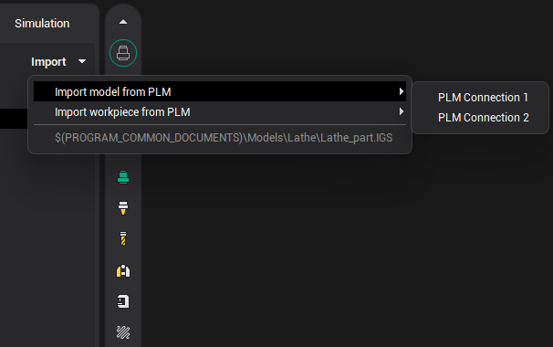
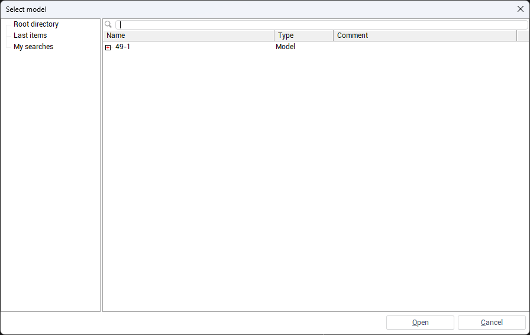
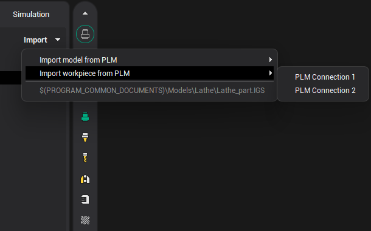
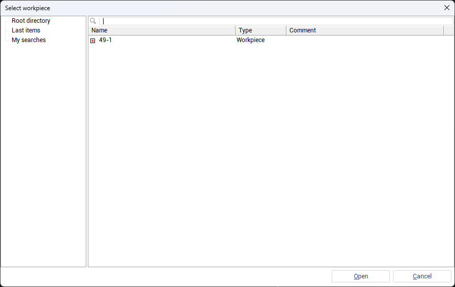

# Importing a Geometry Model from an External System

Geometry models of parts and workpieces can be imported directly from a PLM system using the **Import** button in the **main window** toolbar. This button includes a small arrow that opens a drop-down menu with additional import options:

- **Import model from PLM**
- **Import workpiece from PLM**

Each option includes a submenu where you can select a configured PLM connection.

**Note:** The **PLM-related** **options** appears only if at least one PLM connection is configured.

## Importing a Geometry Model from an External System

Click the arrow next to the **Import** button, then select **Import model from PLM** → *[connection name]*.

 A window will open with a tree view of available geometry models in the external system. Select the desired model and click **Open**. The model will be imported into the current project.

## Importing a Workpiece from an External System

Click the arrow next to the **Import** button, then select **Import workpiece from PLM** → *[connection name]*.

 Browse the external system's object structure to find the required workpiece, then click **Open**. The selected workpiece will be imported into the current project.

