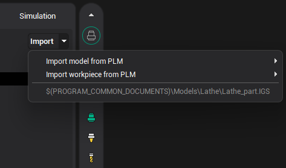
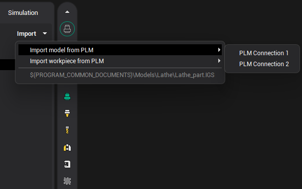
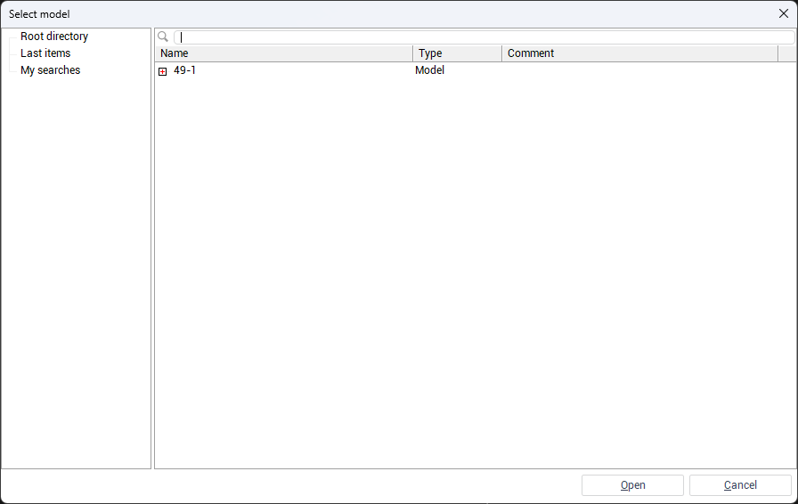
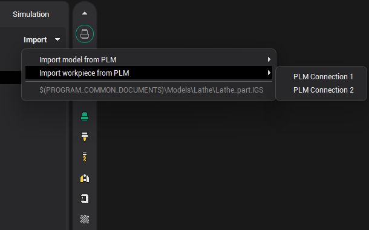
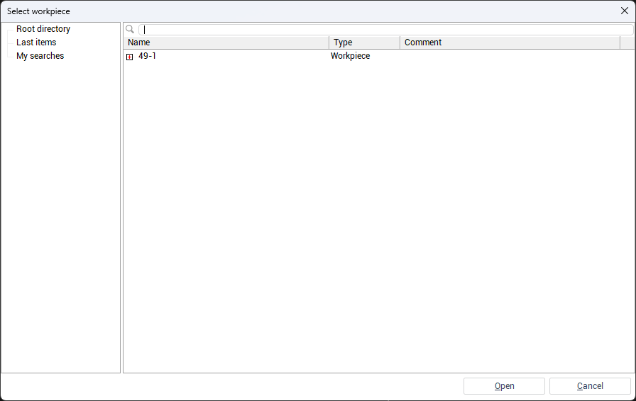

# 外部システムからの図形のインポート

パーツとワークのジオメトリモデルは、<strong>メインウィンドウ</strong>のツールバーにある<strong>インポート</strong>ボタンから、PLMシステムから直接インポートできます。ボタンの小さな矢印をクリックすると、追加のインポートオプションを含むドロップダウンメニューが開きます。

- <strong>PLMからモデルをインポート</strong>
- <strong>PLMからワークをインポート</strong>

各オプションにはサブメニューがあり、設定済みのPLM接続を選択できます。

<strong>注意：PLM関連のオプション</strong>は、少なくとも1つのPLM接続が設定されている場合にのみ表示されます。

## 外部システムからのジオメトリモデルのインポート

<strong>インポート</strong>ボタンの横にある矢印をクリックし、<strong>PLMからモデルをインポート</strong>→［接続名］を選択します。

 外部システムで利用可能なジオメトリモデルのツリーを表示するウィンドウが開きます。目的のモデルを選択し、<strong>開く</strong>をクリックします。モデルが現在のプロジェクトにインポートされます。

## 外部システムからのワークピースのインポート

<strong>インポート</strong>ボタンの横にある矢印をクリックし、<strong>PLMからワークをインポート</strong>→［接続名］を選択します。

 外部システムのオブジェクト構造から必要なワークを探し、<strong>開く</strong>をクリックします。選択したワークが現在のプロジェクトにインポートされます。

