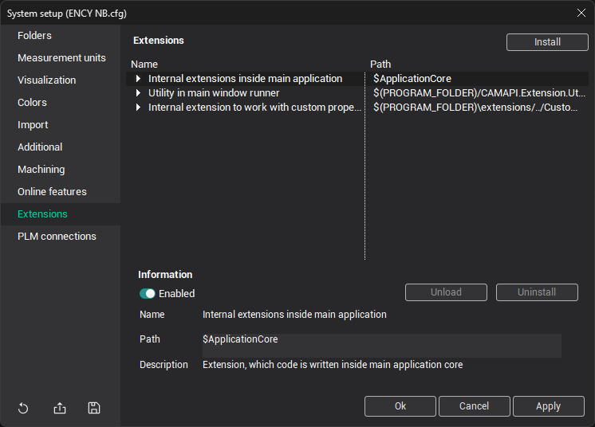
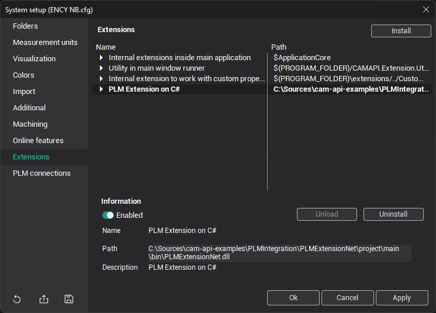
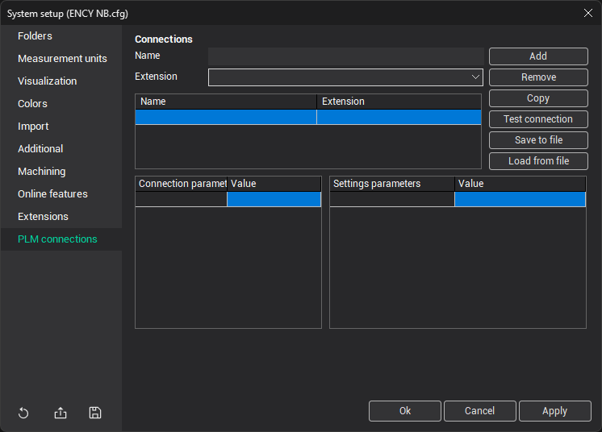
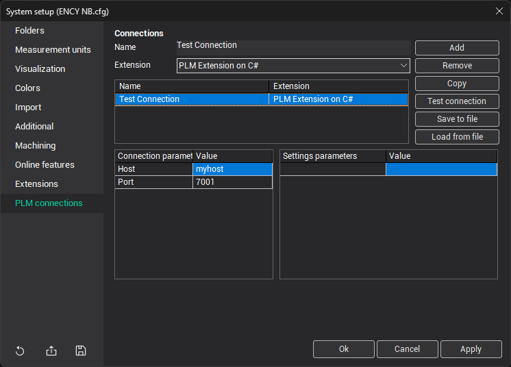

# Installing and Configuring PLM Integration Modules

## Setting Up the Integration Extension

To setup PLM system integration module, open **System Settings** window and go to **Extensions** tab.

Click the **Install** button. In opened **File Explorer** window choose extension's json-file or dext-file and open it. Successful installation example:

You can also disable extension or uninstall it, select it in list of extensions and switch toggle on **Enabled** or click the **Uninstall** button.

The extension can also be installed via the command-line interface (CLI, ExtensionManagerCLI.exe could be found at the program installation folder). To do so, open the Windows Command Prompt and enter the command:

**ExtensionManagerCLI.exe register-library --path "***[path to the extension]***"** **--storage stAllUsers**

## Configuring PLM Connections

To create and configure connection, open the **System Settings** window and go to the **PLM connections** tab.

Write connection name in the **Name** text field and choose installed PLM extension in drop-down menu. Then click **Add** button.

You can configure selected connection changing values of suggested connection parameters or settings parameters in tables below.

Also you can save settings to file, click the **Save to file** button. This file can be used to load settings, click **Load from file** button.

You can remove connection. Select it in list of connections and click the **Remove** button.

To check connection, click the **Test connection** button and enter your account credentials.

Click the **Apply** or **Ok** buttons to apply changes.
