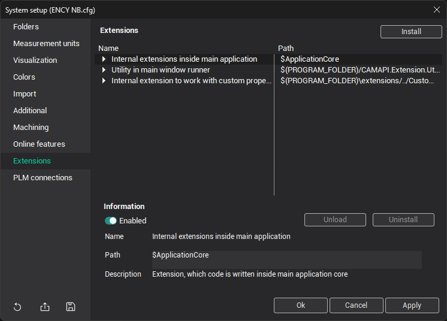
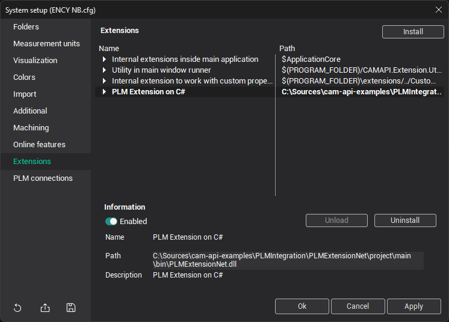
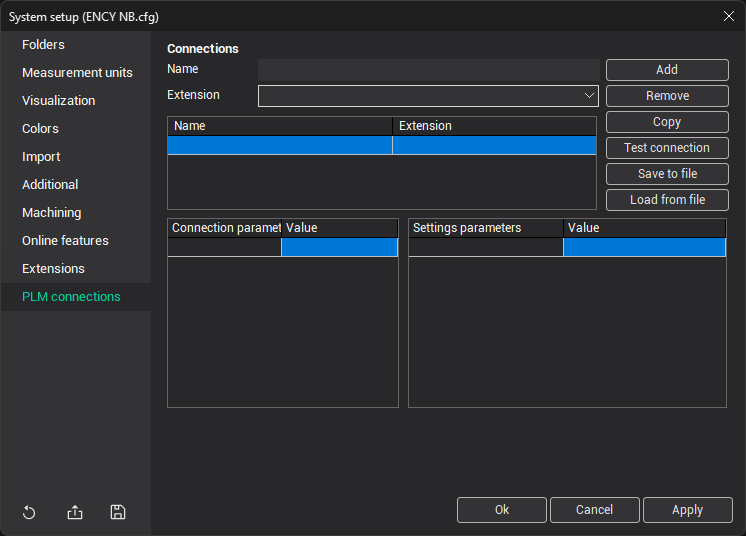
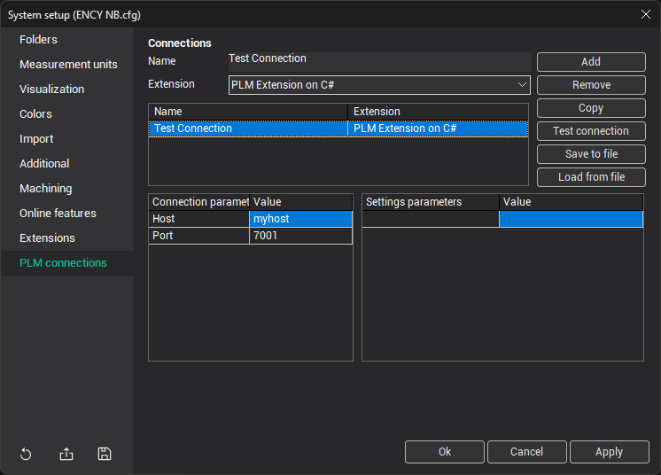

# PLM統合モジュールのインストールと設定

## 統合拡張機能のセットアップ

PLMシステム統合モジュールをセットアップするには、<strong>システム設定</strong>ウィンドウを開き、<strong>拡張機能</strong>タブに移動します。

<strong>インストール</strong>ボタンをクリックします。表示された<strong>ファイルエクスプローラー</strong>ウィンドウで、拡張機能のjsonファイルまたはdextファイルを選択して開きます。インストールに成功すると、次のように表示されます。

拡張機能を無効化またはアンインストールすることもできます。拡張機能一覧から対象の拡張機能を選択し、<strong>有効</strong>のトグルを切り替えるか、<strong>アンインストール</strong>ボタンをクリックします。

拡張機能はコマンドラインインターフェース（CLI）からもインストールできます（ExtensionManagerCLI.exeはプログラムのインストールフォルダにあります）。これを行うには、Windowsのコマンドプロンプトを開き、次のコマンドを入力します：

<strong>ExtensionManagerCLI.exe register-library --path</strong> "[拡張機能のパス]" <strong>--storage stAllUsers</strong>

## PLM接続の設定

接続を作成および設定するには、<strong>システム設定</strong>ウィンドウを開き、<strong>PLM接続</strong>タブに移動します。

<strong>名前</strong>テキストフィールドに接続名を入力し、ドロップダウンメニューからインストール済みのPLM拡張機能を選択します。その後、<strong>追加</strong>ボタンをクリックします。

表示される、あらかじめ用意された接続パラメータや設定パラメータの値を変更することで、選択した接続を設定できます。

また、設定をファイルに保存することも可能です。<strong>ファイルに保存</strong>ボタンをクリックします。このファイルは、<strong>ファイルから読み込む</strong>ボタンをクリックして設定を読み込むために使用できます。

接続を削除することもできます。接続一覧から対象の接続を選択して<strong>削除</strong>ボタンをクリックします。

接続を確認するには、<strong>接続テスト</strong>ボタンをクリックし、アカウントの認証情報を入力します。

変更を適用するには、<strong>適用</strong>または<strong>OK</strong>ボタンをクリックします。
