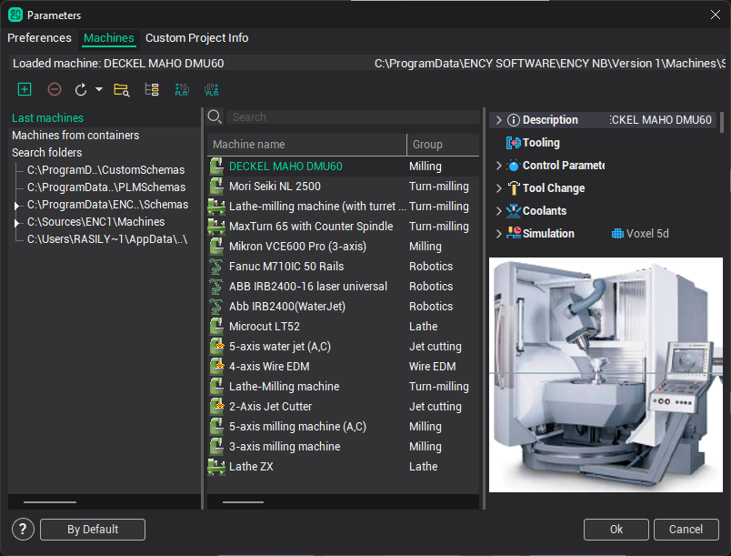
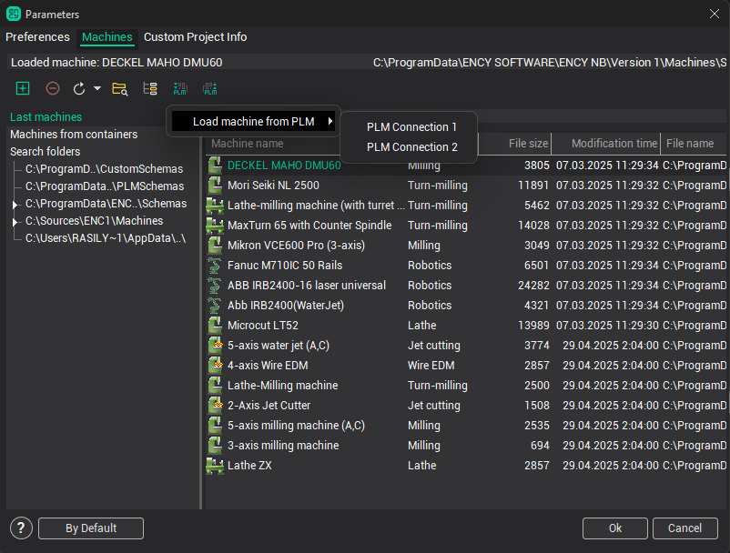
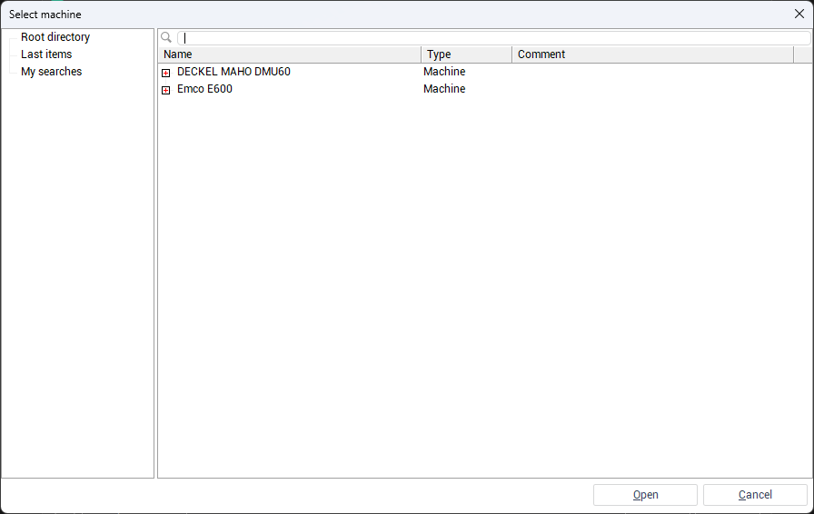
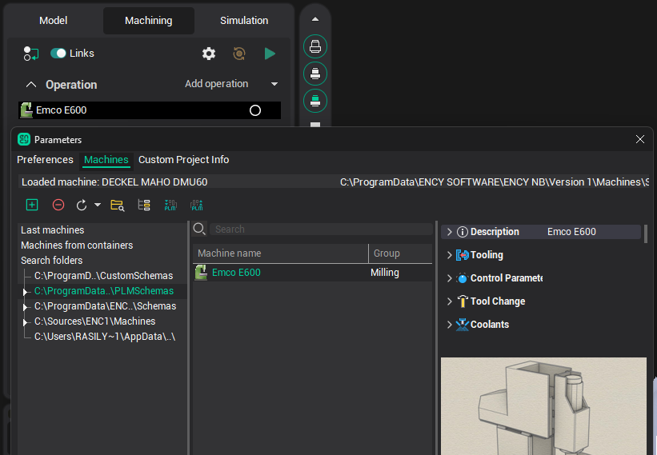
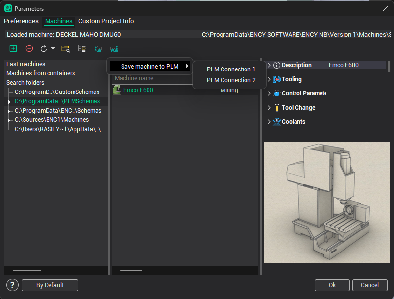
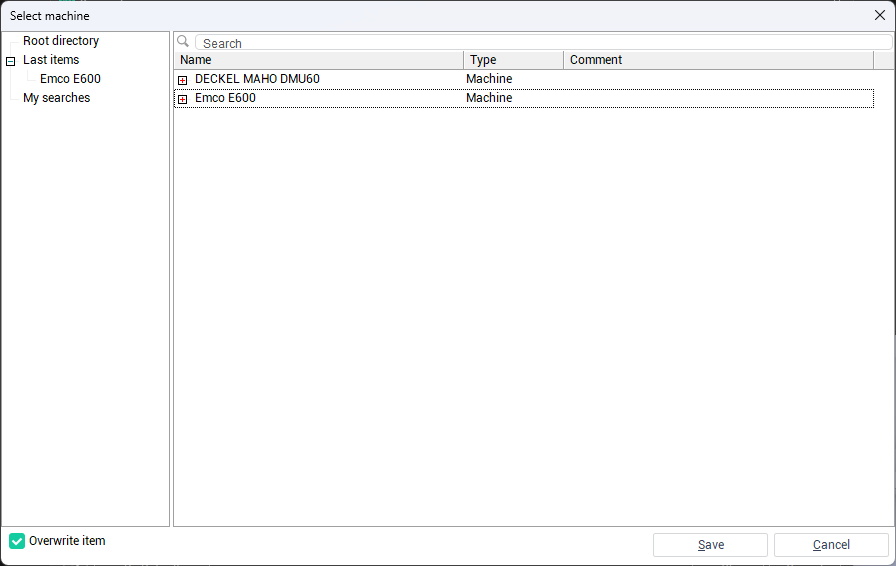
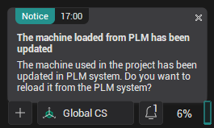
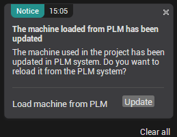

# Carregamento e salvamento de máquina em um sistema externo

Para gerenciar máquinas com um sistema externo, abra a janela <strong>Parameters</strong> e acesse a aba <strong>Machines</strong>. No painel superior dessa aba, estão os botões <strong>Load machine from PLM</strong> e <strong>Save machine to PLM</strong>, que permitem interagir com o sistema externo.

## Carregamento de uma máquina de um sistema externo

Para carregar uma máquina de um sistema externo, clique no botão <strong>Load from PLM</strong>. No menu suspenso, selecione <em>[connection name]</em> para abrir uma janela com a árvore de objetos disponíveis no sistema externo.

Localize a máquina CAM desejada expandindo os objetos aninhados da árvore ou usando a pesquisa por nome. Em seguida, clique no botão <strong>Open</strong>.

A máquina selecionada será carregada e definida como a máquina ativa na janela principal.

## Salvamento de uma máquina em um sistema externo

Para salvar uma máquina em um sistema externo, selecione a máquina que deseja salvar, clique no botão <strong>Save to PLM</strong> e escolha <em>[connection name]</em> no menu suspenso para abrir uma janela com a árvore de objetos disponíveis no sistema externo.

Selecione o elemento de destino no qual os arquivos da máquina devem ser salvos. Para substituir arquivos existentes, marque a caixa de seleção <strong>Overwrite item</strong> e clique no botão <strong>Save</strong>.

Se um elemento da máquina for alterado no sistema externo, uma notificação será exibida na janela principal.

Expanda a notificação e clique no botão <strong>Update</strong> para carregar a versão atualizada da máquina.

Também é possível verificar se há atualizações na janela <strong>Parameters</strong>: clique com o botão direito na máquina e selecione <strong>Check for updates in PLM</strong> no menu de contexto.
