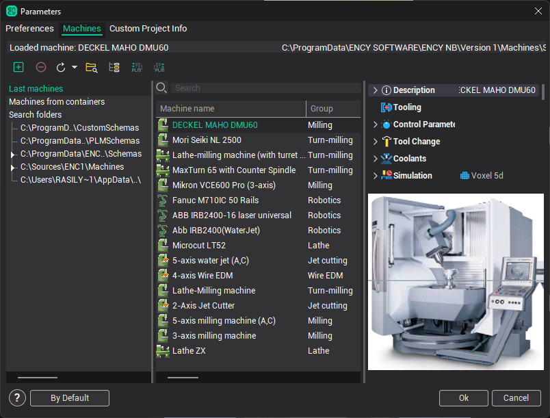
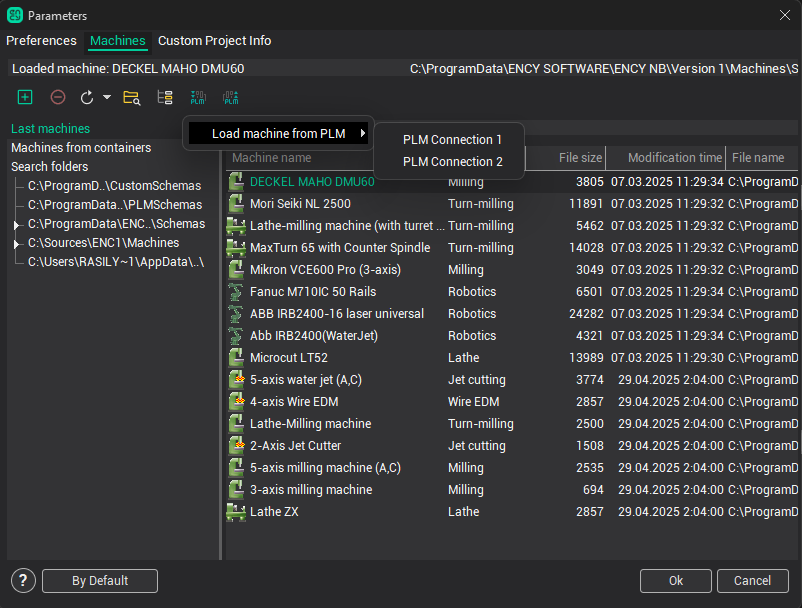
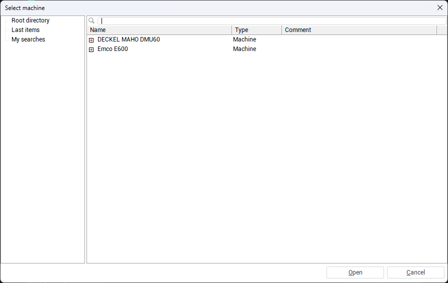
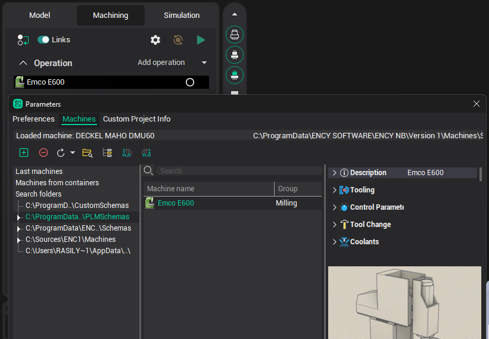
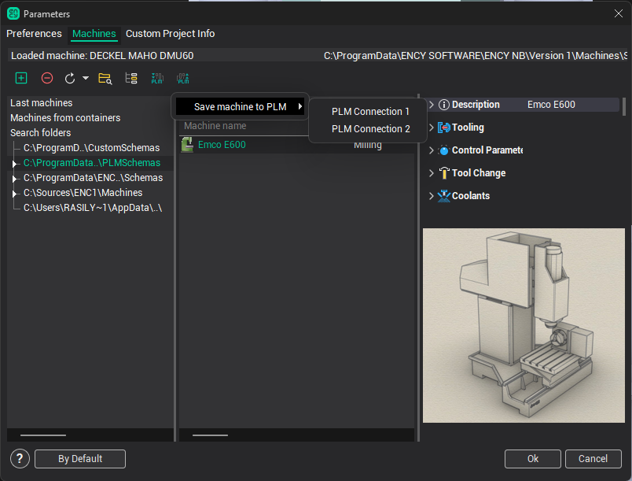
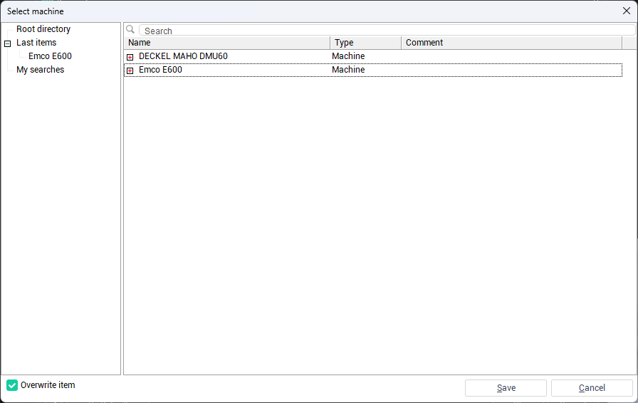
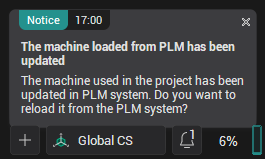
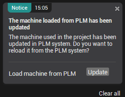

# 外部システムへのマシンの読み込みおよび保存

外部システムを使用してマシンを管理するには、<strong>パラメータ</strong>ウィンドウを開き、<strong>マシン</strong>タブに移動します。このタブの上部パネルには<strong>PLMから機械を読み込む</strong>ボタンと<strong>PLMに機械を保存</strong>ボタンが表示されており、これらを使用して外部システムと連携できます。

## 外部システムからマシンを読み込む

外部システムからマシンを読み込むには、<strong>PLMから機械を読み込む</strong>ボタンをクリックします。ドロップダウンメニューから［接続名］を選択すると、外部システム内で利用可能なオブジェクトをツリー表示したウィンドウが開きます。

ツリー内の階層化されたオブジェクトを展開するか、名前検索を使用して目的のCAMマシンを見つけます。その後、<strong>開く</strong>ボタンをクリックします。

選択したマシンが読み込まれ、メインウィンドウでアクティブなマシンとして設定されます。

## 外部システムへのマシン保存

外部システムにマシンを保存するには、保存したいマシンを選択し、<strong>PLMに保存</strong>ボタンをクリックします。続いて、ドロップダウンメニューから［接続名］を選択すると、外部システムで利用可能なオブジェクトをツリー表示したウィンドウが開きます。

マシンファイルを保存先となる要素を選択します。既存のファイルを上書きする場合は、<strong>アイテムを上書き</strong>チェックボックスにチェックを入れ、その後、<strong>保存</strong>ボタンをクリックします。

外部システムでマシン要素が変更された場合は、メインウィンドウに通知が表示されます。

通知を展開し、<strong>更新</strong>ボタンをクリックすると、更新されたバージョンのマシンが読み込まれます。

更新を確認するには、<strong>パラメータ</strong>ウィンドウでマシンを右クリックし、コンテキストメニューから<strong>PLM で更新を確認</strong>を選択します。
