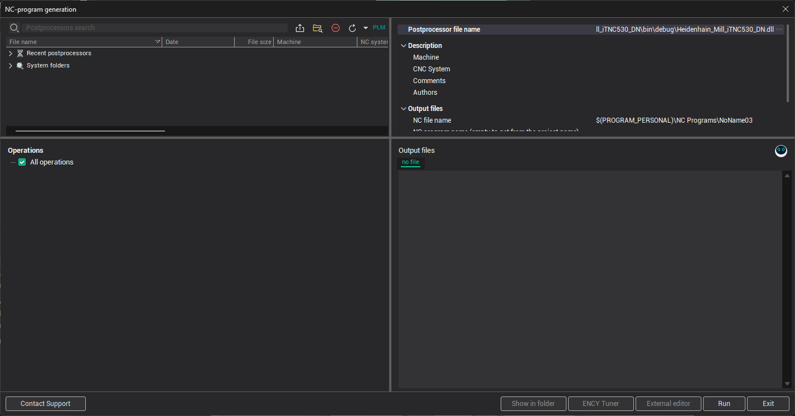
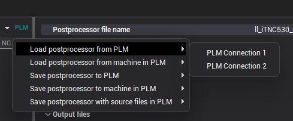
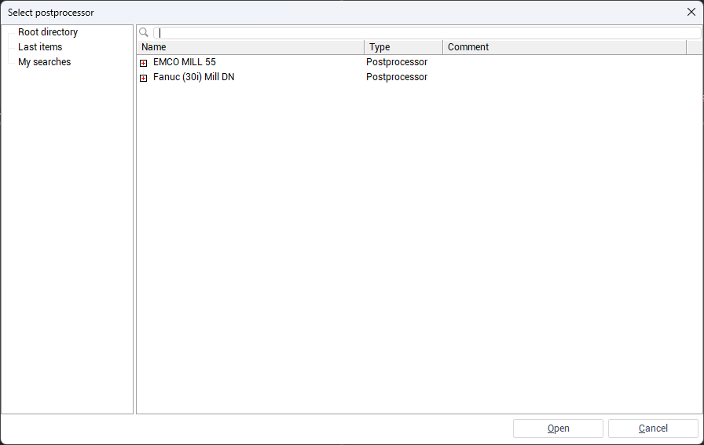
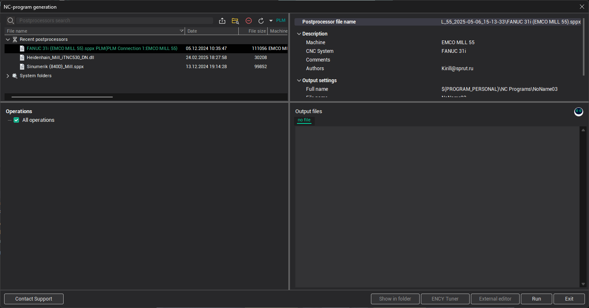
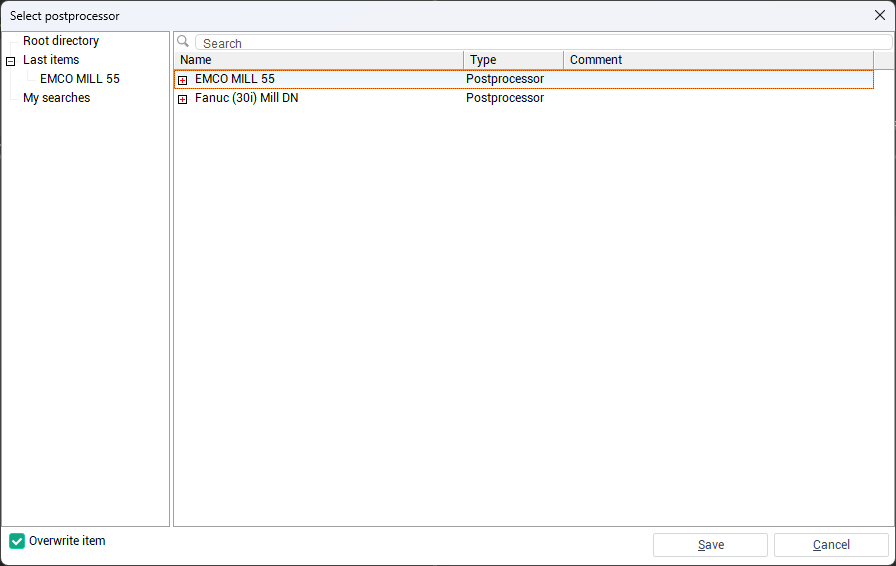
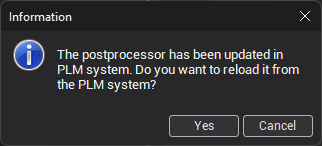

# 外部システムへのポストプロセッサーの読み込みと保存

このウィンドウの上部パネルには<strong>PLM</strong>ボタンがあります。このボタンをクリックすると、以下のオプションを含むドロップダウンメニューが開きます。

- <strong>PLMからポストプロセッサーを読み込む</strong>
- <strong>PLM内の機械からポストプロセッサーを読み込む</strong>
- <strong>ポストプロセッサーをPLMに保存</strong>
- <strong>ポストプロセッサーをPLM内のマシンに保存</strong>
- <strong>ポストプロセッサーをソースファイルと共にPLMに保存</strong>

これらの各オプションには、<em>複数の接続が設定されている場合にのみ、PLM接続を選択するためのサブメニューが表示されます。</em>

## 外部システムからポストプロセッサを読み込む

外部システムからポストプロセッサを読み込むには、<strong>PLM</strong> →<strong>PLMからポストプロセッサーを読み込む</strong>→ [接続名]をクリックします。外部システムで利用可能なオブジェクトをツリー表示したウィンドウが開きます。

オブジェクトツリーを操作するか、名前検索を使用して目的のポストプロセッサを探し、<strong>開く</strong>をクリックします。選択したポストプロセッサが読み込まれ、外部システムから取得されたことが分かる名前で<strong>最近のポストプロセッサー</strong>リストに表示されます。

外部システム内の特定のマシンに関連付けられたポストプロセッサを読み込むには、<strong>PLM</strong> →<strong>PLM内の機械からポストプロセッサーを読み込む</strong>→ [接続名]をクリックします。

開いたウィンドウで目的のポストプロセッサが格納されているマシンを参照し、選択して<strong>開く</strong>をクリックすると、アプリケーションに読み込まれます。

## 外部システムへポストプロセッサーを保存

外部システムへポストプロセッサを保存するには、保存したいポストプロセッサーを選択し、<strong>PLM</strong> →<strong>ポストプロセッサーをPLMに保存</strong>→ [接続名]」をクリックします。

外部システムのオブジェクトツリーを表示したウィンドウが開きます。ポストプロセッサーの保存先となるエレメントを選択してください。既存ファイルを上書きする場合は、<strong>アイテムを上書き</strong>チェックボックスをオンにし、<strong>保存</strong>をクリックします。

コンパイル済みポストプロセッサーとそのソースファイルの両方を保存するには、<strong>PLM</strong> →<strong>ポストプロセッサーをソースファイルと共にPLMに保存</strong> → [接続名]」を選択します。このオプションは、ポストプロセッサーの拡張子が.<strong>dll</strong> であり、関連するソースファイルが存在する場合にのみ使用できます。ソースファイルはコンパイル済みファイルとともにアーカイブとして保存されます。

外部システム内の特定のマシンにポストプロセッサを関連付けるには、<strong>PLM</strong> → <strong>PLM</strong> →<strong>ポストプロセッサーをPLM内のマシンに保存</strong>→ [接続名]をクリックします。

その後は通常の保存と同じ手順で保存先を選択し、必要に応じて<strong>アイテムを上書き</strong>をオンにして、<strong>保存</strong>をクリックします。

外部システム内でポストプロセッサーが最後に読み込まれて以降に更新されている場合、そのポストプロセッサーを実行しようとすると情報ダイアログが表示されます。このダイアログでは、新しいバージョンが利用可能であることが通知されます。次のいずれかの操作を選択できます。

- <strong>はい</strong>をクリックすると、更新されたポストプロセッサをダウンロードして適用します。
- <strong>キャンセル</strong>をクリックすると、更新は行わず、現在読み込まれているバージョンを引き続き使用します。

