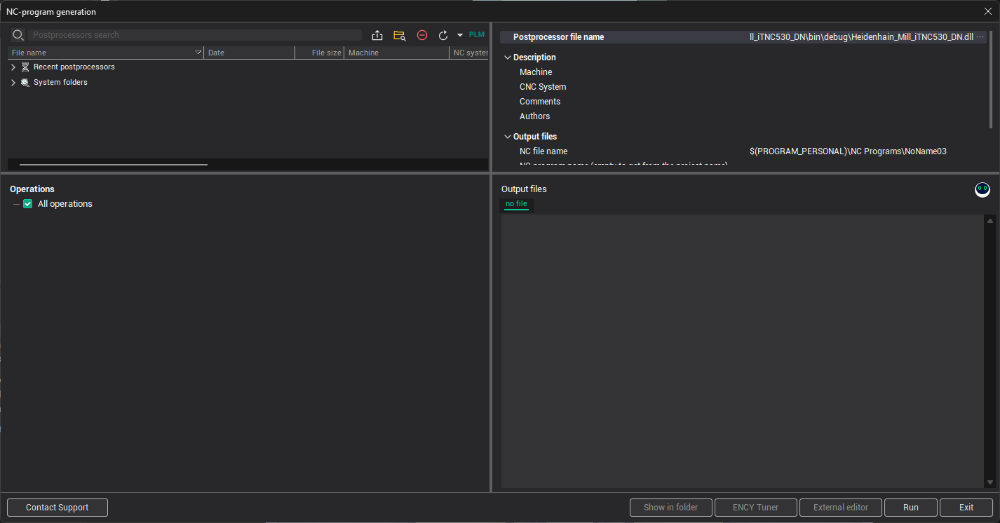
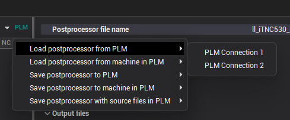
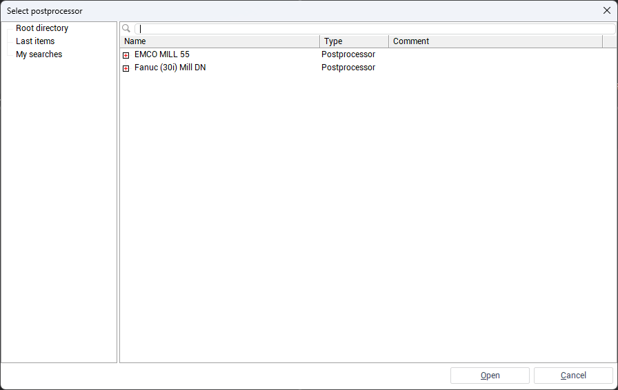
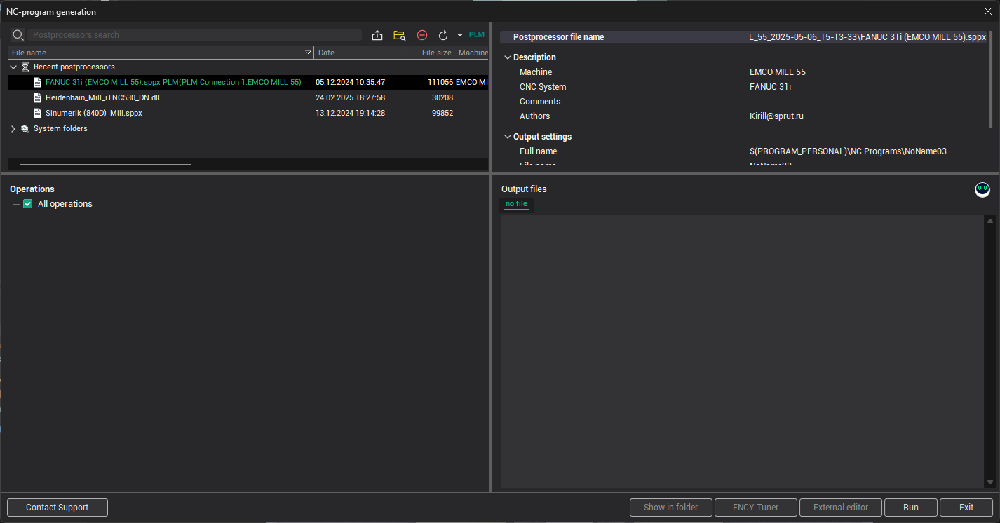
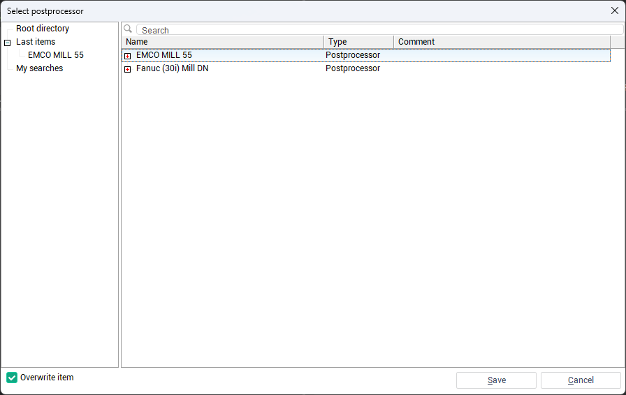
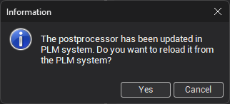

# Loading and Saving Postprocessors to an External System

To manage postprocessors with an external system, open the **NC-program generation** window.

In the upper panel of this window, there is a **PLM** button. Clicking this button opens a drop-down menu with the following options:

- **Load postprocessor from PLM**
- **Load postprocessor from machine in PLM**
- **Save postprocessor to PLM**
- **Save postprocessor to machine in PLM**
- **Save postprocessor with source files** **to PLM**

Each of these options includes a submenu for selecting a PLM connection *only if more than one connection is configured*.

## Loading a Postprocessor from an External System

To load a postprocessor from an external system, click **PLM** → **Load postprocessor from PLM**→ *[connection name]*. A window will appear displaying a tree of available objects from the external system.

Locate the required postprocessor by navigating the object tree or using the name search, then click **Open**. The selected postprocessor will be loaded and displayed in the **Recent postprocessors** list with a name that reflects its origin from the external system.

To load a postprocessor associated with a specific machine in the external system, click **PLM** → **Load postprocessor from machine in PLM** → *[connection name]*. In the opened window, browse to the machine that contains the postprocessor, then select it and click **Open** to load it into the application.

## Saving a Postprocessor to an External System

To save a machine to an external system, select the postprocessor you want to save, then click **PLM** → **Save postprocessor to PLM** → *[connection name]*.

A window will open displaying the object tree from the external system. Select the destination element where the postprocessor should be saved. To overwrite existing files, enable the **Overwrite item** checkbox, then click **Save**.

To save both the compiled postprocessor and its source files, select **PLM** → **Save postprocessor with source files** **to PLM** → *[connection name]*. This option is available only if the postprocessor has a **.dll** extension and associated source files. The source files will be saved as an archive along with the compiled file.

To associate a postprocessor with a specific machine in the external system, click **PLM** → **Save postprocessor to machine in PLM** → *[connection name]*.

Then, follow the same steps as in the standard saving process — select the destination location, enable **Overwrite item** if necessary, and click **Save**.

If a postprocessor has been updated in the external system since it was last loaded, an informational dialog box will appear when you attempt to run it. The dialog notifies you that a newer version is available. You can choose one of the following actions:

- Click **Yes** to download and apply the updated version of the postprocessor.
- Click **Cancel** to continue using the currently loaded version without updating.

