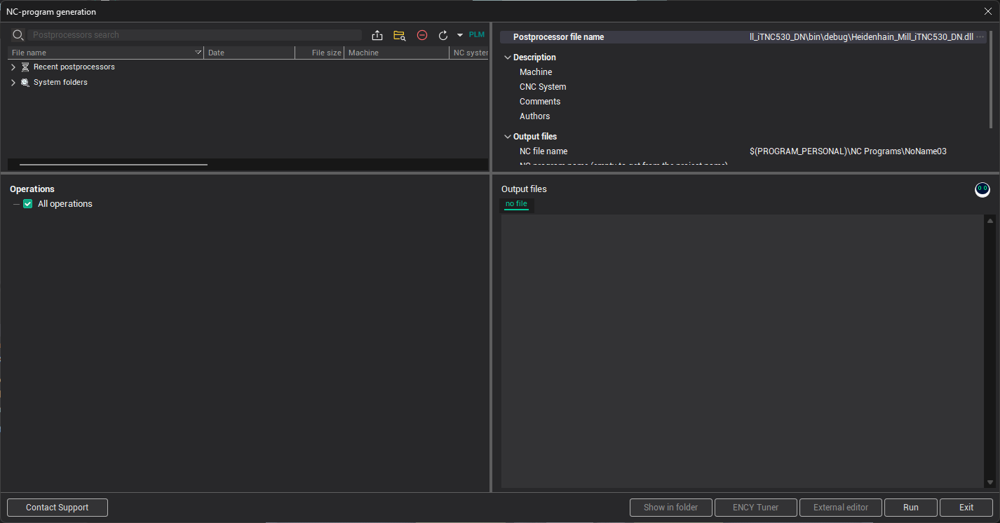
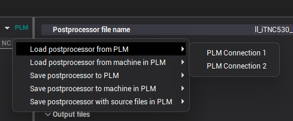
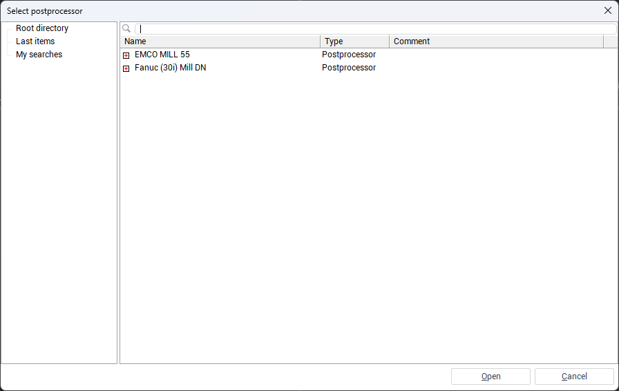
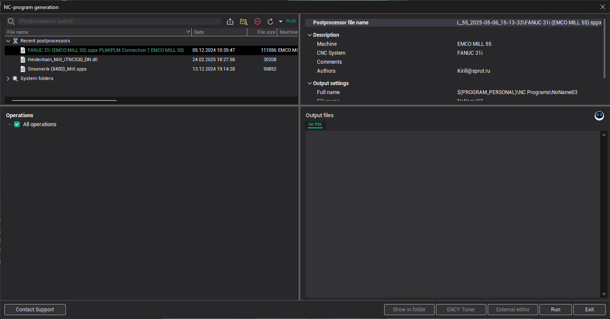
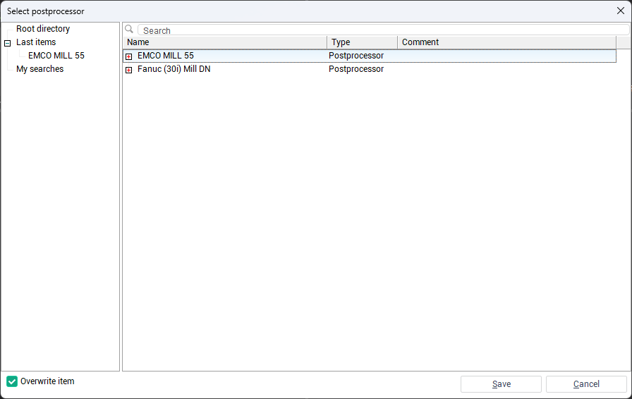
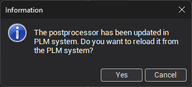

# Caricamento e salvataggio dei postprocessori in un sistema esterno

Per gestire i postprocessori con un sistema esterno, aprire la finestra <strong>N</strong><strong>C-program generation</strong> (generazione del programma NC).

Nel pannello superiore di questa finestra è presente il pulsante <strong>PLM</strong>. Facendo clic su di esso si apre un menu a discesa con le seguenti opzioni:

- <strong>Load postprocessor from PLM</strong>
- <strong>Load postprocessor from machine in PLM</strong>
- <strong>Save postprocessor to PLM</strong>
- <strong>Save postprocessor to machine in PLM</strong>
- <strong>Save postprocessor with source file</strong><strong>s</strong> <strong>to PLM</strong>

Ognuna di queste opzioni include un sottomenu per la selezione di una connessione PLM <em>solo se è configurata più di una connessione</em>.

## Caricamento di un postprocessore da un sistema esterno

Per caricare un postprocessore da un sistema esterno, fare clic su <strong>PLM</strong> → <strong>Load postprocessor from PLM</strong>→ <em>[nome della connessione]</em>. Viene visualizzata una finestra con l'albero degli oggetti disponibili nel sistema esterno.

Individuare il postprocessore richiesto navigando nell'albero degli oggetti o utilizzando la ricerca per nome, quindi fare clic su <strong>Open</strong> (apri). Il postprocessore selezionato viene caricato e visualizzato nell'elenco <strong>Recent p</strong><strong>ostprocessors</strong> (postprocessori recenti) con un nome che ne indica la provenienza dal sistema esterno.

Per caricare un postprocessore associato a una macchina specifica nel sistema esterno, fare clic su <strong>PLM</strong> → <strong>Load postprocessor from machine in PLM</strong> → <em>[nome della connessione]</em>. Nella finestra che si apre, individuare la macchina che contiene il postprocessore, quindi selezionarlo e fare clic su <strong>Open</strong> per caricarlo nell'applicazione.

## Salvataggio di un postprocessore in un sistema esterno

Per salvare una macchina in un sistema esterno, selezionare il postprocessore da salvare, quindi fare clic su <strong>PLM</strong> → <strong>Save postprocessor to PLM</strong> → <em>[nome della connessione]</em>.

Si apre una finestra con l'albero degli oggetti del sistema esterno. Selezionare l'elemento di destinazione in cui salvare il postprocessore. Per sovrascrivere i file esistenti, attivare la casella di controllo <strong>Overwrite item</strong> (sovrascrivi elemento), quindi fare clic su <strong>Save</strong> (salva).

Per salvare sia il postprocessore compilato sia i relativi file sorgente, selezionare <strong>PLM</strong> → <strong>Save postprocessor with source file</strong><strong>s</strong> <strong>to PLM</strong> → <em>[nome della connessione]</em>. Questa opzione è disponibile solo se il postprocessore ha estensione <strong>.dll</strong> e dispone di file sorgente associati. I file sorgente vengono salvati come archivio insieme al file compilato.

Per associare un postprocessore a una macchina specifica nel sistema esterno, fare clic su <strong>PLM</strong> → <strong>Save postprocessor to machine in PLM</strong> → <em>[nome della connessione]</em>.

Quindi seguire gli stessi passaggi del salvataggio standard: selezionare la posizione di destinazione, attivare <strong>Overwrite item</strong> se necessario e fare clic su <strong>Save</strong>.

Se un postprocessore è stato aggiornato nel sistema esterno dopo l'ultimo caricamento, al tentativo di eseguirlo viene visualizzata una finestra di dialogo informativa. La finestra segnala che è disponibile una versione più recente. È possibile scegliere una delle seguenti azioni:

- Fare clic su <strong>Yes</strong> per scaricare e applicare la versione aggiornata del postprocessore.
- Fare clic su <strong>Cancel</strong> per continuare a utilizzare la versione attualmente caricata senza aggiornarla.

