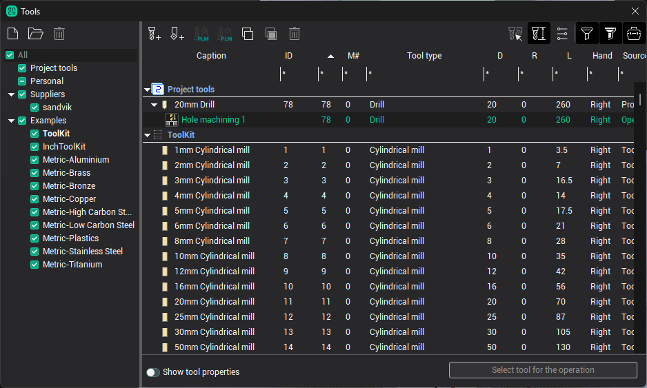
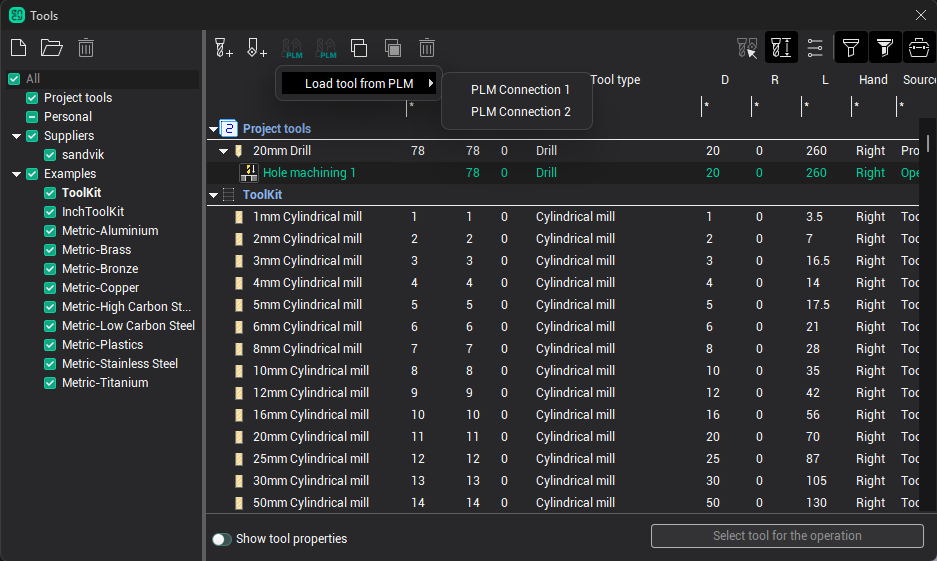
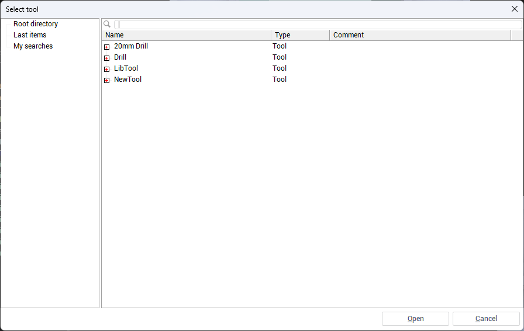
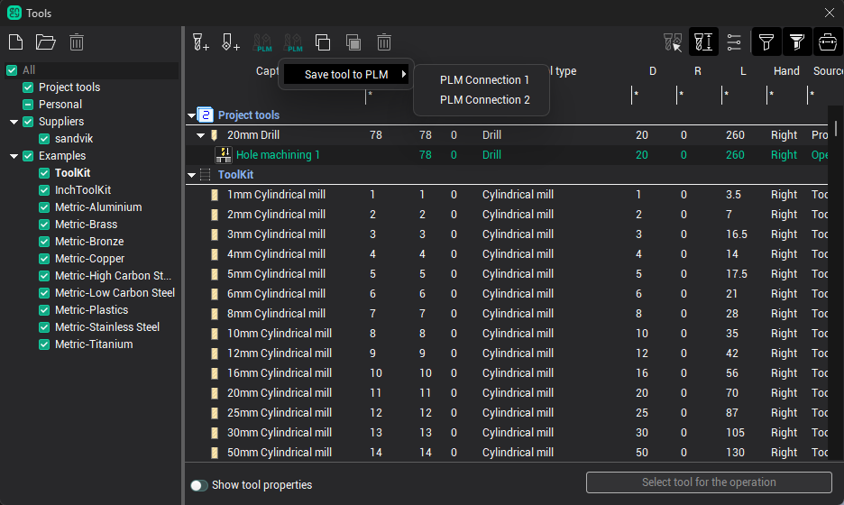
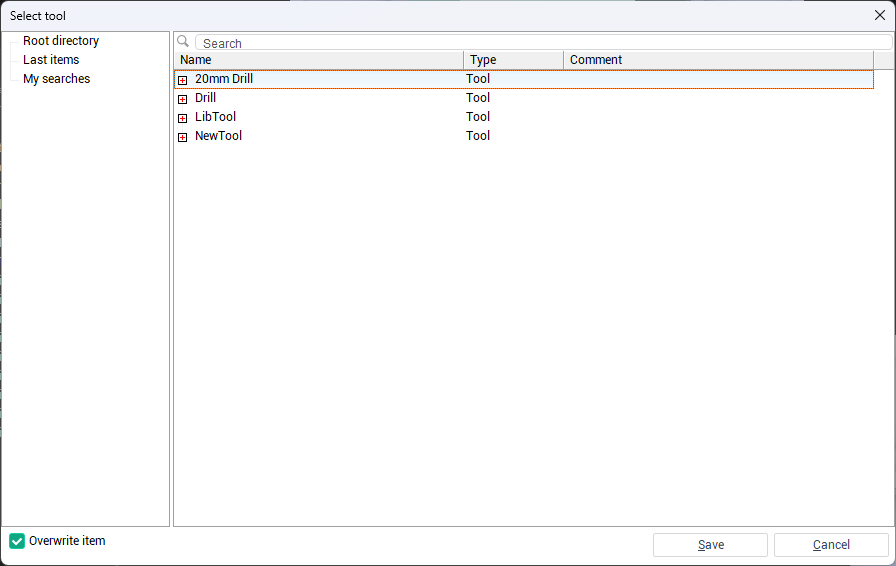

# Carregamento e salvamento de ferramentas em um sistema externo

Para gerenciar ferramentas em um sistema externo, abra a janela **Tools**. No painel superior estão os botões **Load tool from PLM** e **Save tool to PLM**.

## Carregamento de ferramentas de um sistema externo

Clique em **Load tool from PLM** e selecione a conexão necessária.

Será exibida uma janela com a árvore de objetos disponíveis. Selecione o conjunto de ferramentas desejado e clique em **Open**. As ferramentas serão carregadas e exibidas na janela **Tools**.

## Salvamento de ferramentas em um sistema externo

Selecione a ferramenta, clique em **Save tool to PLM**, escolha a conexão desejada e selecione o destino na estrutura do sistema externo.

Para substituir arquivos existentes, marque **Overwrite item**. Em seguida, clique em **Save**.

