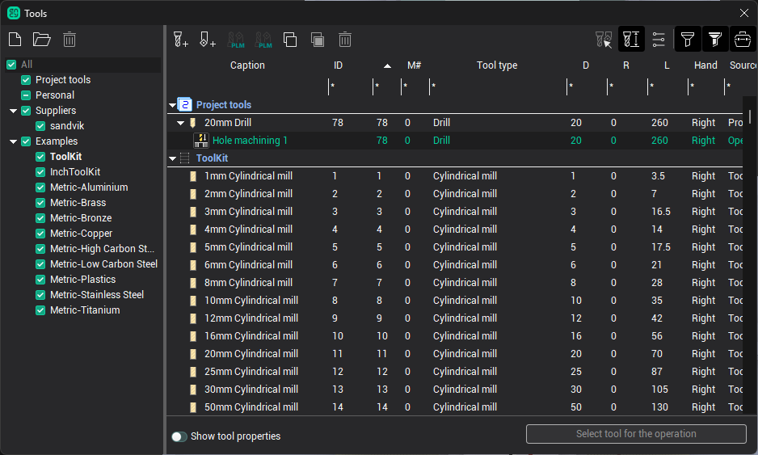
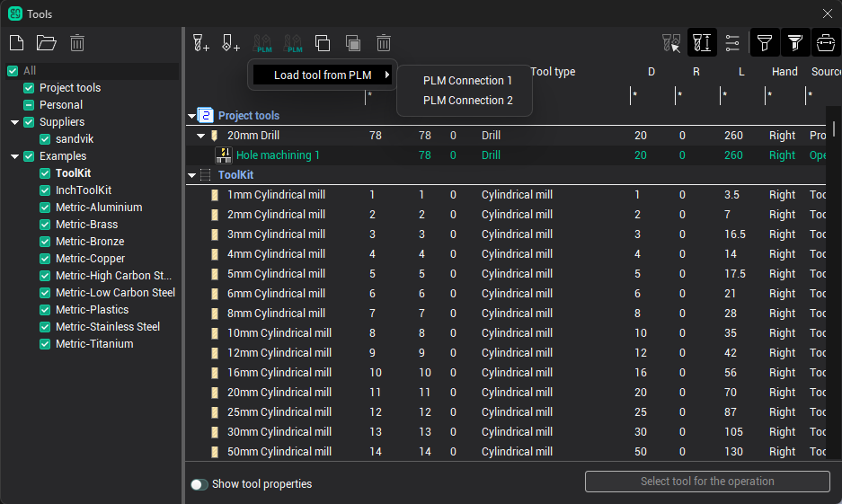
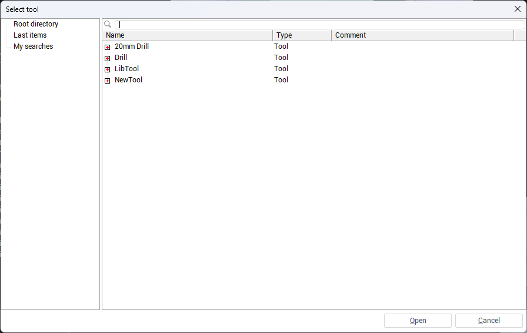
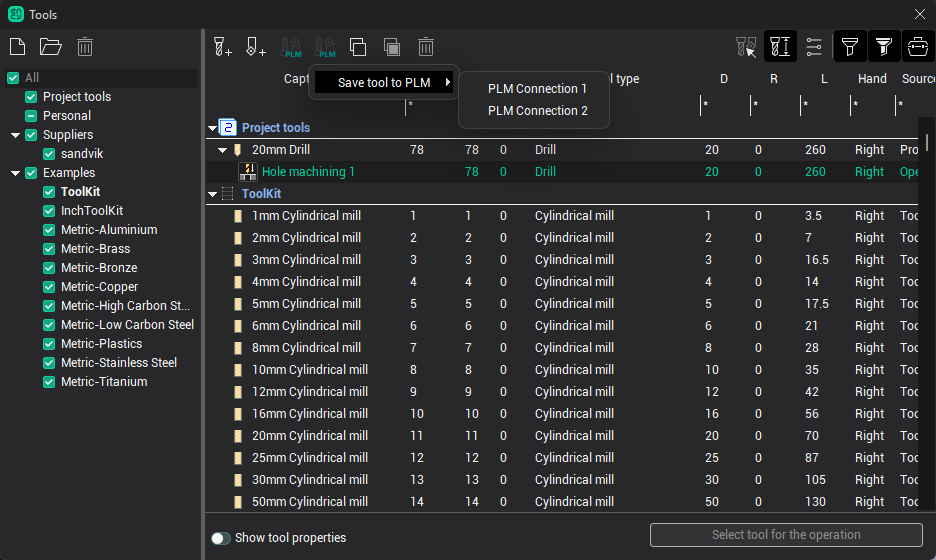
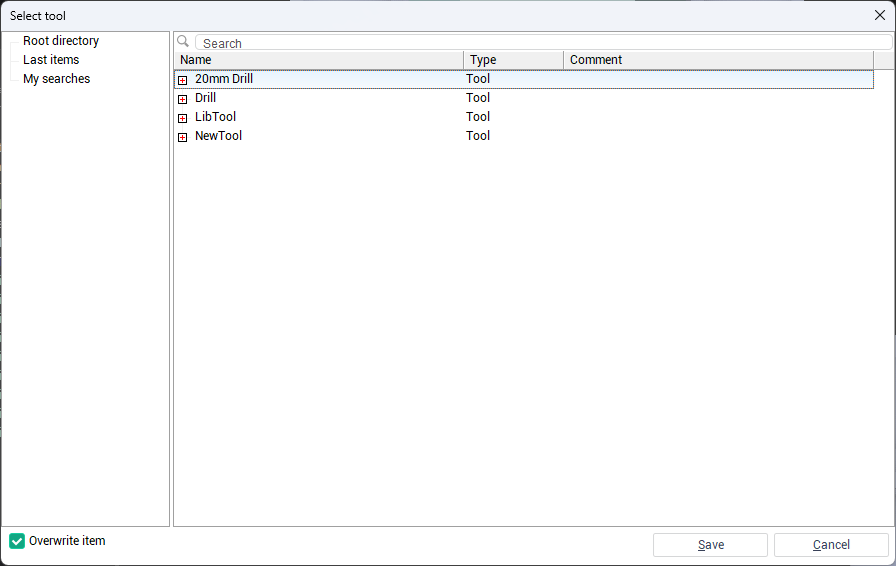

# Loading and Saving Tools to an External System

To manage tools with an external system, open the **Tools** window. In the upper panel, you will find the **Load** **tool** **from PLM** and **Save** **tool** **to PLM** buttons.

## Loading Tools from an External System

Click **Load** **tool** **from PLM**, then choose the required connection.

 A window will appear showing a tree of available objects. Select the tool set you want to load and click **Open**. The tools will be imported and displayed in the **Tools** window.

## Saving Tools to an External System

Select a tool, click **Save** **tool** **to PLM**, select the desired connection, and choose the destination in the external system's structure.

To overwrite existing files, enable the **Overwrite item** checkbox. Then click **Save** to complete the operation.

