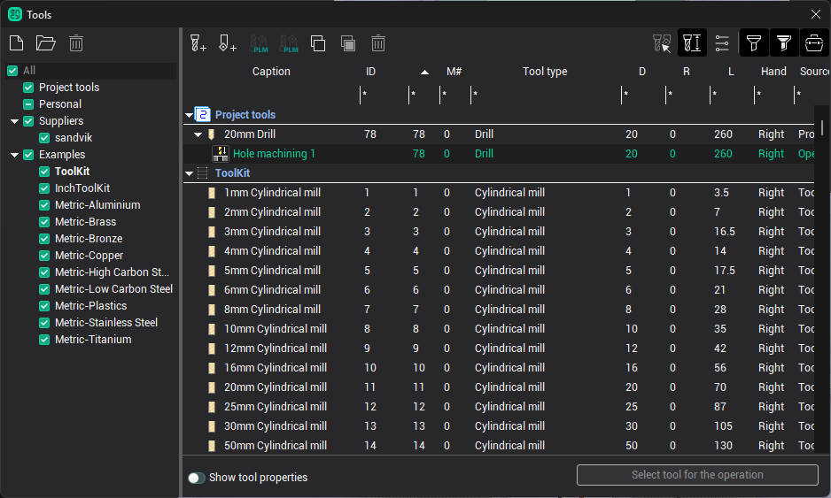
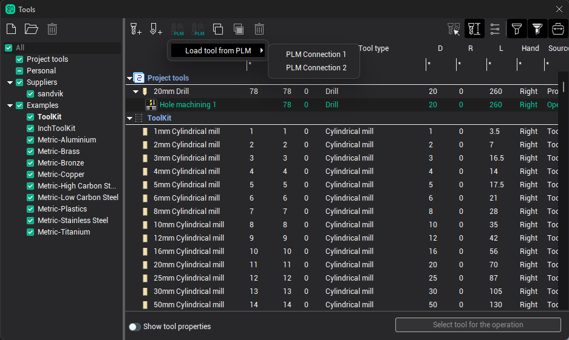
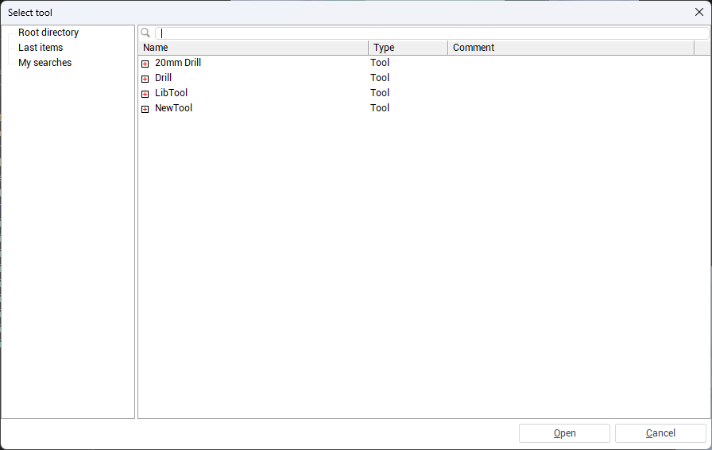
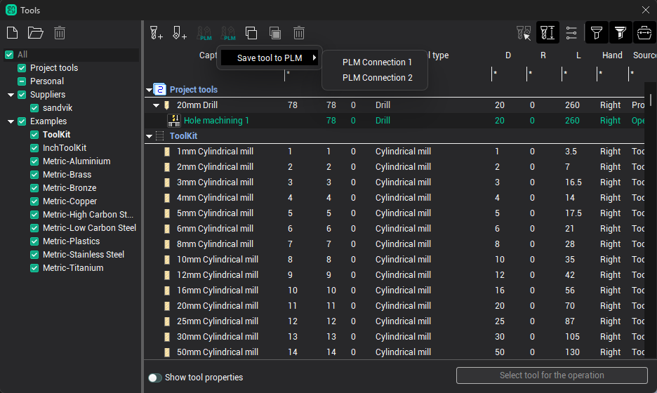
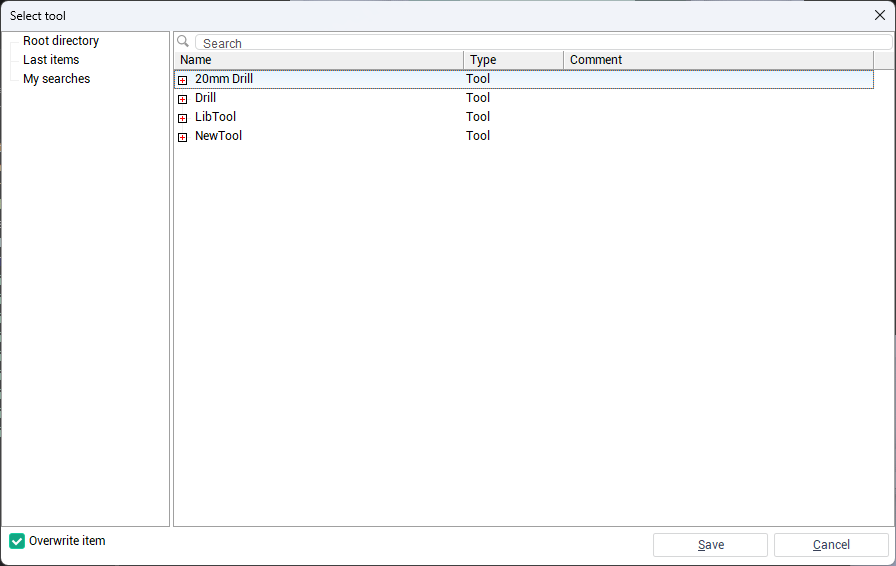

# 外部システムへの工具の読み込みと保存

外部システムで工具を管理するには、<strong>工具</strong>ウィンドウを開きます。

上部パネルには、<strong>PLMから工具を読み込む</strong>と<strong>PLMへ工具を保存</strong>ボタンがあります。

## 外部システムからツールを読み込む

外部システムから工具を読み込むには、<strong>PLMから工具を読み込む</strong>をクリックし、使用する接続を選択します。

利用可能なオブジェクトをツリー表示したウィンドウが開きます。読み込みたい工具セットを選択し、<strong>開く</strong>をクリックしてください。工具がインポートされ、<strong>工具</strong>ウィンドウに表示されます。

## 外部システムへ工具を保存

外部システムへツールを保存するには、工具を選択し、<strong>PLMへ工具を保存</strong>をクリックして、使用する接続を選択します。続いて、外部システムの構造内で保存先を選択します。

既存のファイルを上書きする場合は、<strong>アイテムを上書き</strong>チェックボックスをオンにしてください。その後、<strong>保存</strong>をクリックして操作を完了します。

