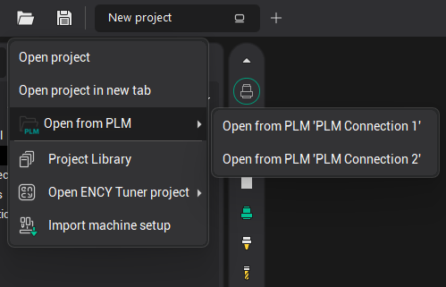
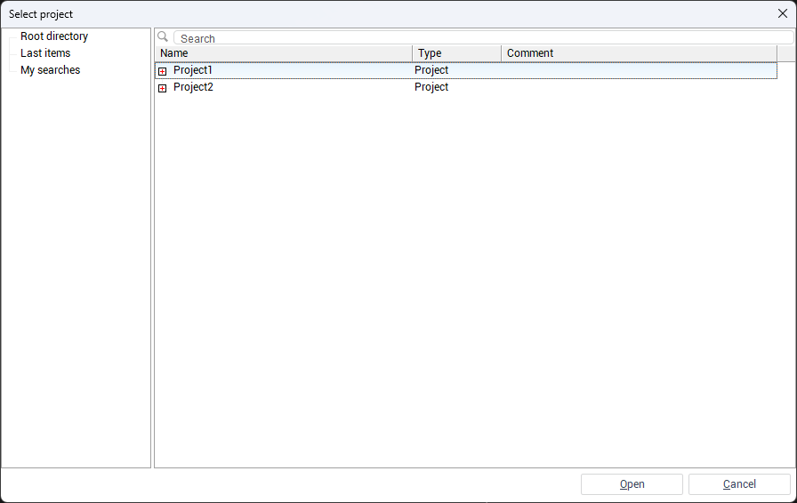
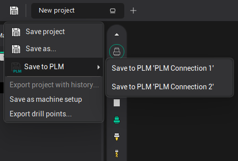
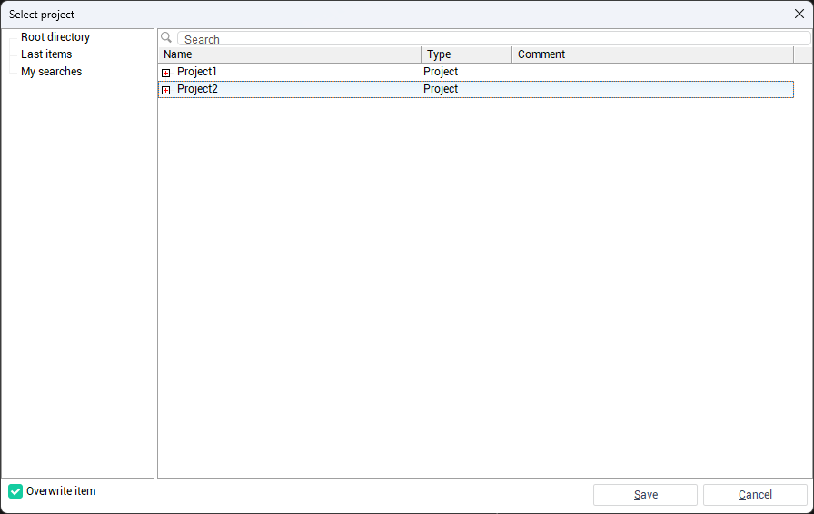

# Opening and Saving Projects to an External System

To manage projects with an external system, use the **Open Project** and **Save Project** buttons in the **main window** toolbar. When hovering over these buttons, a drop-down menu appears with additional options, including **PLM-related** **option**. Selecting this item reveals a submenu with all available PLM connections.

**Note:** The **PLM-related** **option** appears only if at least one PLM connection is configured.

## Opening a Project from an External System

Hover over the **Open Project** button, select **Open from** **PLM** → **Open from** **PLM** *[connection name]*.

 A window will open displaying the object tree from the external system. Locate and select the desired project, then click **Open**. The project will be opened.

## Saving a Project to an External System

Hover over the **Save Project** button, select **Save Project** **to** **PLM** → **Save Project** **to** **PLM** *[connection name]*.

 A window will open displaying the object tree from the external system. Choose the location to save the project, optionally enable the **Overwrite item** checkbox, and click **Save**.

