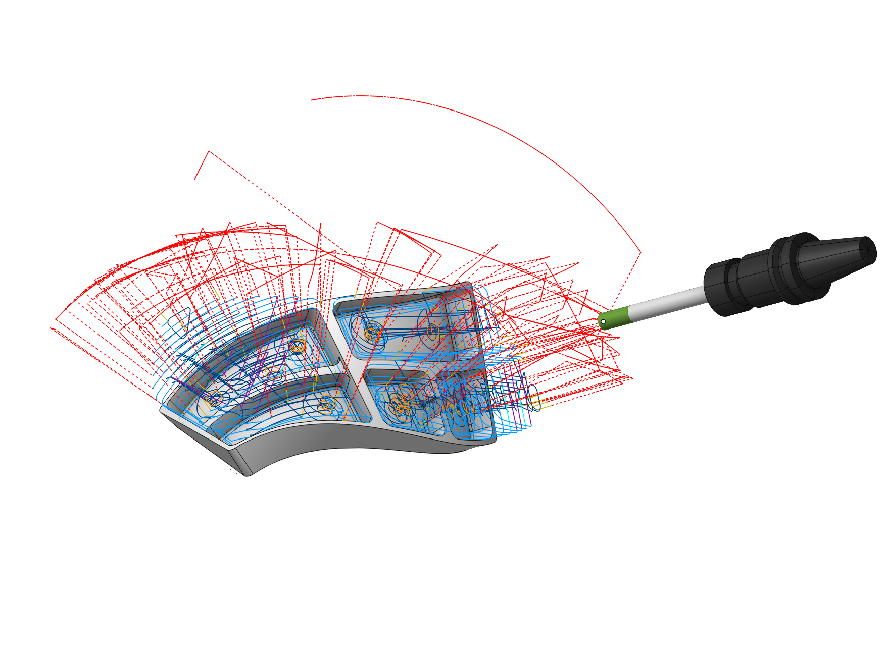

# Desbaste 5D por linhas de nível

## Área de aplicação:

Usinagem especializada de bolsões com fundo curvo, baseada na <strong>operação Waterline</strong>.

### Definição da tarefa:

<strong>Floor surfaces.</strong> Superfície de controle. Normalmente definida pelo fundo do bolsão.

<strong>Job Zone curve.</strong> As zonas de trabalho são usadas para definir as áreas da peça que devem ser usinadas por operações de fresamento de desbaste e acabamento. Nesta operação, só é aplicável uma zona de trabalho <strong>fechada</strong>. [Detalhes](10151.md)

<strong>Propriedades.</strong> Exibe as propriedades de um elemento. É possível adicionar sobremetal. Esse menu também pode ser aberto com um clique duplo em um item da lista.

<strong>Excluir.</strong> Remove um item da lista.

<strong>Restrições.</strong> Permite restringir as áreas que não devem ser usinadas. [Detalhes](101231.md)

### Estratégia:

#### Estratégia.

Esse parâmetro permite obter um percurso da ferramenta adaptativo ou equidistante ao executar operações de usinagem de bolsões. Esse grupo de parâmetros funciona de forma semelhante à <strong>operação de desbaste por linhas de nível</strong>. [Detalhes](736.md)

#### Níveis de usinagem.

Define o intervalo de usinagem ao longo do eixo da ferramenta.

Clique aqui para expandir...

<strong>Auto top level.</strong> Se a opção estiver marcada, o nível superior é calculado automaticamente com base no bruto.

5D.png)

Alguns grupos de parâmetros funcionam de forma semelhante à <strong>operação de desbaste por linhas de nível</strong>. [Detalhes](736.md)

#### Lado da face.

Determina o sentido da usinagem a partir da superfície do fundo do bolsão.

Clique aqui para expandir...

<strong>Front.</strong> A ferramenta só pode usinar pelo lado do sentido positivo do vetor normal da superfície.

.png)

<strong>Back.</strong> A ferramenta só pode usinar pelo lado oposto ao vetor normal da superfície.

.png)

#### Passo de profundidade.

Material removido em uma passada ao longo do eixo da ferramenta entre os níveis <strong>superior</strong> e <strong>inferior</strong>.

Clique aqui para expandir...

#### Tipo de fresamento.

Pode ser definido em quase todas as operações, exceto nas operações de usinagem de curvas. Permite controlar o tipo de fresamento necessário (concordante ou discordante) durante o cálculo do percurso da ferramenta. Esse grupo de parâmetros funciona de forma semelhante à <strong>operação de desbaste por linhas de nível</strong>. [Detalhes](736.md)

### Parâmetros:

Esta aba contém os principais parâmetros de controle da peça, do bruto, dos dispositivos de fixação e de outros elementos que permitem modificar o percurso da ferramenta. [Detalhes](100112.md)

### Ligações e entradas/saídas:

Na aba **Links/Leads**, são definidos os parâmetros dos movimentos rápidos: aproximação a partir da posição de troca da ferramenta, entrada no início do movimento de trabalho, saída após o último corte, transições entre passadas e retorno ao ponto de troca. É possível configurar a sequência dos movimentos ao longo das coordenadas, seus percursos e as distâncias dos deslocamentos.

Clique aqui para expandir.

**Componentes:**

**Aproximação/retorno.** Controla os movimentos da ferramenta entre a posição de troca e o início do percurso de entrada, nos dois sentidos. [Detalhes](100116.md)

**Movimentos seguros.** Define o tipo de superfície de segurança e sua distância ao bruto. Essa superfície permite as transições entre superfícies ou percursos usinados; a primeira etapa da aproximação ou do retorno é realizada em direção a ela. [Detalhes](100117.md)

**Ligações.** Define as regras das ligações de entrada e saída e das ligações entre movimentos de trabalho. [Detalhes](100120.md)

**Permitir mergulhos.** Permite usinar cavidades fechadas. Quando uma cavidade não pode ser usinada a partir do exterior, o sistema CAM gera um movimento de mergulho. [Detalhes](744.md)

**Distâncias.** Define as distâncias usadas nas regras de ligação e na troca de avanços. [Detalhes](100139.md)

### Avanços e velocidades:

Esta janela permite definir a rotação do fuso, o avanço rápido e os avanços dos diferentes trechos do percurso. A rotação do fuso pode ser definida em rotações por minuto ou pela velocidade de corte. O valor de referência fica sublinhado; o outro valor é recalculado a partir dele, considerando o diâmetro da ferramenta. [Detalhes](100142.md)

### Transformações:

Conjunto de parâmetros da operação que permite executar a conversão de coordenadas do percurso da ferramenta calculado dentro da operação. [Detalhes](10168.md)

### Peça:

A peça é um grupo de elementos geométricos que define a região a ser verificada quanto a cortes indevidos. [Detalhes](330.md)

### Bruto:

O modelo do bruto de uma operação define o material a ser usinado. [Detalhes](738.md)

### Dispositivos de fixação:

Os dispositivos de fixação normalmente incluem mandris, garras, grampos e outros elementos de fixação, além de áreas de restrição de qualquer natureza. [Detalhes](10283.md)
