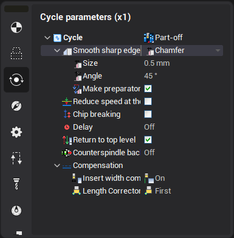

# Ciclo de corte da peça

.png)

O ciclo de corte (part-off) do torno foi projetado para separar de forma simples a peça usinada pronta do restante do bruto, com o acabamento simultâneo da face oposta da peça. O contorno de trabalho é determinado automaticamente como o lado extremo (esquerdo ou direito) da peça, do ponto mais alto ao ponto mais baixo do bruto.

É possível definir os parâmetros do chanfro ou do arredondamento para obter uma aresta suave na face acabada da peça pronta. Também é possível ativar a quebra de cavaco durante o corte e uma pausa no fundo ou em cada pico.

O retorno ao nível superior pode ser desativado se você quiser usar a ferramenta atual como um batente para a barra ejetada de um alimentador.

Se a compensação da largura da pastilha estiver ativada, a largura da ferramenta pode ser adicionada automaticamente à coordenada axial da face usinada. O corretor de comprimento da ferramenta efetivo (esquerdo ou direito) pode ser alternado facilmente.

O parâmetro de recuo do contrafuso permite definir a distância que o contrafuso deve recuar após terminar o corte. Aqui também deve ser definido o nome do eixo que realiza os movimentos axiais do contrafuso.
