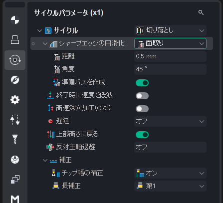

# 切り落としサイクル

切り落としサイクルは、加工済みのパーツをワークの残り部分から簡単に分離すると同時に、パーツの反対側の端面を仕上げ加工できるように設計されています。

加工輪郭は、ワークの最高点から最低点までの範囲において、パーツの最大（左側または右側の）の端面として自動的に決定されます。

完成したパーツの仕上げ面のエッジを滑らかにするために、面取りまたはフィレットのパラメータを設定できます。また、突切り加工中の切りくず切断や、底部または各ピーク位置でのドウェルを有効にすることもできます。

フィーダーから排出されたバーのストッパーとして現在の工具を使用する場合は、上端高さへの戻り動作を無効にすることができます。

チップ幅補正を有効にすると、加工面の軸方向座標に工具幅を自動的に加算することができます。実際の工具長補正の左右は簡単に切り替えることができます。

反対主軸退避距離パラメータでは、切削終了後に反対主軸を退避させる距離を設定できます。反対主軸の軸方向移動を行う軸名を指定する必要があります。
