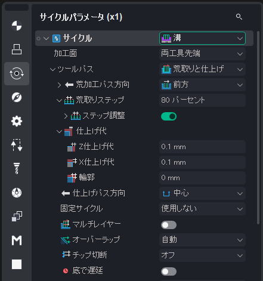
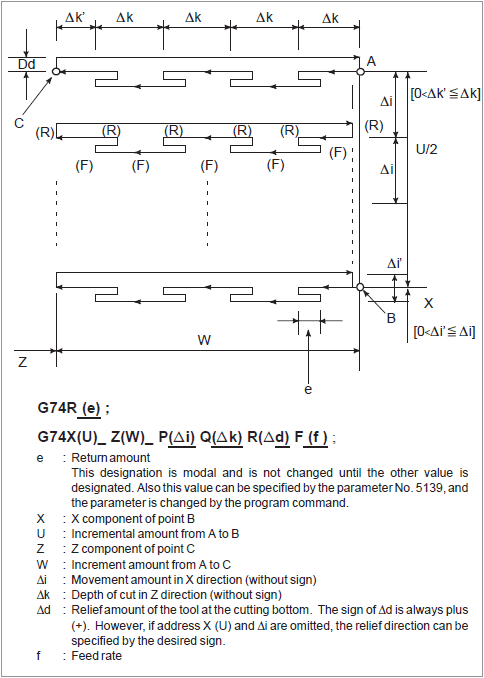
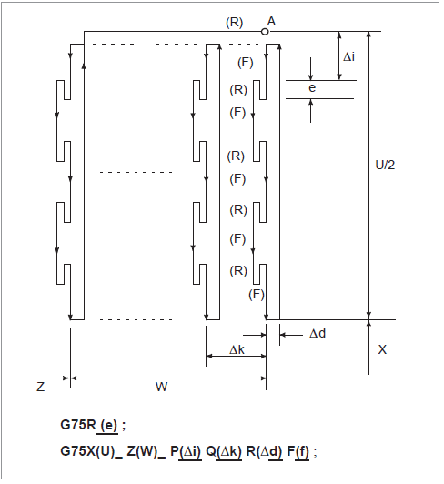

# ペック溝加工／ドリルサイクル

溝加工サイクルは、定義された輪郭に基づき、ISO G74 または ISO G75 のいずれかの固定サイクルを生成します。サイクルのパラメータは、プロパティウィンドウで設定できます。

方向 G74とG75を切り替えます。

以下に、G74/G75 サイクルに関する Fanuc オペレーターズマニュアルからの抜粋を示します。

以下のプログラムは、下図に示す切削パスを生成します。このサイクルでは下図に示すように切りくず切断を行うことができます。

X(u) および P を省略すると、Z 軸方向のみの加工となり、穴あけ加工（ドリル加工）として使用できます。

