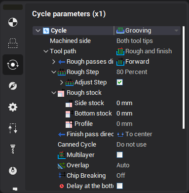
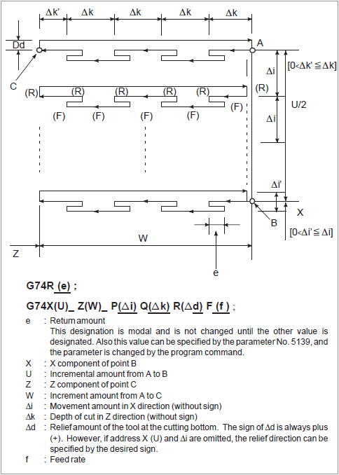
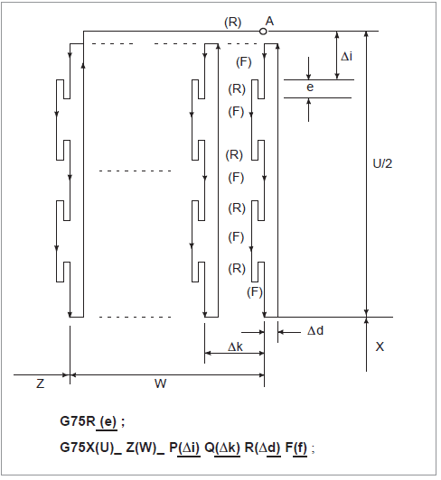

# Einstech- und Tiefbohrzyklus

Der Einstechzyklus erzeugt anhand des Begrenzungsbereichs des Profils ISO G74 oder G75. Die Parameter werden im Eigenschaftendialog festgelegt. **Direction** wählt zwischen G74 und G75.

Die folgenden Abbildungen zeigen Auszüge aus der Fanuc-Beschreibung von G74/G75.

Das dargestellte Programm erzeugt die gezeigte Bewegungsfolge. Werden X(u) und P weggelassen, erfolgt die Bearbeitung nur entlang Z; dies kann zum Bohren verwendet werden.

