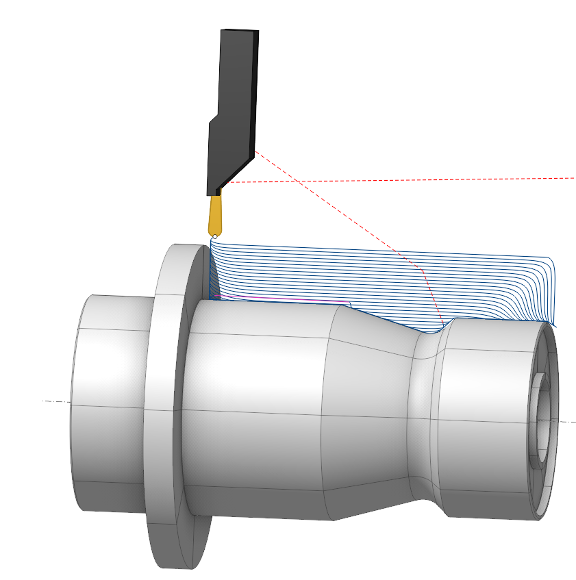
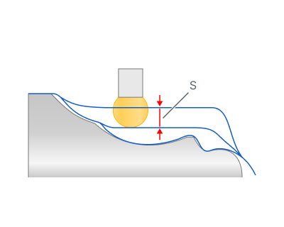
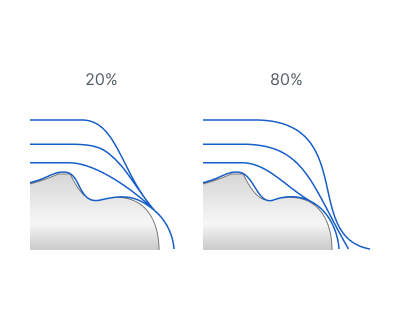
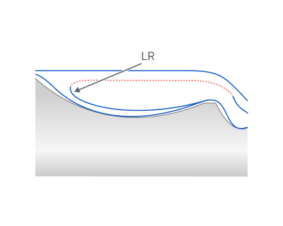
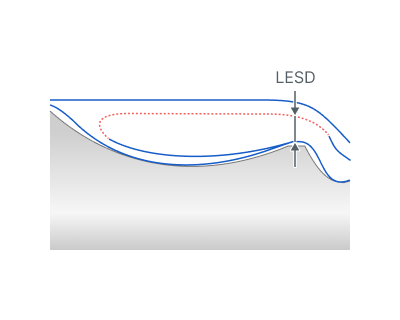
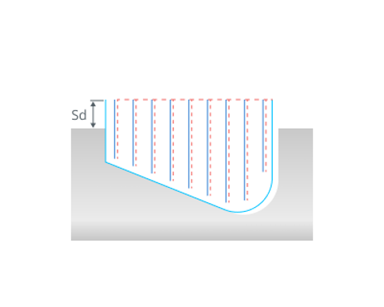
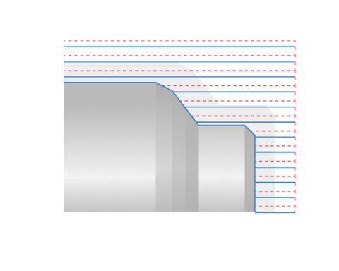
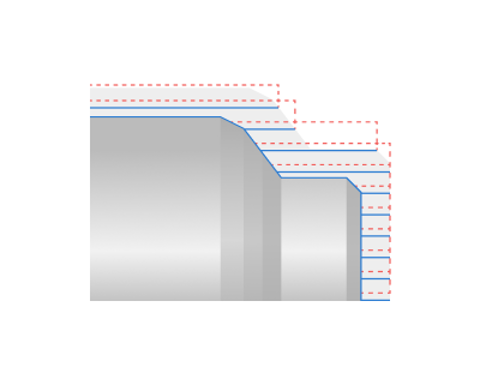
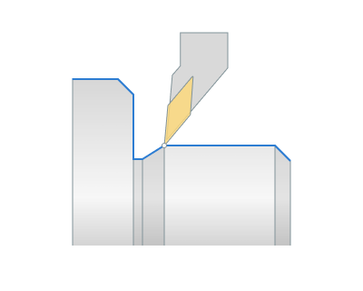

# アダプティブ荒取り（旋盤）

## 適用分野：

このオペレーションは、工具負荷を一定に保つ最適化された滑らかな軌跡を生成します。これにより工具寿命が延び、切削送り速度の向上によって加工速度が大幅に向上します。 この旋削加工は、従来の <strong>溝加工</strong>サイクルと比較して、2 倍以上の速度で実行されます。このサイクルでは、 [ウォーターライン荒加工](736.md)から<strong>アダプティブ</strong> 方法を 採用し、すべてのパラメータはこの方法と同様です。 円形インサート（チップ） の工具を使用します。

### セットアップ：

<strong>セットアップ</strong>タブでは、プロジェクトの主要なパラメータを設定します。これには、装置上のパーツの位置、パーツの座標系などが含まれます。[詳細を見る](1022.md)

### ジョブ割り当て：

<strong>アダプティブ</strong> この工程では、高い送り速度と小さなステップを使用し、加工パスを丸めることで、ツールパスに鋭角部が生じないようにします。工具の進入には、工具への負荷を軽減するロールイン手法を採用しています。この方法は、正方向と逆方向の両方での加工に対応しています。

<strong>プロパティ</strong> 要素のプロパティを表示します。ストックを追加することも可能です。リスト内の項目をダブルクリックすることでも、このメニューを表示できます。

<strong>削除</strong> リストから項目を削除します。

<strong>制限</strong> 加工してはならない領域を制限することができます。[詳細を見る](101231.md)

### サイクルパラメータ：

#### サイクル

このオペレーションでは、 <strong>アダプティブ</strong>サイクルのみ使用できます。

詳細を表示

##### ツールパス

以下は主要なパラメータです。パラメータの構成は、<strong>サイクル</strong>セクションで選択した方法に応じて異なる場合があります。

詳細を表示

<strong>ステップ</strong> 工具パス間の距離で、切り込み深さに相当します。

<strong>S</strong> - ステップ

<strong>逆方向ステップ</strong> <strong>両方向</strong>旋削モードが有効な場合、逆方向ステップを正方向<strong>ステップ</strong>に対する割合（%）を設定できます。

<strong>仕上げパス</strong> <strong>ジョブ割り当て</strong>で指定した輪郭が仕上げ加工用の輪郭になります。この輪郭からパラメータで指定された距離に、追加の荒加工パスが追加されます。

.png) .png)

<strong>荒取りR半径</strong> 荒加工パスにおける進入および退出領域を丸める半径（R）を指定します。

<strong>リンク半径</strong> 加工パス 間の移動を滑らかにするリンク半径を指定します。

<strong>LR -</strong> リンク半径

<strong>リードの安全距離</strong> 加工領域間を工具が早送りで移動する際の、ワークの未加工部分からの最小距離を指定します 。

<strong>LESD</strong> -リードの安全距離

<strong>安全距離</strong> 溝の上面高さから早送り移動を行う高さまでの距離です。安全距離を編集するには、グラフィック画面上の点をドラッグするか、オプションウィンドウに直接値を入力します。

<strong>ワークチェック</strong> このオプションを有効にすると、システムはワークの現在の状態を考慮し、実際にはワークを切削しないツールパスの区間をすべて除去します。これにより、特に仕上げ代形状が複雑な場合に、加工時間を大幅に短縮できます。

 

<strong>補正</strong>チップパラメータの出力方法を制御します。

<strong>チップ幅の補正</strong> このパラメータは、工具ノーズ半径補正の出力方法を制御します。[詳細を見る](350.md)

<strong>オフ</strong> ツールパスの輪郭は部品の輪郭に対応し、工具ノーズ半径を考慮せずにNCプログラムに出力されます。このモードを複雑な輪郭で使用すると、アンダーカットや加工不足が発生する可能性があるため、マシンシミュレーション時には注意が必要です。

<strong>コンピューター</strong> チップの幅と先端半径を考慮し、刃物の最初の設定点に従ってツールパスを生成します。

#### 方向

加工パスの方向を設定します。

詳細を表示

<strong>両方向</strong> <strong>ジョブ割り当て</strong>の開始点を基準として、正進方向と逆方向に加工パスを実行します。

<strong>前方</strong> 加工パスは主軸に向かう方向に進みます。

<strong>後方</strong> 加工パスは主軸から離れる方向に進みます。

#### 円弧でロール

システムは、工具ノーズ半径と同じ半径の円弧を使用して、ツールパスの外側コーナーを丸めます。このパラメーターグループは、外径、内径荒取り オペレーションと同様に機能します<strong>。</strong>[詳細を見る](316.md)

### 送り速度設定

このダイアログを使用して、ユーザーは主軸回転速度、早送り値、ツールパスの各領域の送り値を設定できます。主軸回転速度は、毎分回転数または切削速度のいずれかで指定できます。設定値には下線が表示されます。もう一方の値は、工具径を考慮し、設定値に基づいて再計算されます。[詳細を見る](100142.md)

### 変換：

オペレーション内で計算された工具の軌跡に対して座標変換を行うためのパラメータグループです。[詳細を見る](10168.md)

### パーツ：

パーツは、干渉をチェックする空間を定義する幾何要素のグループです。[詳細を見る](330.md)

### ワーク：

加工のワークモデルは、加工する素材を定義します。[詳細を見る](738.md)

### 治具：

治具には通常、チャック、グリップ、クランプなどの固定補助具と、その他の種類の制限領域を指定します。[詳細を見る](10283.md)
