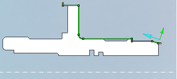
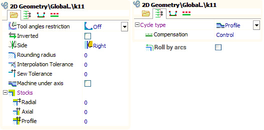
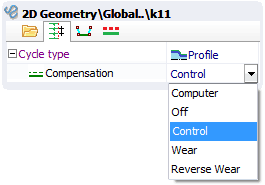
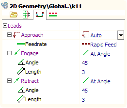
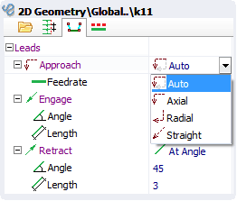
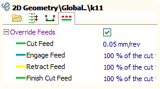
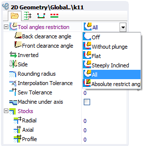
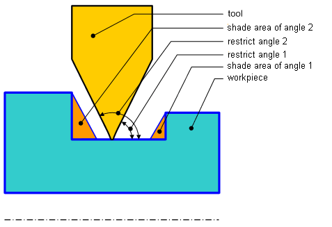
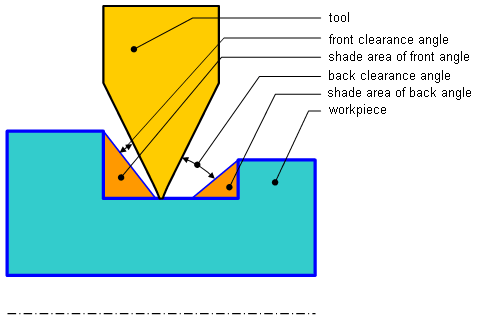

# Parametri dell'elemento di assegnazione del lavoro

Parametri di base:

Dopo l'aggiunta di un contorno all'elenco degli elementi di assegnazione del lavoro, il contorno viene visualizzato nella finestra grafica. Le frecce che definiscono la direzione di lavorazione e il lato di lavorazione sono visualizzate in corrispondenza del punto iniziale del contorno. È possibile cambiare la direzione di lavorazione facendo clic con il tasto sinistro del mouse sulla freccia blu. È possibile cambiare il lato di lavorazione facendo clic con il tasto sinistro del mouse sulla freccia gialla.

La finestra dei parametri del contorno è disponibile facendo clic con il tasto destro del mouse su una qualsiasi di queste frecce oppure facendo clic sul pulsante 'Parameters' dell'elemento.

Il [tipo di ciclo](10188.md) (Cycle type) definisce il modo di generare il percorso utensile in base al contorno specificato.

Il raggio di arrotondamento (Rounding radius) definisce il raggio dell'arco con cui vengono arrotondati tutti gli spigoli vivi esterni del contorno. Se il valore è zero, gli spigoli non vengono arrotondati.

La tolleranza di interpolazione (Interpolation tolerance) consente di modificare il contorno unendo gruppi di segmenti con archi o rette. In questo caso il contorno risultante differisce da quello originale per non più del valore specificato. Questa funzione è molto utile per l'elaborazione delle curve spline.

I sovrametalli (Stocks) consentono di spostare il contorno in direzione radiale, assiale ed equidistante. La direzione positiva (+) dei sovrametalli è definita dal lato di lavorazione del contorno.

La tolleranza di cucitura (Sew tolerance) viene utilizzata per creare la generatrice di tornitura da un insieme di curve e superfici.

<strong>Roll by arcs</strong> consente di determinare con maggiore precisione il percorso utensile lungo il contorno aggiungendo archi agli spigoli esterni del percorso utensile. Questa funzione è utile per un utensile con raggio grande.

Modalità di compensazione del raggio utensile:

Se la correzione è disattivata (Off), il programma NC utilizza il contorno originale senza alcuna trasformazione. L'uso di questa modalità con contorni complessi può produrre linee o difetti, perciò occorre prestare attenzione durante la simulazione della lavorazione.

Se la modalità di correzione è "Computer", al contorno originale viene costruita una curva equidistante basata sul raggio di punta dell'utensile, che viene poi spostato sul punto di impostazione dell'utensile. Di solito ciò comporta uno spostamento dei segmenti inclinati, l'aumento dei raggi esterni e la diminuzione dei raggi interni degli archi di cerchio del contorno, pari al raggio di punta dell'utensile. Anche i punti iniziali vengono spostati del raggio di punta dell'utensile.

Se la modalità di correzione è "Control", il programma NC utilizza il contorno originale senza alcuna trasformazione. I comandi di correzione sono inclusi prima dei blocchi di attacco e di uscita (ISO G41/42/40).

Nelle modalità Wear e Reverse wear la geometria del contorno viene trasformata come nella modalità "Computer", ma i comandi di correzione sono inclusi anch'essi prima dei blocchi di attacco e di uscita, come nella modalità "Control". La modalità Reverse wear si distingue dalla modalità Wear per il senso della correzione.

Il parametro "Machine under axis" consente di creare il percorso utensile al di sotto dell'asse di rotazione. In tal caso tutte le coordinate radiali diventano negative.

Se il parametro "Rounding radius" è abilitato e la modalità di compensazione è "Wear" o "Computer", sugli spigoli esterni del contorno vengono formati archi con raggio pari al raggio di punta dell'utensile. In alcuni casi ciò aiuta a ridurre le vibrazioni della macchina dovute al brusco cambio di direzione del movimento dell'utensile.

Attacco, uscita e transizione tra gli elementi.

Prima dell'inizio e alla fine di ogni contorno viene aggiunto un elemento speciale. Tali elementi si chiamano rispettivamente attacco (engage) e uscita (retract). Quando si utilizza la compensazione del raggio di punta dell'utensile, l'attacco è il tratto di inserimento della compensazione e l'uscita è il tratto di disinserimento della compensazione. I parametri geometrici di attacco e uscita possono essere impostati nel campo grafico. Qui si possono impostare sia il punto finale sia la lunghezza del tratto. L'attacco/uscita può essere eseguito con una retta o con un arco. Fare clic ancora una volta sull'attacco selezionato nella schermata per passare da arco a tratto rettilineo. I parametri geometrici di attacco e uscita possono essere impostati anche nella finestra successiva.

Se nell'operazione sono presenti più elementi, le transizioni tra di essi vengono eseguite in rapido. Il modo di avvicinamento al primo punto di un contorno a partire dall'ultimo punto dell'elemento precedente è definito dalla modalità di avvicinamento.

Nella modalità assiale (axial) l'avvicinamento avviene prima in direzione assiale e poi in direzione radiale. Nella modalità radiale (radial) l'avvicinamento avviene prima in direzione radiale e poi in direzione assiale. La modalità "Straight" genera la transizione con una retta. La modalità "Auto" sceglie l'avvicinamento radiale o assiale in base all'ultimo punto del contorno precedente e al lato del contorno lavorato. È possibile specificare anche l'avanzamento della transizione.

Controllo dell'avanzamento

Per impostazione predefinita, la lavorazione di ciascun contorno viene eseguita con l'avanzamento specificato nei parametri dell'operazione. Per specificare l'avanzamento per ogni elemento dell'assegnazione del lavoro, usare la finestra dei parametri dell'elemento.

Se la casella di controllo "Override feeds" non è selezionata, l'avanzamento del contorno è quello specificato nei parametri dell'operazione; altrimenti è quello specificato in questa finestra.

Limitazioni degli angoli dell'utensile

Nella lavorazione di gole è necessario considerare le limitazioni degli angoli dell'utensile per evitare sovrapposizioni di linee e rotture dell'utensile. Questi angoli possono essere impostati nella finestra dei parametri. Esistono 6 modalità di limitazione degli angoli dell'utensile.

Per i contorni semplici la limitazione degli angoli dell'utensile è disattivata per impostazione predefinita. In questo caso la correzione del contorno in base agli angoli dell'utensile non viene eseguita. Se il contorno presenta gole, le sovrapposizioni di linee diventano molto probabili.

La modalità degli angoli limite assoluti consente di correggere il contorno indipendentemente dagli angoli reali dell'utensile. Questi angoli sono misurati dalla linea orizzontale e sono mostrati nella figura seguente.

La modalità "Without plunge" consente di impedire l'affondamento dell'utensile nelle gole frontali e cilindriche. Quando la gola esterna viene lavorata sul mandrino sinistro, questa modalità equivale a impostare il primo angolo a 0 e il secondo angolo a 90 gradi.

La modalità "All" consente l'affondamento nelle gole frontali e laterali per quanto l'utensile lo permette. L'angolo di spoglia posteriore e l'angolo di spoglia anteriore definiscono angoli assoluti rispetto agli angoli reali dell'utensile.

La modalità "Flat" consente all'utensile di affondare nelle gole cilindriche, ma non nelle gole frontali. Quando la gola esterna viene lavorata sul mandrino sinistro, questa modalità equivale a impostare il secondo angolo assoluto a 90 gradi, utilizzando l'angolo di spoglia posteriore.

La modalità "Steeply inclined" consente all'utensile di affondare nelle gole frontali, ma non nelle gole cilindriche. Quando la gola esterna viene lavorata sul mandrino sinistro, questa modalità equivale a impostare il primo angolo assoluto a 0, utilizzando l'angolo di spoglia anteriore.
